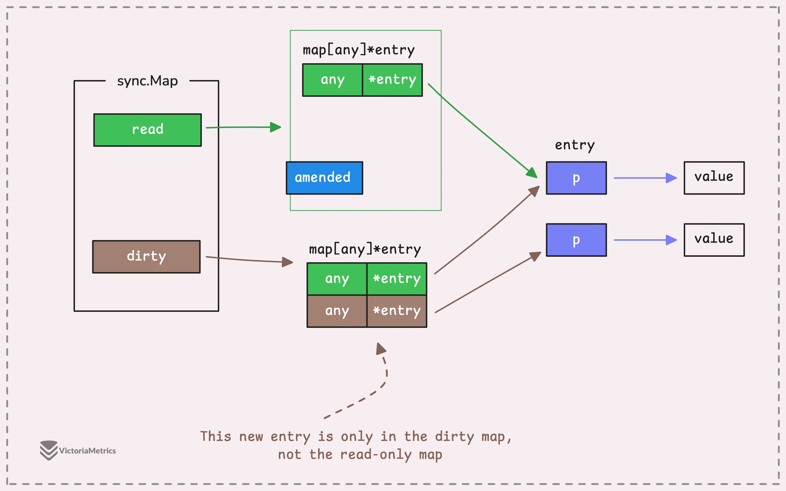

## `sync`

Предоставляет базовые примитивы синхронизации, такие как *mutex*. За исключением типов `Once` и `WaitGroup`, большинство из них предназначены для использования низкоуровневыми библиотечными подпрограммами. Синхронизацию более высокого уровня лучше выполнять через *channel* и *communication* (что это???).

Значения, содержащие *type*'s, определенные в этом *package*, не должны копироваться.

### `type Map`

```go
type Map struct {
	// contains filtered or unexported fields
}
```

`Map` похожа на `map[any]any`, но безопасна для одновременного использования несколькими *goroutine*'s без дополнительной блокировки или координации. Операции загрузки, сохранения и удаления выполняются за амортизированное постоянное время.

Тип `Map` является специализированным. Большинству кода следует использовать обычный `map` с отдельной блокировкой или координацией для повышения типобезопасности и упрощения поддержания других инвариантов наряду с содержимым карты (???).

Тип `Map` оптимизирован для двух распространенных сценариев использования: 

1. когда *entry* для заданного *key* записывается только один раз, но считывается много раз, как в кэшах, которые только увеличиваются в размере
2. когда несколько *goroutine*'s читают, записывают и перезаписывают *entry* для непересекающихся наборов ключей. 

В этих двух случаях использование `Map` может значительно снизить конкуренцию за блокировки по сравнению с использованием обычной `map` в паре с отдельным [Mutex](https://pkg.go.dev/sync#Mutex) или [RWMutex](https://pkg.go.dev/sync#RWMutex) .

Zero `Map` пуста и готова к использованию. Копирование `Map` после первого использования запрещено.

Внутри `Map` использует две внутренние *map*:

- *read* — *map* только для чтения (можно представить как кэш).
- *dirty* — обычная *map* для записи и чтения (защищается мьютексом).

Идея в том, чтобы оптимизировать частые чтения. Если значение есть в карте read, операция чтения выполняется быстро, без блокировки. Если ключа в read нет, проверяется dirty (уже с захватом мьютекса). Когда счётчик промахов (misses) превышает определённый порог, происходит «продвижение»: карта dirty становится новой read, а счётчик сбрасывается. 



### `type Mutex`

`Mutex` (*mutual exclusion*, взаимное исключение) – *lock* взаимного исключения. *Zero value* для `Mutex` - это *unlocked mutex*.

`Mutex` нельзя копировать после первого использования.

```go
type Mutex struct {
    // contains filtered or unexported fields
}
```

#### `Lock()`

```go
func (m *Mutex) Lock()
```

Блокирует (lock, захватывает?) *mutex* `m`. Если *mutex* `m` уже заблокирован, то вызывающая *goroutine* блокируется до тех пор, пока *mutex* не станет доступным.

#### `Unlock()`

```
func (m *Mutex) Unlock()
```

Разблокирует *mutex* `m`. Если `m` не заблокирован, то происходит *run-time error*.

Заблокированный *mutex* не связан с конкретной *goroutine*. Разрешена ситуация, когда *mutex* блокируется одной *goroutine* и разблокируется другой *goroutine*.


#### Пример

 Пример *mutex*'а в *goroutine* для синхронизации:

 ```go
  result := make(map[int]int)
  var wg sync.WaitGroup
	var mutex sync.Mutex

	for key, value := range values {
		
		wg.Add(1)
    // обязательно нужно передавать значение через аргументы в goroutine
		go func(val int) {
			defer wg.Done()

			mutex.Lock()
			result[key] = val
			mutex.Unlock()
		}(value)
	}

	wg.Wait()
 ```


### `type Once()`

```go
type Once struct {
	// contains filtered or unexported fields
}
```

`Once` – это объект, который будет выполнять точно одно действие (??? действие точно один раз).

`Once` нельзя копировать после первого использования.

#### `Do()`

```go
func (o *Once) Do(f func())
```

`Do()` вызывает функцию `f()` тогда и только тогда, когда `Do()` вызывается первый раз для этого экземпляра `Once()`. 

Например, если дано:

```go
var once Once
```

и `once.Do(f)` вызывается несколько раз, только первый вызов вызовет `f()`, даже если аргумент-функция `f` имеет разные значение в каждом вызове. 

`Do()` может использоваться для инициализации, которую нужно выполнить точно один раз. Поскольку `f()` не принимает аргументов, эти аргументы для функции необходимо получить через *closure*.


Пример:

```go
func main() {
	var once sync.Once
	onceBody := func() {
		fmt.Println("Only once")
	}
	done := make(chan bool)
	for i := 0; i < 10; i++ {
		go func() {
			once.Do(onceBody)
			done <- true
		}()
	}
	for i := 0; i < 10; i++ { // барьер
		<-done
	}
}
```


### `type RWMutex`

`RWMutex`  (*mutual exclusion*, взаимное исключение) - это *lock* взаимного исключения *reader/writer*. *Lock* может удерживать произвольное количество *reader*'s ИЛИ (!!!) одиночный *writer*. *Zero value* для `RWMutex` - это *unlocked mutex*.

`RWMutex` нельзя копировать после первого использования.

Если какая-либо *goroutine* вызывает `Lock()` , когда блокировка уже удерживается одним или несколькими *reader*,  вызовы `RLock()` будут блокироваться до тех пор, пока *writer* не получит (и не освободит) блокировку, чтобы гарантировать, что блокировка в конечном итоге станет доступна *writer*'у. В частности, это запрещает рекурсивную *read locking* (иначе будет дедлок).  Это необходимо для того, чтобы *lock* в конечном итоге (*eventually*) стала доступной; вызов `Lock()` исключает захват блокировки новыми *reader*'s.

```go
type RWMutex struct {
    // contains filtered or unexported fields
}
```

#### `RWMutex.Lock()`

```go
func (rw *RWMutex) Lock()
```

`Lock()` блокирует на  *writing*. Если блокировка уже заблокирована для *reading* или *writing*, блокировка будет продолжаться до тех пор, пока блокировка не станет доступной.

#### `RWMutex.RLock()`

```go
func (rw *RWMutex) RLock()
```

`RLock()` блокирует на *reading*.

Его не следует использовать для рекурсивной блокировки *read*; вызов `Lock()` исключает для новых *reader* возможность получения блокировки.

#### `RWMutex.RUnLock()`

```
func (rw * RWMutex ) RUnlock()
```

`RUnlock()` отменяет один вызов `RLock()`; она не влияет на другие параллельные *reader*'s. Если при вызове `RUnlock()` - `rw` не заблокирована для *reading*, это приводит к *run-time error*.

#### `RWMutex.UnLock()`

```go
func (rw *RWMutex) Unlock()
```

`Unlock()` разблокирует для *writing*. Если `rw` не заблокирован на *writing* при вызове `Unlock()`, это приведет к *run-time error*.


Пример:

```go
type DataStore struct {
    mu  sync.RWMutex
    data map[string]string
}

func (ds *DataStore) Get(key string) string {
    ds.mu.RLock() // Захватываем блокировку для чтения
    defer ds.mu.RUnlock() // Гарантируем освобождение через defer
    return ds.data[key]
}

func (ds *DataStore) Set(key, value string) {
    ds.mu.Lock() // Захватываем блокировку для записи
    ds.data[key] = value
    ds.mu.Unlock() // Освобождаем блокировку
}
```


### `type WaitGroup`

WaitGroup — это подсчитывающий *semaphore*,  используемый для ожидания завершения группы *goroutine*'s.

```
type WaitGroup struct {
     // contains filtered or unexported fields (???)
}
```

*Main goroutine* запускает *goroutine*'s, вызывая метод [`Go()`](#WaitGroup.Go) , а затем ожидает завершения всех задач, вызывая метод [`Wait()`](#WaitGroup.Wait) . Например:

```go
var wg sync.WaitGroup
wg.Go(task1)
wg.Go(task2)
wg.Wait()
```

Старый вариант использования `WaitGroup` – через методы `Add()` и `Done()`.

*Main goroutine* вызывает `Add()`, чтобы установить количество ожидаемых *gotoutine*'s. Затем каждая из *goroutine* запускается и по завершении вызывает `Done()`. `Wait()` используется, чтобы заблокироваться дло тех пор пока все *goroutine*'s не будут завершены. 

`WaitGroup` не должен копироваться после первого использования. В функцию `WaitGroup` необходимо передавать *by pointer*. 

```go
func worker(wg *sync.WaitGroup) {
	defer wg.Done() 
	fmt.Println("Работа выполнена")
}

func main() {
	var wg sync.WaitGroup

	wg.Add(1)      
	go worker(&wg) // Передаём указатель.
	wg.Wait()     
}
```


Предыдущий пример через методы `Add()` и `Done()`.


```go
wg := sync.WaitGroup{}


wg.Add(1)
go func() {
   defer wg.Done()
   // ...
}()


wg.Add(1)
go func() {
   defer wg.Done()

   // ...
}()

wg.Wait()
```

В этом примере выполняется одновременная загрузка нескольких URL-адресов с использованием `WaitGroup` для блокировки до завершения всех загрузок.

```go
func main() {
	var wg sync.WaitGroup
	var urls = []string{
		"http://www.golang.org/",
		"http://www.google.com/",
		"http://www.example.com/",
	}
	for _, url := range urls {
		// Launch a goroutine to fetch the URL.
		wg.Go(func() {
			// Fetch the URL.
			http.Get(url)
		})
	}
	// Wait for all HTTP fetches to complete.
	wg.Wait()
}
```

Этот же пример через методы `Add()` и `Done()`.


 ```go
var wg sync.WaitGroup
	var urls = []string{
		"http://www.golang.org/",
		"http://www.google.com/",
		"http://www.somestupidname.com/",
	}
	for _, url := range urls {
		// Increment the WaitGroup counter.
		wg.Add(1)
		// Launch a goroutine to fetch the URL.
		go func(url string) {
			// Decrement the counter when the goroutine completes.
			defer wg.Done()
			// Fetch the URL.
			http.Get(url)
		}(url)
	}
	// Wait for all HTTP fetches to complete.
	wg.Wait()
 ```

`WaitGroup` можно использовать повторно для новой группы задач, но новые вызовы `Add()` должны происходить **после возврата всех предыдущих `Wait()`**.

#### `WaitGroup.Add()`

Лучше стоит использовать [`WaitGroup.Go()`](#WaitGroup.Go) .

```go
func (wg *WaitGroup) Add(delta int)
```

Добавляет значение `delta`, которое может быть отрицательным, к *counter*'у. Если *counter* становится равным 0, все *goroutine*'s, заблокированные на `Wait()`, освобождаются. Если *counter* станет отрицательным, `Add` вызывает *panic*.

Вызовы с положительной `delta`, происходящие, когда *counter* равен нулю, должны выполняться до `Wait()` (иначе `Wait()` не будет заблокирован, т.к. *counter* к этому моменту будет равен 0). 

```go
func main() {
  wg := sync.WaitGroup{}

  wg.Wait()  // Тут блокировки не произойдет

  wg.Add(1)
}
```

Это означает, что `Add()` должен вызываться перед `go` *statement* или другим событием, которое должно ожидаться. Иначе, если `wg.Add()` поместить внутрь *goroutine*, то `wg.Wait()` будет вызван до старта  *goroutine* и ожидания не произойдет:

```go
func main() {
  wg := sync.WaitGroup{}

  go func() {
    wg.Add(1)
  }()

  wg.Wait() // Блокировки не произойдет
}
```

Вызовы с отрицательной `delta` и вызовы с положительной `delta`, которые происходят, когда *counter* больше нуля, могут произойти в любое время (???). 

Если *WaitGroup* повторно используется для ожидания нового набора событий, новые вызовы `Add()` должны выполняться после возврата всех предыдущих вызовов `Wait()`.

#### `WaitGroup.Done()`

Лучше стоит использовать [`WaitGroup.Go()`](#WaitGroup.Go) .

```go
func (wg *WaitGroup) Done()
```

Уменьшает *counter* на единицу.

#### `WaitGroup.Go()`

```go
func (wg *WaitGroup ) Go(f func())
```

`Go()` вызывает функцию `f()` в новой *goroutine* и добавляет эту *task* (?) в `WaitGroup` . Когда `f()` возвращает управление, *task* удаляется из `WaitGroup`.

`Go()` вызывается для запуска *task* до вызова `Wait()`. *goroutine*, запущенная `Go()`, сама может вызвать `Go()`. Если WaitGroup используется повторно для ожидания нескольких независимых наборов *task*, новые вызовы `Go()` должны происходить после того, как все предыдущие вызовы `Wait()` вернут результат.


#### `WaitGroup.Wait()`

```
func (wg *WaitGroup) Wait()
```

Блокирует, до тех пор пока *counter* не станет равным 0.

`Wait()` можно вызывать несколько раз, в том числе одновременно из разных *goroutine*. Все вызовы ждут, пока *counter* станет равен нулю. Если он уже нулевой, `Wait()` сразу возвращается.


#### Основные правила использования Waitgroup

- вызывать `WaitGroup.Add()`  в родительской *goroutine* (которая запускает подчиненные *goroutine*'s) перед `go` *statement*
- рекомендуется делать ` defer WaitGroup.Done()`, чтобы он вызывался, даже если *goroutine* паникует
- если вы хотите передать `WaitGroup` в другую функцию (и не использовать какую-то *variable* из общего *scope*), вы должны передать ее *by pointer*, иначе `WaitGroup` (которая является *struct*) будет скопирована, и `Done()` метод, вызванный на копии, не будет наблюдаться на оригинале


## Спинлок

Спин-блокировки (спинлоки) в Go — это лёгкий примитив синхронизации, который использует активное ожидание (busy-waiting) вместо перевода горутины в спящее состояние. Это позволяет избежать накладных расходов на переключение контекста, но имеет важные нюансы в использовании. [pixelstech.net](https://www.pixelstech.net/article/1704886776-deep-dive-into-spin-locks-in-golang)[ru.wikipedia.org*](https://ru.wikipedia.org/wiki/Спин-блокировка)

## Как работает спинлок

Когда горутина пытается получить спинлок, она входит в цикл, где постоянно проверяет состояние блокировки. Если блокировка свободна, она её захватывает. Если нет — продолжает цикл, тратя процессорное время на проверку. [pixelstech.net](https://www.pixelstech.net/article/1704886776-deep-dive-into-spin-locks-in-golang)

В Go спинлок обычно реализуется с помощью атомарных операций из пакета 

```
sync/atomic
```

. Ключевая операция — 

```
CompareAndSwapUint32
```

, которая атомарно пытается изменить значение (0 на 1), возвращая предыдущее. Если оно не 0 (блокировка уже была захвачена), цикл продолжается. Для освобождения блокировки используется 

```
StoreUint32
```

. [pixelstech.net](https://www.pixelstech.net/article/1704886776-deep-dive-into-spin-locks-in-golang)

**Пример простой реализации:**

```
type SpinLock uint32

func (sl *SpinLock) Lock() {
    for !atomic.CompareAndSwapUint32((*uint32)(sl), 0, 1) {
        runtime.Gosched() // Уступает квант времени, чтобы не монополизировать CPU
    }
}

func (sl *SpinLock) Unlock() {
    atomic.StoreUint32((*uint32)(sl), 0)
}
```

## Когда спинлок эффективен

Спинлоки имеют смысл в следующих сценариях:

- **Очень короткие критические секции.** Если блокировка захватывается и освобождается за наносекунды, накладные расходы на переключение контекста с спинлоком будут меньше, чем с мьютексом.
- **Низкая конкуренция.** Если конфликты за блокировку возникают редко, спинлок не будет сильно тормозить выполнение.
- **Контекст, где блокирование нежелательно.** Например, в обработчиках прерываний, где нет поддержки спящих потоков.

 [pixelstech.net](https://www.pixelstech.net/article/1704886776-deep-dive-into-spin-locks-in-golang)[stackoverflow.com](https://tr-page.yandex.ru/translate?lang=en-ru&url=https%3A%2F%2Fstackoverflow.com%2Fquestions%2F1957398%2Fwhat-exactly-are-spin-locks)

## Почему спинлоки могут быть опасны

При неправильном использовании спинлоки приводят к проблемам:

- **Высокое потребление CPU.** Если блокировка удерживается долго или конкуренция высокая, горутины в цикле постоянно проверяют состояние, загружая процессор на 100%.
- **Проблемы с когерентностью кэша.** Активное ожидание заставляет потоки многократно читать и записывать одну и ту же кэш-строку, что вызывает её invalidation и снижает производительность на многоядерных системах (эффект «проклятья кэша»).
- **Голодание потоков.** Если несколько горутин постоянно вращаются, пытаясь захватить одну и ту же блокировку, они могут надолго заблокировать ресурс для других потоков.

 [golangdev.cn](https://www.golangdev.cn/ru/impl/sync/mutex.html)

## Готовые решения

Вместо самостоятельной реализации рекомендую использовать проверенные пакеты:

- ```
  github.com/slymarbo/spin
  ```

  pkg.go.dev

- ```
  github.com/lemon4ksan/foundation/sync/spinlock
  ```

  pkg.go.dev

- ```
  github.com/julienschmidt/spinlock
  ```

  pkg.go.dev

Эти библиотеки часто включают оптимизации (например, Test and Test-and-Set (TTAS) для снижения нагрузки на кэш) и дополнительные функции (таймауты на захват). [pkg.go.dev](https://pkg.go.dev/github.com/lemon4ksan/foundation/sync/spinlock)

## Когда лучше выбрать `sync.Mutex`

Для более длинных критических секций, высокой конкуренции или когда контекст выполнения не позволяет активно ждать (например, в обработчиках сигналов), предпочтительнее использовать 

```
sync.Mutex
```

. Он переводит горутину в спящее состояние, что гораздо эффективнее с точки зрения использования ресурсов. [pixelstech.net](https://www.pixelstech.net/article/1704886776-deep-dive-into-spin-locks-in-golang)[pkg.go.dev](https://pkg.go.dev/github.com/lemon4ksan/foundation/sync/spinlock)

## Вывод

Спинлоки — мощный инструмент для оптимизации, но их применение требует осторожности. Всегда оценивайте, действительно ли ожидаемое время удержания блокировки очень мало, и помните о рисках. Если есть сомнения, безопаснее выбрать мьютекс.


**Спинлок (spinlock)** — блокировка, при ожидании которой поток выполнения крутится в цикле и повторяет попытки захвата. Такое ожидание расходует CPU, но может сэкономить время на приостановке и пробуждении, если блокировка освобождается очень быстро.

В Go обычно стоит использовать **`sync.Mutex`**: его реализация уже умеет немного покрутиться при подходящих условиях, а затем припарковать ожидающую горутину. [Исходный код Mutex](https://go.dev/src/internal/sync/mutex.go)

**Простейшая реализация** на Go 1.19+:

```
package spinlock

import "sync/atomic"

// SpinLock — блокировка с активным ожиданием.
// Нулевое значение готово к использованию.
// Нельзя копировать после первого использования.
type SpinLock struct {
	locked atomic.Bool
}

// Lock захватывает блокировку.
func (s *SpinLock) Lock() {
	for !s.locked.CompareAndSwap(false, true) {
		// Активно ждём освобождения блокировки.
	}
}

// Unlock освобождает ранее захваченную блокировку.
func (s *SpinLock) Unlock() {
	s.locked.Store(false)
}
```

Как это работает:

1. `false` означает, что блокировка свободна.
2. `CompareAndSwap(false, true)` атомарно проверяет состояние и меняет его. Среди конкурирующих горутин только одна успешно захватит свободную блокировку.
3. Остальные повторяют попытки, пока владелец не вызовет `Unlock()`.

Атомики обеспечивают и **видимость защищённых данных**: записи перед освобождением блокировки видны горутине, которая затем её захватит. Однако все обращения к этим данным должны соблюдать тот же протокол блокировки. Обычный `bool` вместо атомарного здесь привёл бы к гонке данных. [Документация `sync/atomic`](https://pkg.go.dev/sync/atomic)

Использование, например внутри функции:

```
var lock spinlock.SpinLock
var counter int
var wg sync.WaitGroup

for i := 0; i < 4; i++ {
	wg.Add(1)

	go func() {
		defer wg.Done()

		for j := 0; j < 1000; j++ {
			lock.Lock()
			counter++
			lock.Unlock()
		}
	}()
}

wg.Wait()
fmt.Println(counter) // 4000
```

**Почему такой спинлок редко полезен в Go:**

- Владелец блокировки может быть вытеснен планировщиком: ожидающие горутины расходуют CPU, пока он не выполняется.
- При `GOMAXPROCS=1` активное ожидание особенно невыгодно: владелец не может исполняться параллельно с ожидающим.
- При высокой конкуренции постоянные CAS создают нагрузку на механизм согласования кешей процессоров.
- Нет гарантии справедливости: отдельная горутина может долго проигрывать захват.
- Повторный `Lock()` без `Unlock()` зависнет; ошибочный `Unlock()` эта реализация не обнаруживает.

Можно добавить уступку планировщику:

```
func (s *SpinLock) Lock() {
	for !s.locked.CompareAndSwap(false, true) {
		runtime.Gosched()
	}
}
```

Для этого нужен импорт `runtime`. Это уже цикл повторных попыток с добровольной передачей исполнения: `Gosched()` позволяет другим горутинам поработать, но **не организует ожидание события освобождения блокировки**. [Документация `Gosched`](https://pkg.go.dev/runtime#Gosched)

Свой спинлок имеет смысл рассматривать только для очень коротких критических секций и после измерений на реальной нагрузке. Для показанного счётчика проще использовать `atomic.Int64.Add(1)`, а для защиты нескольких связанных полей — `sync.Mutex`.

15:39
