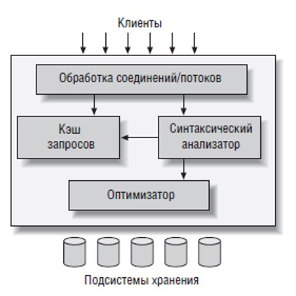
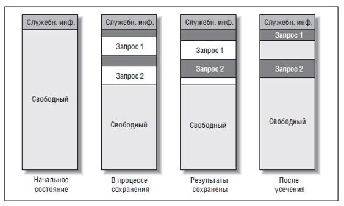

# Консоль

Основная папка `/usr/local/opt/mysql@5.7/`

## Сервер

- Старт –`/usr/local/opt/mysql@5.7/bin/mysql.server start`
- Стоп – `/usr/local/opt/mysql@5.7/bin/mysql.server stop`
- Рестарт – `/usr/local/opt/mysql@5.7/bin/mysql.server restart`

В MacOS  `datadir` *by default* – `/usr/local/var/mysql`.

https://habr.com/ru/post/217245/

# Конфигурирование

## Файл `my.cfg`

Файл `my.cfg` может располагаться в нескольких местах. Если существует несколько файлов `my.cfg`, то каждый из них влияет на конфигурацию. MySQL будет загружать файлы `my.cfg` поочередно, и каждое последующее значение будет переопределять предыдущие (в порядке перечисления файлов)???

Узнать те места, которые MySQL будет просматривать при загрузке конфигурации:

```bash
$ mysqld --verbose --help | grep -A1 'Default options'  
Default options are read from the following files in the given order:
/etc/my.cnf /etc/mysql/my.cnf /usr/local/etc/my.cnf ~/.my.cnf

```

```bash
$ mysql --help | grep /my.cnf | xargs ls
ls: /etc/my.cnf: No such file or directory
ls: /etc/mysql/my.cnf: No such file or directory
ls: ~/.my.cnf: No such file or directory
/usr/local/etc/my.cnf
```

Поэтому в MacOS путь `/usr/local/etc/my.cnf`

Последним загружается файл в домашнем каталоге пользователя `~/.my.cnf`. Директивы этого файла перезаписывают директивы остальных файлов и позволяют настроить MySQL индивидуально под пользователя. Настраивать сервер в этом файле не имеет смысла т. к. запускается он с правами `root`. Как правило, в этом файле размещаются секции `[client]`, `[mysql]`, `[mysqldump]`... с настройками клиентских утилит.

Файл использует формат `.ini`. Для комментирования строки используется точка с запятой `;` или символ решетка `#`.

Содержимое конфигурационного файла разделено на секции, которые имеют вид `[имя_секции]`. Имя секции определяет утилиту или сервер, к которым будут относиться перечисленные далее директивы до тех пор, пока не встретится новая секция или конец файла.

Ниже перечислены наиболее типичные секции.

| Секция                    | Описание                                                    |
| ------------------------- | ----------------------------------------------------------- |
| <u>Настройки сервера</u>  |                                                             |
| `[mysqld]`                | Сервер MySQL                                                |
| `[server]`                | Сервер MySQL                                                |
| `[mysqld-5.7]`            | Сервер MySQL, определенной версии                           |
| `[mysqld_safe]`           | Утилита запуска  mysqld_safe                                |
| <u>Настройки клиентов</u> |                                                             |
| `[client]`                | Любая  клиентская утилита, обращающаяся к серверу           |
| `[mysql]`                 | Консольный  клиент mysql                                    |
| `[mysqldump]`             | Утилита  создания SQL-дампов mysqldump                      |
| `[mysqlhotcopy]`          | Утилита  "горячего" копирования бинарных файлов базы данных |

Секция `[client]` задает настройки для всех клиентов (которые умеют читать эту конфигурацию), а `[mysql]`, `[mysqldump]`... только для определенных клиентов и поэтому имеют более высокий приоритет чем `[client]`. 

Пример секции `[mysqld]` в файле `my.cnf`:

```apache
# Директивы MySQL-сервера 
[mysqld]
# Linux-пользователь, под которьм работают рабочие процессы 
user = mysql

# Файл с идентификатором главного процесса mysqld-сервера
pid-file = /var/run/mysqld/mysqld.pid

# Местоположение сокета, через который осуществляется обмен
# данными с MySQL-клиентами
socket = /var/run/mysqld/mysqld.sock

# Порт, по которому ждет запросов MySQL-сервер
port = 3306

# Папка установки MySQL-сервера
basedir = /usr

# Каталог данных, в котором хранятся файлы баз данных
datadir = /var/lib/mysql

# Временная папка
tmpdir = /tnp

# Каталог с локализацией (переводами) сообщений об ошибках 
lc-messages-dir = /usr/share/mysql

# Отключение системной блокировки файлов, вместо этого используется
# блокировка на уровне MySQL (предотвращает дедлоки) 
skip-external-locking

# Привязка к IP-адресу; при использовании в качестве IP-адреса 0.0.0.0
# MySQL будет доступен для обращений извне.
# Отключить работу MySQL-сервера через сеть можно при помощи директивы
# skip-networking. Удаление bind-address и включение skip-networking
# приведет к тому, что сервер начнет работать только через сокет
bind-address = 127.0.0.1

# Объем оперативной памяти, которая отводится на кэш ключей (только MylSAM)
key_buffer = 16М

# Максимальный размер SQL-запроса
max_allowed_packet = 16М

# Размер стека для каждого потока
thread_stack = 192К

# Сколько потоков кэшируется для повторого использования,
# обычно вычисляется по формуле: 8 + (max_connections / 100) 
thread_cache_size = 8

# Максимальное количество одновременных соединений, при достижении этого
# значения новые соединения будут отбрасываться сервером
max_connections = 150

# Максимальный объем для результирующей таблицы, сохраняемой кэшем запросов
query_cache_limit = 4М

# Объем кэша запросов
query_cache_size = 128М

# Местоположение журнала ошибок 
log_error = /var/log/mysql/error.log

# Кодировка по умолчанию для новых баз данных и таблиц 
character-set-server = utf8

# Тип таблиц по умолчанию 
default-storage-engine = InnoDB

# SQL режим (ниже описан)
sql-mode="NO_ENGINE_SUBSTITUTION"

#############################################
# Директивы для настройки InnoDB
#############################################
# Каждая таблица хранится в отдельном файле, собственном табличном
# пространстве. 
innodb_file_per_table

# Объем оперативной памяти, которая отводится под кэш InnoDB. 
innodb_buffer_pool_size=2G

# Как часто сохранять транзакции на диск
innodb_flush_log_at_trx_commit = 2

# Размер буфера журнала транзакций 
innodb_log_buffer_size=8M
```

Пример секции `[mysql]` в файле `my.cnf`:

```apache
[mysql]
# Хост, к которому будет стучаться клиент
host = localhost

# Порт, по которому будет стучаться клиент
port = 3306

# UNIX-сокет, по которому будет стучаться клиент
socket = /var/run/mysqld/mysqld.sock

# Под каким пользователем будет стучаться
user = root

# С каким паролем
password = root
```

Проверить установленное значение конфигурационного параметра можно если посмотреть [системные переменные](#системные-переменные).

## System Variables

*System Variables* (системные переменные) – это различные конфигурационные параметры, которые настраивают работу сервера.

### Установка *System Variables*

- при запуске сервера в параметрах командной строки:

  ```bash
  mysqld --innodb_log_file_size=16M
  ```

- в конфигурационном файле `my.cnf`:

  ```apache
  [mysqld]
  innodb_log_file_size=16M
  ```

- во время выполнения с помощью команды `SET`. Команда `SET` используется также и для пользовательских переменных, однако пользовательские переменные начинаются с символа `@`:

  ```sql
  SET [GLOBAL | PERSIST | SESSION] innodb_log_file_size=16M
  ```

  - `GLOBAL` – глобальная системная переменная
  - `SESSION` – сессионная системная переменная
  - `PERSIST` – глобальная системная переменная, сохраненная в файл

  либо таким образом:

  ```sql
  SET @@session.sort_buffer_size := <value>; 
  ```

### Вывод значения *System Variables*

- команда:

  ```sql
  SHOW [GLOBAL | SESSION] VARIABLES [LIKE 'pattern']
  ```

- запрос:

  ```sql
  SELECT @@GLOBAL.sql_mode;  # Глобальное значение
  SELECT @@SESSION.sql_mode; # Сеансовое значение
  ```

- обратится к таблицам `INFORMATION_SCHEMA.global_variables` и `INFORMATION_SCHEMA.session_variables`.

[Документация к *System Variables*](https://dev.mysql.com/doc/refman/8.0/en/server-system-variables.html) и [InnoDB System Variables](https://dev.mysql.com/doc/refman/5.7/en/innodb-parameters.html)

### Общие особенности конфигурирования

При задании параметров слишком большое значение по памяти может привести к выходу за пределы физической памяти и включению файла подкачки. Самый лучший подход к делу – изменять не более одной-двух переменных за раз, и после каждой такой модификации прогонять тесты. Лучшим свидетельством того, что в распоряжении ОС достаточно памяти, является отсутствие выгрузки страниц в файл подкачки на диске.

Проще всего взять за основу один из образцов конфигурационного файла, поставляемых вместе с MySQL. Образцы конфигурационных файлов имеют говорящие имена, например: `my_huge.cnf`, `my large.cnf`,  `my small.cnf`.

Самое важное – правильно выделить память под кеш MyISAM и InnoDB:

- если используется только MyISAM, то можно отключить InnoDB
- если используется только InnoDB, то можно под MyISAM отвести минимум ресурсов, т.к. MySQL применяет таблицы типа MyISAM для своих внутренних нужд.

### Thread cache

Создание и удаление потоков для обслуживания запросов является дорогой операцией. Вместо постоянного создания и удаления потоков, MySQL может сохранять неактивные потоки в кеш потоков и использовать в случае необходимости. Пока в кэше есть свободные потоки, MySQL отвечает на запросы об открытии соединения очень быстро. 

Системная переменная `thread_cache_size` определяет максимальное количество потоков в этом кэше. 

Мониторинг кеша потоков выполняется *server status variable*'s':

- `Threads_cached` – количество потоков в кеше потоков

- `Threads_created` – количество созданных потоков с момента старта сервера.

Если значение `Threads_created` слишком велико, то необходимо увеличить кеш потоков. Для оценки можно использовать:

- количество потоков, создаваемых в секунду   


- процент промаха в кеш, когда пришлось создавать новый поток   


### Table cache

Кеш таблиц позволяет при обращении к таблице не открывать файл заново, а вернуть файловый дескриптор из объекта в кэше. Кэш таблиц разделен на две части: 

- кэш открытых таблиц (размер определяется переменной `table_cache`)
- кэш определений таблиц (размер определяется переменной `table_definition_cache`).

Конфигурирование:

- Проще всего переменным `table_cache` и `table_definition_cache` присвоить значение, достаточно большое для кэширования всех таблиц. Значение необходимо рассчитать по формуле: 

  ```
  количество одновременных соединений * количество открытых таблиц в соединении
  ```

  Т.е. для каждого соединения используется свои ячейки из кэша.

  Если таблиц немного, то можно выделить кеш таблиц под все таблицы:

  ```
  количество одновременных соединений * количество таблиц
  ```

- Смотреть на переменную состояния `Opened_tables`, если она велика или постоянно растет, то переменную `table_cache` следует увеличить.

### `sql-mode`

`sql_mode` – настройка, которая влияет на синтаксис SQL, поддерживаемый MySQL, и проверки правильности данных, которые он выполняет.

Возможные значения:

- `STRICT_TRANS_TABLES`– включить *strict SQL mode* (режим строгого SQL) 


# Термины


## Установка

Установка MySQL:

```bash
brew install mysql[@5.7]
```

После установки MySQL можно выполнить постинсталляционную настройку с целью повышения безопасности сервера. Производится настройка пользователя `root`, анонимного пользователя и т.д.

```bash
sudo mysql_secure_installation
```


## Архитектура

Общие принципы:

- MySQL - это приложение, запускаемое в один процесс. Процесс называется mysqld (от MySQL Daemon).

- Он многопоточен.

- Он выступает в качестве сервера, принимая соединения.

- Каждое соединение получает выделенный поток.

- Эти потоки иногда называются процессами, а иногда они называются соединениями.

На самом верхнем уровне содержатся службы, обеспечивают поддержку соединений, идентификацию, безопасность и т. п.

                                

Mysql Engine Level (? мое) – второй уровень сосредоточена значительная часть интеллекта MySQL: синтаксический анализ запросов, оптимизация, кэширование и все встроенные функции (например, функции работы с датами и временем, математические функции, шифрование). На этом уровне реализуется любая независимая от подсистемы хранения данных функциональность, например хранимые процедуры, триггеры и представления.

Storage Engine Level – Третий уровень содержит подсистемы хранения данных. Они отвечают за сохранение и извлечение всех данных, хранимых в MySQL. Подобно различным файловым системам GNU/Linux, каждая подсистема хранения данных имеет свои сильные и слабые стороны. Сервер взаимодействует с ними с помощью API подсистемы хранения данных. Этот интерфейс скрывает различия между подсистемами хранения данных и делает их почти прозрачными на уровне запросов. Кроме того, данный интерфейс содержит пару десятков низкоуровневых функций, выполняющих операции типа «начать транзакцию» или «извлечь строку с таким первичным ключом». Подсистемы хранения не производят синтаксический анализ.

В системах, которые имеют дело с совместным доступом на чтение/запись, обычно реализуется набор блокировок, делящихся на два типа. Эти блокировки обычно называют разделяемыми блокировками и монопольными блокировками или блокировками чтения и блокировками записи. MySQL запрещает одному клиенту считывать данные, когда другой клиент их изменяет.

Основной стратегией блокировки в MySQL, дающей наименьшие накладные расходы (получение, проверка, освобождение), является табличная блокировка . Блокировки таблицы READ LOCAL разрешают некоторые типы одновременных операций записи. Также блокировки записи имеют более высокий приоритет, чем блокировки чтения, поэтому запрос блокировки записи будет помещен в очередь перед уже имеющимися запросами блокировки чтения. СУБД MySQL также использует для различных целей разные блокировки, например, для таких команд, как ALTER TABLE, сервер применяет табличную блокировку вне зависимости от подсистемы хранения данных. Блокировка на уровне строк доступна в подсистемах InnoDB и Falcon. Блокировки строк реализуются подсистемами хранения данных, а не сервером.


## Типы систем хранения

Файловая структура баз данных и таблиц:

- Каждая база данных (также именуемая схемой) хранится в отдельном подкаталоге, внутри каталога данных (параметр datadir в my.cfg) . 

- Определение каждой таблицы (поля, типы полей…) хранится  в файле с расширением .frm и именем, совпадающим с именем таблицы (например, MyTable.frm). Определение таблиц сервер обрабатывает самостоятельно, файлы .frm не зависят от используемой подсистемы хранения.

- Данные таблиц и индексы в каждой подсистеме хранения записываются на диск по разному. 

Определить параметры любой таблицы (подсистему хранения, кодировку, …) можно с помощью команды SHOW TABLE STATUS (подробнее Show table status)

### MyIsam

MyISAM используется для хранения системных данных в таблице mysql. 

Особенности MyISAM:

- отсутствует поддержка транзакций. Т.е. MyISAM не гарантирует Durability – даже одна команда может быть выполнена частично. Если, например, ошибка произойдет в процессе выполнения команды UPDATE, обновляющей несколько строк, то некоторые строки будут обновлены, а некоторые нет. 

- движок быстрый, по причине отсутствия транзакций.

- блокировка на уровне таблицы, но не строки. Поэтому запросы на запись приводят к монопольной блокировке всей таблицы на запись. Однако выборки в момент вставки новых строк допускаются (конкурентные вставки)

- хранит счетчик количества строк в таблице, поэтому запросы COUNT(*) без условий выполняются мгновенно.

- отсутствие автоматического восстановления данных. При сбое питания требуется ручная проверка таблиц.

- Можно создавать сжатые неизменяемые таблицы.

- пространственные функции (для геоинформационных систем – ГИС).

Хранение данных и индексов 

MyISAM хранит каждую таблицу в двух файлах: 

- файле данных с расширением .MYD (MYData)

- файле индексов с расширением .MYI (MYIndex)

Особенности применения

- движок быстрый, эффективен на чтение.

- не эффективен в задачах, где большое количество записи, т. к. для записи блокируется вся таблица;

#### Конфигурирование

Движок MyISAM самостоятельно кэширует в памяти только индексы. Поэтому наиболее важный параметр в настройке MyISAM – это директива key_buffer_size в файле my.cfg – объем памяти, выделяемый под кэш индексов для MyISAM Под кэш индексов рекомендуется выделять 25-50% оперативной памяти сервера.

Если таблицы типа MyISAM не используются в приложении, все равно следует выделить с помощью параметра key_buffer_size хотя бы небольшой объем памяти, скажем, 32M. MySQL использует MyISAM-таблицы для внутренних целей – для системных таблиц, для временных таблиц.

Остаток памяти будет отведен под кэши операционной системы, в которых будут хранятся данные, считанные из MYD-файлов с данными. Естественно, что данных значительно больше, чем индексов. Важно, чтобы в операционной системе оставалась доступная свободная память под кеши операционной системы (столбцы free и cached в отчете утилиты free или vmstat). Извлечение данных из кеша операционной системы является более дорогим, чем извлечение индекса, т.к. требуется дорогостоящий вызов операционной системы.

Оценить эффективность кэша индексов можно, запросив переменные состояния, начинающиеся с префикса Key_%:

```sql
mysql> SHOW STATUS LIKE 'Key_%';

+------------------------+-------------+

| Variable_name     | Value    |

+------------------------+-------------+

| Key_blocks_not_flushed | 0      |

| Key_blocks_unused   | 0      | Количество свободных блоков в кеше 
 |            |       | ключей

| Key_blocks_used    | 107171    | Количество занятых блоков в кеше
 |            |       | ключей

| Key_read_requests   | 18472428924 | Количество чтений напрямую из кеша
 |            |       | ключей без использования диска

| Key_reads       | 381826182  | Количество чтений ключей с диска в
 |            |       | обход кеша ключей

| Key_write_requests   | 4483957   | Количество записей в кеш изменений
 |            |       | ключей

| Key_writes       | 77799    | Количество записей измененных ключей
 |            |       | из кеша ключей на диск

+------------------------+-------------+
```

Особенности конфигурирования:

- Не имеет смысла делать кеш индексов key_buffer_size больше, чем общий объем файлов с индексами .MYI в базе данных

- Если количество свободных блоков в кеше Key_blocks_unused стабильно держится выше 0, то можно уменьшить объем памяти под кеш индексов key_buffer_size

- Соотношение должно   , т.е. попадание в кеш   .

- Если примерно известна скорость I/O в единицах   , то можно сравнить эту величину с   

- Индексы организованы эффективно, если   , т.е. чтений из индекса гораздо больше изменений индекса при вставке/обновлении данных.

С помощью данной команды можно заранее загрузить индексы из таблиц MyISAM в кэш (прогреть кеш):

LOAD INDEX INTO CACHE table1, table2;

 

### MyISAM Merge

Объединение нескольких структурно одинаковых таблиц MyISAM в одну виртуальную таблицу. Подробнее Объединенные таблицы и секционирование

### InnoDB

Особенности InnoDB:

- поддерживает транзакции

- блокировка данных на уровне строк. Поэтому эффективен в случае большого количества записи.

- уровень изоляции по умолчанию – REPEATABLE READ + предотвращает проблему «фантомное чтение» через блокировки диапазонов (подробнее Блокировки Блокировки)

- автоматическое восстановление после сбоя – через журнал транзакций

- реализует MVCC

- данные хранятся в порядке кластерного индекса. Поэтому данные очень быстро находятся и перебираются по первичному ключу.

- поддерживает ограничения целостности типа «внешний ключ»

- адаптивный хеш-индекс

- не хранит информацию о количестве строк в таблице, т.е. запросы COUNT(*) без фразы WHERE требуют сканирования таблицы или индекса.

#### Хранение данных InnoDB

InnoDB сохраняет данные, индексы и различные внутренние структуры вместе, в одном или нескольких файлов .ibdata, которые называются *табличным пространством (tablespace).* 

Файлы, помещаемые в табличное пространство, перечисляются в конфигурационном параметре innodb_data_file_path. Все они будут находиться в каталоге, который задается параметром innodb_data_home_dir.

innodb_data_home_dir = /var/lib/mysql/

innodb_data_file_path = ibdata1:1G;ibdata2:1G;ibdata3:1G

Табличное пространство в сущности является черным ящиком, которым полностью управляет сама InnoDB. InnoDB может располагать табличные пространства на «сырых» (неформатированных) разделах диска. 

##### Параметр `innodb_file_per_table`

Параметр `innodb_file_per_table` указывает размещать каждую таблицу в отдельном табличном пространстве, файле с именем вида `tablename.ibd`. При этом главное табличное пространство продолжает использоваться для файлов отмены и других системных данных. Этот параметр не позволяет делать резервные копии и восстанавливать таблицы путем простого копирования файлов. 

Преимущества: 

- проще освобождать место при удалении таблицы


- удобное распределение таблиц по разным дискам. 


- делает структуру базы более наглядной. 


- позволяет гораздо быстрее определить размер таблицы, взглянув на соответствующий файл, вместо команды `SHOW TABLE STATUS`


Недостаток:

- больше места растрачивается впустую, т.к. появляется неиспользуемое место в IBD-файлах, что особенно плохо для маленьких таблиц, т.к. размер страницы в InnoDB составляет 16 Кбайт, и даже если в таблице хранится всего 1 Кбайт данных, на диске она все равно будет занимать 16 Кбайт.


#### Параметр innodb_buffer_pool_size

Директива innodb_buffer_pool_size определяет объем памяти, выделяемой под кэш InnoDB (пул буферов). Т.к. пул буферов включает данные, индексы и все служебные данные, документация рекомендует для выделенных серверов БД отдавать под кеш 50-80% оперативной памяти.

#### Мониторинг и конфигурирование

Оценить эффективность кэша индексов можно, запросив переменные состояния, начинающиеся с префикса Innodb_buffer_pool_%:

```sql
mysql> SHOW STATUS LIKE 'Innodb_buffer_pool_%';

+----------------------------------+----------------+

| Variable_name          | Value     |

+----------------------------------+----------------+

| Innodb_buffer_pool_pages_data  | 4259278    | Количество занятых
 |                 |        | страниц в кеше

| Innodb_buffer_pool_bytes_data   | 69784010752  | то же в байтах

|                 |        |

| Innodb_buffer_pool_pages_dirty  | 53550     | Количество «грязных» 
 |                 |        | страниц в кеше

| Innodb_buffer_pool_bytes_dirty  | 877363200   | то же в байтах

|                 |        |

| Innodb_buffer_pool_pages_free  | 1362417    | Количество свободных
 |                 |        | страниц в кеше

|                 |        |

| Innodb_buffer_pool_pages_total  | 5898232    | Общее количество
 |                 |        | страниц в кеше

|                 |        |

| Innodb_buffer_pool_read_requests | 11594798923377 | Количество чтений из
 |                 |        | кеша

|                 |        |

| Innodb_buffer_pool_reads     | 3628278    | Количество чтений с 
 |                 |        | диска в обход кеша

|                 |        |

| Innodb_buffer_pool_write_requests| 1451780634   | Количество записей в
 |                 |        | кеш

+---------------------------- -----+----------------+
```

Также можно посмотреть Buffer pool hit rate в выводе (наверное рассчитывается как   ):

```sql
mysql> SHOW ENGINE InnoDB STATUS\G ...

 —------------------— BUFFER POOL AND MEMORY —------------------— 

... Buffer pool hit rate 994 / 1000, young-making rate 6 / 1000 not 0 / 1000 ...
```

Особенности конфигурирования:

- Не имеет смысла делать пул буферов innodb_buffer_pool_size больше, чем полный размер базы данных+служебные данные InnoDB

- Можно выделить под пул буферов памяти столько, чтобы туда поместилась вся база данных. Однако это зачастую не эффективно, т.к. не все данные требуется грузить в кеш.

- Если количество свободных блоков в кеше Innodb_buffer_pool_pages_free стабильно держится выше 0, то можно уменьшить объем памяти под пул буферов innodb_buffer_pool_size

- Соотношение должно   , т.е. попадание в кеш   . Если   , то следует увеличить размер пула буферов innodb_buffer_pool_size. Если размер пула буферов вылезает за пределы доступной оперативной памяти, то стоит добавить памяти на сервер.

- Если примерно известна скорость I/O в единицах   , то можно сравнить эту величину с   

- Кеш используется эффективно, если   , т.е. чтений из кеша гораздо больше изменений кеша при вставке/обновлении данных.

Для таблиц типа InnoDB не существует аналога команды LOAD INDEX INTO CACHE. Если требуется «прогреть» сервер, то это нужно делать вручную – отправлять запросы, выполняющие полное сканирование таблицы или индекса.

#### Журнал транзакций

Для восстановления после падения сервера и уменьшения стоимости фиксации транзакций в InnoDB используется журнал транзакций (*redo* *log*). 

Изменения данных и индексов, произведенные внутри транзакции, часто относятся к разрозненным местам в табличном пространстве, поэтому для сброса потребуется помещать их в несмежные области диска. Вместо сброса пула буферов на диск после фиксации каждой транзакции InnoDB записывает транзакции в журнал (эти данные называются *redo*) – это называется *упреждающая запись в журнал*. Журнал используется для превращения произвольного ввода/вывода в последовательный. После того как запись в журнал произведена, транзакцию можно считать долговечной (D из ACID), пусть даже изменения еще не записаны в файлы пула буферов. 

Параллельно изменения в страницах пула буферов фиксируются в копии, находящейся в памяти. Разумеется, InnoDB в конечном итоге должна записать эти  изменения в файлы пула буферов на диске. В InnoDB имеется фоновый поток, который упорядочивает сброс изменений в файлы данных. Этот поток умеет группировать операции записи так, чтобы они выполнялись последовательно, с целью повышения его эффективности. Размер журнала транзакций фиксирован, запись в журнал производится циклически: по достижении конца журнала происходит переход в начало. 

Если случится какая-то авария (например, пропадет питание), то InnoDB сможет воспроизвести журнал и восстановить зафиксированные транзакции. Процесс восстановления после падения в InnoDB полностью автоматический и в обязательном порядке выполняется в момент запуска InnoDB. 

Полный размер файла журнала задается параметром innodb_log_file_size, а количество файлов журнала задается параметром innodb_log_files_in_group. По умолчанию InnoDB создает два файла журнала в каталоге данных MySQL ( datadir): ib_logfile0 и ib_logfile1. 

При модификации любых данных InnoDB помещает запись об изменении в *буфер журнала*, который хранится в памяти, позже он сбрасывается на диск. Размером буфера журнала управляет переменная innodb_log_buffer_size. 

##### Параметр innodb_flush_log_at_trx_commit

Параметр innodb_flush_log_at_trx_commit контролирует как часто сбрасывается буфер журнала. Возможные варианты:

- 0 – сброс буфера журнала на диск раз в секунду (самый быстрый режим)

- 1 –  сброс буфера журнала на диск при каждой фиксации транзакции (самый безопасный режим)

- 2 – аналогичен 0, только транзакции не теряются при аварийном останове сервера

##### Параметр innodb_flush_method

Параметр innodb_flush_method позволяет указать, как InnoDB сбрасывает на диск данные пула буферов и журнал транзакций. 

Часто используемые варианты:

- fsync (значение по умолчанию). Для сброса используется системный вызов fsync() fsync() копирует на диск все части файла, находящиеся в памяти, и ожидает пока устройство скажет, что все эти части сохранены. При этом операционная система буферизует, по крайней мере, некоторые данные в собственном кэше. Возникает двойная буферизация данных: операционной системой и подсистемой InnoDB. Однако двойная буферизация – это необязательно плохо, некоторые ОС умеют накапливать процедуры записи и выполнять их одним пакетом, выполнять упреждающее чтение и другие оптимизации. 

- O_DIRECT  – часто рекомендуется для включения. ОС дается указание не кэшировать данные и не прибегать к опережающему чтению. Все операции чтения и записи направляются напрямую устройству хранения во избежание двойной буферизации. Задание флага O_DIRECT в случае, когда между InnoDB и физическим устройством нет никакого буфера, например при отключенном кэше записи на RAID-контроллере, может привести к серьезному падению производительности. Если нужные данные отсутствуют в пуле буферов, то InnoDB будет вынуждена читать их прямо с диска, что гораздо медленнее, чем из буфера.

#### MVCC в InnoDB

Если транзакция долгое время остается открытой (даже не делая ничего полезного), то InnoDB не может удалить старые версии строк, поскольку они должны быть видны незафиксированным транзакциям. InnoDB хранит старые версии в табличном пространстве. При большом количестве невычищенных транзакция табличное пространство быстро растет по мере накапливающихся изменений данных. 

Команда SHOW INNODB STATUS может показать текущий номер транзакции и номер транзакции, до который вычищено табличное пространство:

----------— 
 TRANSACTIONS 
 ----------— 
 Trx id counter 0 80157601             # Текущий номер транзакции


 Purge done for trx’s n:o <0 80154573 undo n:o <0 0 # Номер транзакции, до 
                           которой вычищено 
                           табличное пространство

 

 

 

 

### Memory

полезны, когда необходимо осуществить быстрый доступ к данным, которые либо никогда не изменяются, либо нет надобности в их сохранении после перезапуска. Обычно таблицы типа Memory обрабатываются примерно на порядок быстрее, чем таблицы MyISAM. Все их данные хранятся в памяти, поэтому запросам не нужно ждать выполнения операций дискового ввода/вывода. Структура таблицы Memory сохраняется после перезапуска сервера, но данные теряются, не сохраняются на диск. Применение: Для «справочных» таблиц или таблиц «соответствия», например для таблицы, в которой почтовым кодам соответствуют названия регионов•• Для кэширования результатов периодического агрегирования данных •• Для промежуточных результатов при анализе данных Таблицы Memory поддерживают индексы типа HASH, обеспечивающие очень большую скорость выполнения поисковых запросов. используют блокировку на уровне таблицы, что уменьшает конкуренцию при записи,. MySQL внутри себя использует подсистему Memory для хранения про межуточных результатов при обработке запросов. Отсутствуют динамические строки, т.е. поля типа BLOB и TEXT, тип VARCHAR(5000) превращается в CHAR(5000). Отсутствие статистика индексов, что иногда приводит к плохим планам выполнения.

### Archive

Подсистема хранения Archive позволяет выполнять только команды INSERT и SELECT. буферизует записываемые данные и сжимает все вставляемые строки с помощью библиотеки *zlib**.* Каждый запрос SELECT требует полного сканирования таблицы. По этим причинам таблицы Archive идеальны для протоколирования и сбора данных, когда анализ чаще всего сводится к сканированию всей таблицы

### Blackhole

Отсутствует система хранения. Запросы пишутся в журналы, они могут быть реплицированы на подчиненные серверы или просто сохранены в журнале. Необходимо для настройки предполагаемых репликаций и ведения журнала аудита.

### Falcon, solidDB, PBXT, Maria

Обычные система с MVCC и хранимыми в памяти транзакциями. Можно самому создать свою систему хранения.

### Выбор системы хранения

Критерии:

- Определение необходимости транзакций.

- Определение типа конкурентного доступа. Если основной объем операций это INSERT и SELECT то лучший вариант – MyISAM. Если требуется конкурентное изменение данных то лучше выбрать систему с блокировкой на уровне строки InnoDB.

- Особенности резервного копирования (возможность останова сервера)

- Скорость восстановления после сбоя (MyISAM часто повреждается)

- Необходимость кластерных индексов, полнотекстовый поиск

### Примеры выбора типа

Протоколирование, логгирование

В оперативном режиме необходимо быстрый INSERT, наилучшие MyISAM и Archive. Данные можно реплицировать на подчиненный сервер, где выполнять аналитическую обработку, либо запускать ее в периоды спада нагрузок. Еще вариант – MyIsam Merge с отдельными таблицами по датам, и виртуальной таблицей для агрегирования.

Справочные таблица, практически только для чтения

MyISAM, с минусом в виде опасности повреждения.

  

Способы преобразования таблиц между форматами:

\1.   ALTER TABLE mytable ENGINE = Falcon Занимает много времени, блокирует таблицу на чтение

\2.   mysqldump

\3.    

```sql
mysql> CREATE TABLE innodb_table LIKE myisam_table;

mysql> ALTER TABLE innodb_table ENGINE=InnoDB;

mysql> INSERT INTO innodb_table SELECT * FROM myisam_table;
```

для транзакционных таблиц последняя команда приводит к большому журналу отмены, поэтому лучше частями:

```sql
mysql> START TRANSACTION;

mysql> INSERT INTO innodb_table SELECT * FROM myisam_table

-> WHERE id BETWEEN x AND y;

mysql> COMMIT;
```

## MySQL query cache

MySQL (и многие СУБД) умеет кэшировать планы выполнения, что позволяет серверу пропустить стадии разбора и оптимизации запросов, уже встречавшихся ранее. Однако у MySQL есть еще кэш запросов (*Mysql query cache*), в котором хранятся полные результирующие наборы, сгенерированные командами SELECT.

При попадании в кэш запросов (hits) сервер сразу же возвращает сохраненные итоги, пропуская стадии разбора, оптимизации и выполнения. Кэш запросов отслеживает, какие таблицы были использованы в запросе, и, если хотя бы одна из них изменилась, данные в кэше становятся недействительными, без разбора связано ли это изменение с данными в кеше. Такая грубая политика позволяет значительно снизить накладные расходы. Кэш прозрачен для приложений, однако может изменить семантику в одном аспекте – по умолчанию запрос может быть обслужен из кэша, если одна из участвующих в нем таблиц заблокирована.

Ключом таблицы кэшей является хеш, рассчитанный по тексту запроса, текущей базе данных, номеру версии клиентского протокола (от них зависят результаты обработки запроса). Любое различие (регистр символов, лишние пробелы или комментарии) приведет к тому, что новый запрос не совпадет с кэшированной версией.

Результат не кешируется, если сгенерирован недетерминированным запросом, (содержащим недетерминированную функцию, например NOW() или CURRENT_DATE()), если запрос содержит ссылки на определенные пользователем функции, хранимые процедуры, пользовательские переменные, временные таблицы, таблицы в базе данных Mysql. 

MySQL помечает запрос как некэшируемый, как только обнаруживает конструкцию, препятствующую кэшированию, и результаты такого запроса не сохраняются. Что бы избежать этого, стоит избавить запрос от недетерминированных функций, например, записать дату в виде литерала: 

```sql
-- не кешируется
SELECT * FROM table WHERE DATE_SUB(CURRENT_DATE, INTERVAL 1 DAY);

-- кешируется
SELECT * FROM table WHERE DATE_SUB('2018-05-05', INTERVAL 1 DAY);
```

Поиск в кэше производится до разбора запроса и сервер лишь проверяет, что запрос начинается с букв SEL (без учета регистра) перед поиском в хэш-таблице. 

При включении кеша добавляются накладные расходы как при чтении, так и при записи:

- Перед началом обработки запроса на чтение нужно проверить, есть ли он в кэше 

- Если запрос допускает кэширование, но еще не помещен в кэш, то нужно потратить время на запись в кэш сгенерированных результатов;

- При обработке любого запроса на запись необходимо сделать недействительными все записи в кэше, в которых встречается измененная таблица

Эти издержки сравнительно невелики, поэтому в целом кэш может дать выигрыш. Пул памяти, выделенной под кэш, состоит из блоков переменной длины. На этапе запуска сервер инициализирует память, выделенную для кэша запросов. Первоначально пул памяти состоит из одного свободного блока размером с выделенную под кеш память. Когда сервер кэширует результат запроса, он выделяет блок для хранения этого результата. Минимальный размер блока составляет query_cache_min_res_unit байтов. Сервер не в состоянии создать блок в точности подходящего размера, так как первоначальное выделение производится еще до того, как результирующий набор полностью сгенерирован, т.к. строки отправляются клиенту по мере их порождения.

Сервер выделяет блок минимального размера и начинает помещать в него результаты, затем новый и т.д. Когда результат полностью сгенерирован, сервер усекает последний блок и объединяет оставшуюся область с соседним свободным блоком. 

  

Память под кэш выделяется только один раз, при создании кэша. Затем сервер только просматривает список блоков и либо находит место, где собирается разместить новый блок, либо при необходимости удаляет самый старый кэшированный запрос, чтобы освободить. Сервер MySQL самостоятельно управляет своей памятью, не полагаясь на операционную систему.

Образование зазоров называется фрагментацией. Ее причины: параллельно выполняемые кеширования, объявление записей в кэше недействительными (инвалидиция).

Выигрывают от наличия кэша те запросы, которые долго выполняются, но занимают в кэше немного места, так что их хранение, возврат клиенту и инвалидация обходятся дешево. В эту категорию попадают, агрегирующие запросы, например, с функцией COUNT() для больших таблиц. 

### Конфигурирование (*query cache*)

- query_cache_type – включен ли режим кэширования запросов. 

Возможные варианты:

o  OFF – кэш запросов отключен

o  ON – кэш запросов включен. При помощи модификатора SQL_NO_CACHE можно помечать SQL-запросы, которые не должны подвергаться кэшированию:

SELECT SQL_NO_CACHE * FROM table WHERE ...;

o  DEMAND кэшируются только запросы с модификатором SQL_CACHE.

SELECT SQL_CACHE * FROM table WHERE ...;

- query_cache_size – общий объем памяти, отведенной под кэш запросов.

- query_cache_min_res_unit – минимальный размер выделяемого блока.

- query_cache_limit – размер максимального результирующего набора, который разрешено кэшировать. 

Сервер кэширует результаты по мере их генерации, поэтому заранее не известно, поместится ли результат в кэш. Если размер результата превышает заданный порог, то MySQL увеличивает переменную состояния Qcache_not_cached и отбрасывает закэшированные к этому моменту строки. Если это происходит часто, то можно включить указание SQL_NO_CACHE в запросы, которые могут приводить к такой ситуации.

- query_cache_wlock_invalidate – запрещать обслуживать из кэша результаты, которые относятся к таблицам, заблокированным другими соединениями. По умолчанию этот параметр равен OFF, что изменяет семантику запроса, поскольку позволяет серверу читать кэшированные данные из заблокированной таблицы, хотя обычно сделать это невозможно. Если установить параметр равным ON, то чтение данных будет запрещено.

### Мониторинг и конфигурирование

За кеш запросов отвечают переменные состояния, которые начинаются с Qcache_:

```sql
mysql> SHOW STATUS LIKE 'Qcache_%';

+-------------------------+--------+

| Variable_name      | Value  |

+-------------------------+--------+

| Qcache_free_blocks   | 154  | Свободных блоков в кеше

|             |    |

| Qcache_free_memory   | 576304 | Свободной памяти в кеше

|             |    |

| Qcache_hits       | 667873 | Число попаданий в кеш

|             |    |

| Qcache_inserts     | 166945 | Число вставок запросов в кеш

|             |    |

| Qcache_lowmem_prunes  | 32423 | Число запросов, удаленных из кеша из-за
 |             |    | недостатка памяти

|             |    |

| Qcache_not_cached    | 171807 | Число незакешированных запросов,
 |             |    | например, превышающих query_cache_limit

|             |    |

| Qcache_queries_in_cache | 6844  | Число запросов в кеше

|             |    |

| Qcache_total_blocks   | 14359 | Общее число блоков в кеше

+-------------------------+--------+
```

Для каждого приложения существует конечный потенциальный размер кэша – это объем памяти, необходимый для сохранения всех кэшируемых запросов, которые может выполнить приложение. Как правило он не так велик, т.к. большинство записей в кэше становятся недействительными. 

Правила определения оптимального размера кеша query_cache_limit: 

- используется не вся память (что можно понять по числу свободных блоков в кеше Qcache_free_blocks и общему числу блоков Qcache_total_blocks) – необходимо его уменьшить

- если  из-за нехватки памяти часто происходит вытеснение (prune) запросов из кеша и растет переменная Qcache_lowmem_prunes – необходимоувеличить его.

Опеределение hit/miss ratio. Когда сервер получает команду SELECT, он увеличивает одну из двух переменных состояния: Qcache_hits или Com_select, в зависимости от того, был запрос кэширован или нет. Поэтому коэффициент попаданий в кэш вычисляется по формуле   

Даже 30% попаданий может быть очень неплохим результатом, поскольку экономия от невыполненных запросов значительно превышает накладные расходы на объявление записей недействительными и на сохранение результатов в кэше.

Если количество непопаданий в кэш велико возможно кэш еще не «прогрелся». 

Если процент хитов маленький при этом свободных блоков много, фрагментация низкая, вытеснений из-за нехватки памяти мало, то, вероятно, кэш запросов вообще мало помогает при данной загрузке сервера. Например, большое количество обновлений, или запросы не допускают кэширования. Можно провести эталонное тестирование с кешем и без, отключив кеш:

query_cache_size = 0

Использование кэша может оказаться неэффективным, поскольку замедляет выполнение запросов на обновление. При обработке любого запроса на обновление приходится проверять, не нужно ли объявить недействительными какие-то кэшированные данные. Если закэшированный результат становится недействительным до того, как сервер снова получает ту же самую команду SELECT, то вся работа по сохранению была пустой тратой времени и памяти. Для оценки нужно сравнить Com_select и Qcache_inserts. Если почти все команды SELECT не попадают в кэш, т.е. все результирующие наборы кэшируются, то Qcache_inserts будет мало отличаться от Com_select. Желательно, чтобы значение Qcache_inserts было существенно меньше Com_select, по крайней мере, после «прогрева» кэша.

Выбор минимального размера блока query_cache_min_res_unit. Слишком маленькое значение приведет к частому выделению блок памяти, слишком большое –к возрастанию фрагментации. Оптимальное значение определяется по средней величине кэшированных запросов. определяется:

  

Если имеется смесь больших и маленьких результирующих наборов, то можно подавить кэширование больших результирующих наборов, уменьшив значение размера максимального кешируемого запроса query_cache_limit.

Фрагментация кеша. Кэш фрагментирован, если Qcache_free_blocks (количество свободных блоков) приблизительно равно Qcache_total_blocks / 2. а также если число преждевременно вытесненных запросов Qcache_lowmem_prunes увеличивается и при этом имеется много свободных блоков. Дефрагментировать кэш запросов можно с помощью команды FLUSH QUERY CACHE. Она уплотняет кэш, перемещая все блоки «вверх» и избавляясь от свободного пространства между ними, так что в итоге остается единственный свободный блок «внизу». На время выполнения команды, доступ к кэшу запросов блокирован, то есть, по существу, приостановлена работа всего сервера, но обычно, если кэш не слишком велик, дефрагментация быстро завершается. Несмотря на название, команда FLUSH QUERY CACHE не удаляет запросы из кэша. Для этой цели предназначена команда RESET QUERY CACHE.

В InnoDB, где реализована MVCC, кеша запросов знает для каждой таблицы, номер последней модифицирующей ее транзакции. Транзакции могут обращаться только к тем таблицам, которые не были модифицированными другими транзакциями с момента их начала. Например, если транзакция 5 установила блокировку на строки в таблице, а затем была зафиксирована, то транзакции с 1 по 4 никогда не смогут обратиться к кэшу запросов для чтения или записи, если в запросе участвует эта таблица.


## Server status variables

*Server status variables* (переменные статуса сервера)  – это набор счетчиков, которые содержат значение какой-то метрики. Счетчики чаще всего увеличиваются, когда MySQL выполняет некоторое действие (например, полное сканирование таблицы `Select_scan`). Некоторые метрики могут как увеличиваться, так и уменьшаться (например, количество открытых соединений `Threads_connected`).

Просмотр значений *server state variable*'s':

- Традиционный способ для MySQL. Команда `SHOW STATUS`:

  ```sql
  SHOW [GLOBAL | SESSION] STATUS
      [LIKE 'pattern' | WHERE expr]
  ```

  - `GLOBAL` – отображение глобальных значений *status variables*. Это либо переменные о состоянии самого сервера (например, `Aborted_connects`), либо агрегированное значение по все соединениям (например, `Bytes_received`)
  - `SESSION` – для текущего соединения (по умолчанию). Также отображаются *global state variables*, которые не имеют сессионных значений.


- Более новый вариант. Считать из таблиц `INFORMATION_SCHEMA.global_status` и `INFORMATION_SCHEMA.session_status`.

Профилировать конкретные запросы можно так:

- сбросить счетчики:

  ```sql
  FLUSH STATUS
  ```

- исполнить запросы

- посмотреть значения счетчиков сессий:

  ```sql
  SHOW SESSION STATUS
  ```

### Статистика потоков и соединений

- `Connections` – количество попыток соединения (успешных и нет)

- `Max_used_connections` – максимальное количество одновременно использованных подключений

- `Threads_connected` – количество открытых соединений сейчас

- `Aborted_clients` – количество некорректно закрытых клиентом соединений. 

- `Aborted_connects` – количество неудачных попыток подключения к серверу. Если значение велико, то возможно проводится подбор пароля.

- `Bytes_received` – количество полученных сервером байт

- `Bytes_sent` – количество байт, отправленных сервером

- `Threads_cached` – количество потоков в кеше потоков

- `Threads_created` – количество созданных потоков с момента старта сервера.

- `Threads_running` – количество потоков, которые не спят

### Статистика binlog

`Binlog_cache_use` – количество транзакций было сохранено в кэше двоичного журнала

`Binlog_cache_disk_use` – количество транзакций, размер которых превысил размер кеша двоичного журнала  `binlog_cache_size`, и поэтому их пришлось записывать на диск. Размер `binlog_cache_size` следует увеличивать до тех пор, пока `Binlog_cache_disk_use` не перестанет расти.

### Остальное

- `Com_` Команды, которые сервер выполняет
- `Created_` Временные таблицы и файлы, созданные во время выполнения запроса

- `Handler_` Операции подсистемы хранения

- `Select_` Различные типы планов выполнения операции соединения

- `Sort_` Разнообразная информация о сортировке


## `SHOW PROCESSLIST`

## `SHOW PROFILE`

Начать сбор статистики: 

```sql
SET profiling = 1;
```

Посмотреть запросы, которые были профилированы:

```sql
SHOW PROFILES
```

Извлечь сохраненные данные профилирования:

```sql
SHOW PROFILE
```

При запуске без аргументов она показывает каждое состояние (чтение таблицы, создание временной таблицы, удаление, сортировка) и время нахождения в нем для последней выполненной команды

## Профилирование системы

### OProfile

Позволяет посмотреть на что тратились ресурсы:

```
samples  %        app name                 symbol name
259130    4.5199  mysqld                   MYSQLparse(void*)
196841    3.4334  mysqld                   my_pthread_fastmutex_lock
106439    1.8566  libc-2.5.so              _int_malloc
```

### newrelic

### okmeter.io


# Особенности оптимизации

Менеджерам незнакомым с БД необходимо объяснять, что незначительная, на первый взгляд, функция удвоит требования к оборудованию. В этом случае они могут решить, что без нее вполне можно обойтись.

# Типы данных

Нужно стараться использовать типы данных минимального размера, т.к. они обычно быстрее, поскольку занимают меньше места на диске, в памяти и в кэше процессора, для их обработки требуется меньше процессорного времени. Следует выбирать верные типы данных: 

- для даты и времени – встроенные типы дат, а не строки
- для IP-адресов – целочисленные типы данных. 

## `NULL`

Желательно определять столбцы как `NOT NULL`. Оптимизация запросов, содержащих допускающие `NULL` столбцы, вызывает дополнительные сложности:

- из-за них усложняются индексы, статистика индексов и сравнение значений. 
- Столбец, допускающий `NULL`, занимает больше места на диске и требует специальной обработки внутри MySQL. 
- Когда такой столбец проиндексирован, ему требуется дополнительный байт для каждой записи
- в MyISAM даже может возникнуть ситуация, когда придется преобразовать индекс фиксированного размера (например, индекс по одному целочисленному столбцу) в индекс переменного размера. 

Даже когда требуется представить в таблице факт отсутствия значения, можно обойтись без использования `NULL`. Вместо этого можно использовать нуль, специальное значение или пустую строку.

## Числа

### Целые числа

Для хранения целых чисел используются: 

- `TINYINT` (8 бит)
- `SMALLINT` (16 бит)
- `MEDIUMINT` (24 бита)
- `INT` (32 бита)
- `BIGINT` (64 бита).

Могут иметь необязательный атрибут `UNSIGNED`. 

Можно указать «размер», например `INT(11)`. Для большинства приложений это не имеет значения: диапазон возможных значений этим не ограничивается. Однако данный параметр говорит некоторым интерактивным инструментам MySQL (например, клиенту командной строки), сколько позиций необходимо зарезервировать для вывода числа. С точки зрения хранения и вычисления `INT(1)` и `INT(20)` идентичны.

Для вычислений с целыми числами обычно используются 64-разрядные целые типа `BIGINT`, даже на машинах с 32-разрядной архитектурой. 

### Вещественные числа

#### Точные (exact) типы

Тип данных `DECIMAL`. 

Также можно хранить большие целые числа, не помещающиеся в типе `BIGINT`. 

`DECIMAL` предназначен для хранения точных дробных чисел. Для столбца типа `DECIMAL` вы можете указать максимально разрешенное количество цифр до и после десятичной запятой. `DECIMAL(18, 9)` будет хранить девять цифр с каждой стороны десятичной точки, используя в общей сложности девять байтов: четыре для цифр перед десятичным разделителем, один для самой десятичной точки и четыре для цифр после нее.

#### Неточные (inexact) типы

Типы данных:

- `FLOAT`
- `DOUBLE`

Допускают приближенные математические вычисления с плавающей точкой. Чем выше значение, тем меньше абсолютная точность. Например, для `FLOAT` максимальное значение мантиссы 2<sup>23</sup>  и с увеличение порядка точность хранения исходного числа падает.

Существуют способы указать желаемую точность так, что MySQL незаметно для пользователя выберет другой тип данных или будет округлять значения при сохранении. Эти спецификаторы точности нестандартны, поэтому желательно задавать тип, но не задавать точность.

Для вычислений используется тип DOUBLE (?).

## Строковые типы

### `VARCHAR`

Тип `VARCHAR` хранит символьные строки переменной длины и является наиболее общим строковым типом данных. Строки этого типа занимают меньше места, чем строки фиксированной длины. В типе `VARCHAR` используется один или два дополнительных байта для хранения длины строки: 

- один байт, если максимальная длина строки в столбце не превышает 255 байт
- два байта в случае более длинных строк.

`VARCHAR` увеличивает производительность за счет меньшего потребления места на диске. Однако поскольку строки имеют переменную длину, они способны увеличиваться при обновлении, что вызывает дополнительную работу.

Имеет смысл использовать тип `VARCHAR` при соблюдении хотя бы одного из следующих условий: 

- максимальная длина строки в столбце значительно больше средней
- обновление поля выполняется редко, так что фрагментация не представляет проблемы
- используется UTF-8, в которой для хранения одного символа используется переменное количество байтов.

Есть ли разница между `VARCHAR(5)` и `VARCHAR(200)` при хранении короткой строки? Для столбца большей размерности может потребоваться намного больше памяти, поскольку MySQL часто выделяет для внутреннего хранения значений участки памяти фиксированного размера. Это особенно плохо для сортировки или операций, использующих временные таблицы в памяти и на диске. 

### `CHAR`

Тип `CHAR` имеет фиксированную длину – MySQL всегда выделяет место для указанного количества символов. При сохранении значения `CHAR` MySQL удаляет все пробелы в конце строки.

Тип `CHAR` полезен, когда требуется сохранять очень короткие строки или все значения имеют приблизительно одинаковую длину. Например, `CHAR` является хорошим выбором для хранения MD5-сверток паролей пользователей. Однако для режима UTF8 под каждый символ выделяется по 3 байта.

### `BINARY` и `VARBINARY`

Родственными типами для `CHAR` и `VARCHAR` являются `BINARY` и `VARBINARY`, предназначенные для хранения двоичных строк. Двоичные строки очень похожи на обычные, но вместо символов в них содержатся байты. В строки типа `BINARY` добавляется нулевой байт `\0` вместо пробелов и не удаляются дополненные байты при извлечении. Необходимы для сохранения двоичных данных, и чтобы MySQL сравнивал значение как байты, а не как символы. Двоичное сравнение проще и быстрее символьного.

### `BLOB` 

Строковые типы `BLOB` и `TEXT` предназначены для хранения больших объемов двоичных или символьных данных соответственно. 

Символьные типы:

- `TINYTEXT`
- `SMALLTEXT` = `TEXT`
- `MEDIUMTEXT`
- `LONGTEXT`

Двоичные типы:

- `TINYBLOB`
- `SMALLBLOB` = `BLOB`
- `MEDIUMBLOB`
- `LONGBLOB`

В отличие от всех остальных типов данных, MySQL обрабатывает значения `BLOB` и `TEXT` как отдельные объекты. Подсис темы хранения зачастую взаимодействуют с ними особым образом; InnoDB может помещать их в отдельную «внешнюю» область хранения, если они имеют большой размер. Каждому значению такого типа требуется от 1 до 4 байтов в самой строке и достаточное место во внешнем хранилище для хранения фактического значения.

Единственное различие между семействами `BLOB` и `TEXT` заключается в том, что типы `BLOB` хранят двоичные данные без учета схемы упорядочения и кодировки, а с типами `TEXT` ассоциированы схемы упорядочения и кодировка. 

СУБД MySQL сортирует столбцы `BLOB` и `TEXT` иначе, чем столбцы других типов: вместо сортировки строк по всей длине хранимых данных, она сортирует только по первым `max_sort_length` байтам. Если нужна сортировка только по нескольким первым символам, то можно либо уменьшить значение серверной переменной `max_sort_length`, либо использовать конструкцию `ORDER BY SUBSTRING(column, length)`. MySQL не может индексировать данные этих типов по полной длине и не может использовать для сортировки индексы.

### `ENUM`

Иногда вместо обычных строковых типов можно использовать тип `ENUM`. В столбце типа `ENUM` можно хранить до 65 535 различных строковых значений. MySQL сохраняет их очень компактно, упаковывая в один или два байта в зависимости от количества значений в списке. MySQL воспринимает каждое значение как целое число, представляющее позицию значения в списке значений поля, и отдельно хранит в `frm`-файле «справочную таблицу», определяющую соответствие между числом и строкой. 

Пример:

```sql
CREATE TABLE enum_test(e ENUM('fish', 'apple', 'dog') NOT NULL );
INSERT INTO enum_test(e) VALUES('fish'), ('dog'), ('apple'); 
```

Во всех трех строках таблицы в действительности хранятся целые числа, а не строки. Убедиться в двойственной природе значений можно, если извлечь их в числовом контексте:

```sql
mysql> SELECT e + 0 FROM enum_test; 
+-------+ 
| e + 0 | 
+-------+ 
| 1     | 
| 3     |
| 2     | 
+-------+

```

Элементам из `ENUM` присваиваются индексы:

- Элементам, перечисленным в определении столбца, присваиваются числа, начиная с `1`.

- Недопустимым значениям, которые приводятся к пустой строке `""` присваивается индекс `0`. 

  ```sql
  mysql> SELECT * FROM tbl_name WHERE enum_col=0;
  ```

- Индекс значения `NULL` –  `NULL`.

Например, у значений из примера – такие индексы

| Значение  | Индекс |
| --------- | ------ |
| `NULL`    | `NULL` |
| `''`      | 0      |
| `'fish'`  | 1      |
| `'apple'` | 2      |
| `'dog'`   | 3      |

Недостатки `ENUM`:

- Список значений фиксирован, а для их добавления или удаления необходимо использовать команду `ALTER TABLE`.

- MySQL сохраняет каждое значение как целое число и вынуждена выполнять просмотр таблицы соответствий для преобразования числа в строковое представление и наоборот. Поэтому со столбцами типа `ENUM` связаны некоторые накладные расходы. 

  Последствия:

  - Соединение столбца типа `CHAR` или `VARCHAR` со столбцом типа `ENUM` может оказаться медленнее, чем с другим столбцом типа `CHAR` или `VARCHAR`.

  - При выборе по индексу, построенному по столбцу `ENUM` в выводе `EXPLAIN` появляется `Using where` (как будто происходит фильтрация на `MySQL Engine Level`).  Время выполнения запроса с фильтрацией по `ENUM` немного больше, чем время выполнения с фильтрацией по `INT`.

    ```
    CREATE TABLE `test_item` (
      `itemId` INT(10) unsigned NOT NULL,
      `status` ENUM('active','gone') NOT NULL,
      `statusInt` INT(10) unsigned NOT NULL,
      `moderated` INT(10) unsigned NOT NULL
      PRIMARY KEY (`itemId`),
      KEY `status` (`status`),
      KEY `statusInt` (`statusInt`)
    );
    
    mysql> EXPLAIN SELECT COUNT(*) FROM test_item WHERE `status` = 'active' \G;
    ...
    Extra: Using where; Using index 
    
    mysql> EXPLAIN SELECT COUNT(*) FROM test_item WHERE `statusInt` = 1 \G;
    Extra: Using index
    ```

    https://bugs.mysql.com/bug.php?id=74083

  - Если поле `ENUM` входит в индекс, а в запросе присутствуют также поля, которые не входят в индекс. То в выводе `EXPLAIN`  вместо `Using where; Using index`  появляется `Using index condition; Using where` (время выполнения запроса немного больше???):

    ```
    mysql> EXPLAIN SELECT COUNT(*) FROM test_item WHERE `status` = 'active' AND moderated = 1 \G;
    ...
    Extra: Using index condition; Using where
    
    mysql> EXPLAIN SELECT COUNT(*) FROM test_item WHERE `statusInt` = 1 AND moderated = 1 \G;
    Extra: Using where; Using index 
    ```

    

     

## Даты

Минимальной единицей времени, которую может хранить MySQL, является одна секунда. 

### Типы данных для хранения части даты

- `YEAR`
- `DATE`

- ...

### Типы для хранения даты и времени

- `DATETIME` (8 байт)
- `TIMESTAMP` (4 байт)

Большинству приложений подходят оба, но в некоторых случаях один работает лучше, чем другой.

Тип `DATETIME` позволяет хранить значения в большом диапазоне, с 1001 до 9999 года, с точностью в одну секунду. Дата и время упаковываются в целое число в формате `YYYYMMDDHHMMSS` независимо от часового пояса. Под значение отводится 8 байт.

`TIMESTAMP` хранит количество секунд, прошедших с `1970-01-01 00:00:00`. Для хранения типа `TIMESTAMP` используется только 4 байта, поэтому он позволяет представить меньший диапазон дат, чем тип `DATETIME`: с 1970 года до некоторой даты в 2038 году. 

Имеются функции `FROM_UNIXTIME()` и `UNIX_TIMESTAMP()`, служащие для преобразования временной метки UNIX в дату и наоборот. 

При выводе значения типа `TIMESTAMP` форматируются точно так же, как значения `DATETIME`. 

Отображаемое значение типа `TIMESTAMP` зависит также от часового пояса. Часовой пояс определен для сервера MySQL, операционной системы и клиентского соединения. Таким образом, если в поле типа `TIMESTAMP` хранится значение `0`, то для часового пояса `Eastern Standard Time`, отличающегося от гринвичского времени на 5 часов, будет выведена строка `1969-12-31 19:00:00`. 

Если вы не указали значение для столбца, MySQL вставляет в первый столбец типа `TIMESTAMP` текущее время. 

Столбцы типа `TIMESTAMP` по умолчанию создаются в режиме `NOT NULL`. Рекомендуется пользоваться типом `TIMESTAMP`, если это возможно, поскольку с точки зрения занимаемого места на диске он гораздо эффективнее, чем `DATETIME`.

Если нужно сохранять значение даты и времени с точностью большей, чем одна секунда, нужно использовать свой собственный формат хранения, скажем, сохранять временную метку с микросекундной точностью в типе данных `BIGINT` либо воспользоваться типом `DOUBLE` и поместить дробную часть секунды после десятичной точки.

## Битовые типы данных

С технической точки зрения являются строковыми. 

### `BIT`

Столбец типа `BIT` позволяет хранить один или нескольких значений `true`/`false` в одном столбце. `BIT(1)` определяет поле, содержащее 1 бит, `BIT(2)` – 2 бита и т. д. Максимальная длина столбца типа `BIT` равна 64 битам. 

Поведение типа `BIT` зависит от подсистемы хранения. *MyISAM* объединяет битовые столбцы, поэтому для хранения 17 отдельных столбцов типа `BIT` требуется только 17 бит (в предположении, что ни в одном из столбцов не разрешено значение `NULL`). При вычислении размера места для хранения *MyISAM* округлит это число до трех байтов. *Memory* и *InnoDB*, представляют каждый столбец как наименьший целочисленный тип, достаточно большой для размещения всех битов, поэтому сэкономить пространство не получится.

При извлечении значения типа `BIT(1)`, результатом является строка, но ее содержимое представляет собой двоичное значение `0` или `1`, а не значение `'0'` или `'1'` в кодировке ASCII. При извлечении в числовом контексте, результатом будет число, в которое преобразуется битовая строка.

```sql
mysql> CREATE TABLE bittest(a bit(8)); 
mysql> INSERT INTO bittest VALUES(b’00111001’); 
mysql> SELECT a, a + 0 FROM bittest; 
+------+-------+ 
| a    | a + 0 | 
+------+-------+ 
| 9    | 57    | 
+------+-------+

```

Аналогом является создание столбца типа `CHAR(0)` с возможностью хранения `NULL` (в *Inno DB* экономия 10%). Однако такой столбец нельзя индексировать. Для проверки значения нужно использовать:

```sql
`a` IS NULL     
`a` IS NOT NULL 
```

### `SET`

Если нужно сохранять много значений `true`/`false`, то их можно объединить в один столбец типа `SET`. В MySQL его внутренним представлением является упакованный битовый вектор, эффективно использующий пространство. MySQL содержит такие функции, как `FIND_IN_SET()` и `FIELD()`, которые можно легко использовать в запросах. 

Главным недостатком является стоимость изменения определения столбца: эта процедура выполняется с помощью команды `ALTER TABLE`, которая для больших таблиц обходится очень дорого. В общем случае при поиске в столбцах типа `SET` не используются индексы.

Альтернативой типу `SET` является использование целого числа как упакованного набора битов. Главным преимуществом такого подхода по сравнению с использованием типа `SET` является то, что вы можете изменить «нумерацию» представляемого поля без обращения к команде `ALTER TABLE`.

```sql
mysql> CREATE TABLE acl ( 
	     perms SET('CAN_READ', 'CAN_WRITE', 'CAN_DELETE') NOT NULL 
       ); 
mysql> INSERT INTO acl(perms) VALUES ('CAN_READ,CAN_DELETE'); 
mysql> SELECT perms FROM acl WHERE FIND_IN_SET('CAN_READ', perms); 
+---------------------+ 
| perms               | 
+---------------------+ 
| CAN_READ,CAN_DELETE | 
+---------------------+
```

## Primary key

Выбор типа данных для столбца идентификатора имеет очень большое значение. т.к. этот столбец будет сравниваться с другими значениями (например, в соединениях) и использоваться для поиска чаще, чем другие столбцы.

Должен использоваться один и тот же тип во всех связанных таблицах. Типы должны совпадать в точности, включая такие свойства как `UNSIGNED`. 

Целые типы обычно лучше всего подходят для идентификаторов, поскольку они работают быстро и допускают автоматический инкремент (`AUTO_INCREMENT`). Следует избегать задания для идентификаторов строковых типов, поскольку они занимают много места и обычно обрабатываются медленнее, чем целочисленные типы.

Случайно сгенерированный ключи например `md5()` могут замедлить работу:

- команды `INSERT`, поскольку вставленное значение должно быть помещено в случайное место в индексе. 
- команды `SELECT`, так как логически соседние строки оказываются разбросаны по всему диску и весь набор данных одинаково «горячий». Не имеет смысла сохранять какие-то части информации в кэше, а если рабочее множество не помещается в памяти, то будут иметь место частые непопадания и вытеснения из кэша.

## IP адрес

IP-адреса необходимо хранить как `INT UNSIGNED`. 

В MySQL имеются функции `INET_ATON()` и `INET_NTOA()` для преобразования между двумя представлениями.

# Дублирование данных

## Денормализация

В нормализованной базе данных каждый факт представлен один и только один раз. В денормализованной базе данных, наоборот, информация дублируется. Любой нетривиальный запрос к хорошо нормализованной схеме потребует `JOIN`. Это не только дорого, но и делает некоторые стратегии индексирования невозможными. Например, из-за нормализации в разных таблицах могут оказаться столбцы, которые хорошо было бы иметь в одном индексе.

Достоинством денормализованной схемы является то, что все данные находятся в одной и той же таблице, что позволяет избежать соединений. Худшим случаем при этом будет полное сканирование таблицы. Это значительно быстрее соединения, когда данные не помещаются в память, поскольку удается избежать операций I/O с произвольным доступом (т.к. связанные данные находятся рядом на диске). Становятся возможны эффективные стратегии индексирования.

На практике часто приходится сочетать оба подхода, применяя частично нормализованные схемы. Самым общим способом денормализации данных является дублирование отдельных столбцов из одной таблицы в другую. Для обновления дублей можно использовать триггеры. 

Недостаток денормализации:

- обновление таблицы становится дороже, поскольку придется изменять значение в двух таблицах. Для принятия решения о необходимости денормализации необходимо сравнить частоту `UPDATE` и `SELECT`. 

## Кеширующие и сводные таблицы

Кеширующие таблицы (*cache table*) – содержит данные, которые можно с тратой ресурсов, извлечь из другой таблицы.

Сводная таблица (*summary table*, таблицы-свертки, *roll-up table*) хранит агрегированные данные из запросов с фразой `GROUP BY`. Построение таких таблиц называется материализацией.

По сути, сводные таблицы являются кеширующими.

Пример применения сводных (кэширующих) таблиц: 

- точный счетчик сообщений, размещенных за предыдущие 24 часа. Строится сводная почасовая таблица. Суммируются число сообщений за 23 целых часа периода из сводной таблицы, за часть часа в начале периода и за часть часа в конце периода. 
- любая статистика: число посещений сайта, наиболее активные пользователи, самые распространенные теги, счетчики по каждому пользователю.

- для оптимизации поисковых запросов и извлечения данных. Такие запросы часто требуют специальной структуры таблиц и индексов, отличной от структуры, которая необходима для оперативной обработки транзакций. Кэширующая таблица может содержать только некоторые столбцы главной таблицы, для нее может  использоваться другая подсистемы хранения (например, MyISAM), с индексами меньшего размера. 


Способы построения кэширующих таблиц аналогичны способам построения выборок в кеше ([1](Memcached.md#выборки-в-кеше))


# `ALTER TABLE` на больших таблицах

При `ALTER TABLE` MySQL создает пустую таблицу с новой структурой, вставляет в нее все данные из старой таблицы и удаляет старую таблицу. Для больших таблиц это может занять очень много времени. Во время преобразования на таблицу будет взята монопольная блокировка и таблица окажется заблокированной на чтение.

Общий алгоритм с использованием дополнительной таблицы:

1. создать временную таблицы одинаковую по структуре с изменяемой

   ```sql
   CREATE TABLE relations_new LIKE relations;
   ```

2. внести изменения во временную таблицу

   ```sql
   ALTER TABLE relations_new CHANGE sent_at sent_at_new int(11) DEFAULT NULL;
   ```

3. перенести данные во временную таблицу из основной. Если данных много можно переносить пачками. Желательно включить режим `AUTOCOMMIT` или вставку каждой пачки завернуть в транзакцию, чтобы журнал отмены не становился слишком большим.

   ```sql
   INSERT INTO relations_new SELECT * FROM relations;
   или пачками
   INSERT INTO relations_new SELECT * FROM relations WHERE id BETWEEN 1 AND 1000000;
   ```

4. поменять временную таблицу и основную местами:

   ```sql
   ALTER TABLE relations RENAME relations_old;
   ALTER TABLE relations_new RENAME relations;
   ```

5. удалить старую таблицу

   ```sql
   DROP TABLE relations_old;
   ```

Если таблица находится под нагрузкой, то между 3 и 4 пунктом в данные могли быть внесены изменения и они останутся в старой таблице и не будут перенесены в новую. Этот конфликт нужно разрешать вручную. Если большая часть запросов идет на `INSERT`, то можно просто найти вновь добавленные записи в старой таблице и дополнительно перенести в новую:

```sql
SELECT MAX(id) INTO @maxidnew FROM relations_new;
INSERT INTO relations_new SELECT * FROM relations WHERE id > @maxidnew;
```

Если изменения выполняются в таблице, на которую идут только `INSERT` (например, таблица с логами) можно использовать другой алгоритм:

- Создать временную пустую таблицу для логов 

- Переименовать таблицы так, чтобы временная таблица стала на место основной.

- Сделать изменения на основной таблице.

- Снова поменять их местами

- Перенести из временной таблицы данные в основную.

## MyISAM

В MyISAM некоторые изменения можно ускорить через изменение `.frm` файла. Например, изменить значение по умолчанию для столбца с помощью команды `ALTER COLUMN`, которая модифицирует `.frm`-файл, не затрагивая таблицу

Для эффективной загрузки таблиц MyISAM часто отключают ключи, загружают данные и повторно включают ключи: 

```sql
ALTER TABLE test.load_data DISABLE KEYS; 
ALTER TABLE test.load_data ENABLE KEYS; 
```

MyISAM, в отличии от InnoDB, после загрузки может построить индексы путем сортировки. Это происходит намного быстрее и приводит к дефрагментированному, компактному индексному дереву.

## InnoDB

Ускорить загрузку можно, удалив индексы, а потом заново их создав.

```sql
ALTER TABLE relations_new DROP INDEX source_persona_index;
```


- 

# Подсказки оптимизатору запросов

- `HIGH_PRIORITY` и ` LOW_PRIORITY`. Говорят, какой приоритет назначить данной команде относительно других команд, пытающихся обратиться к тем же таблицам. Влияют на дисциплину обслуживания очереди команд, ожидающих доступа к таблице.

- `DELAYED`. Применяется к `INSERT` и `REPLACE`. Команда возвращает управление немедленно, а подлежащие вставке строки помещаются в буфер и будут реально вставлены все сразу, когда таблица освободится. Полезно для протоколирования и аналогичных приложений, в которых нужно записывать много строк, не заставляя клиента ждать и не выполняя операцию ввода/вывода для каждой команды в отдельности. Функция `LAST_INSERT_ID()` в этом случае неприменима.

- `STRAIGHT_JOIN`. Пишется сразу после `SELECT`, внутри `SELECT` или в любой другой команде между двумя соединяемыми таблицами. Указывает, что таблицы нужно соединять в порядке перечисления. Полезна, если выбранный MySQL порядок соединения не оптимален или оптимизатор тратит чересчур много времени на выбор порядка. В последнем случае поток слишком много времени проводит в состоянии `Statistics`.

  ```sql
  table1 STRAIGHT_JOIN table2 ON condition
  ```

- `SQL_SMALL_RESULT` и `SQL_BIG_RESULT`. Указывают как выполнять запросы с `GROUP BY` и `DISTINCT` ([1](#group-by-и-distinct)). 

- `SQL_BUFFER_RESULT`. Результат нужно поместить во временную таблицу и как можно скорее освободить табличные блокировки, при этом вместо памяти клиента потребляется память сервера.

- `SQL_CACHE` и `SQL_NO_CACHE`. Кешировать или нет запрос в *MySQL query cache* ([1](#конфигурирование-query-cache)).

- `FOR UPDATE` и `LOCK IN SHARE MODE`. Работают только для InnoDB. Управляют блокирующим чтением ([1](#чтение-и-блокировки))

- `USE INDEX`, `IGNORE INDEX` и `FORCE INDEX`:

  - `USE INDEX` – использовать индекс
  - `IGNORE INDEX` – игнорировать индекс
  - `FORCE INDEX` – то же самое, что `USE INDEX`, однако сообщает оптимизатору о том, что сканирование таблицы обойдется гораздо дороже поиска по индексу, даже если индекс не очень полезен.

  Можно дополнить словами `FOR ORDER BY` или `FOR GROUP BY`.  Полезно если оптимизатор выбрал неподходящий индекс или для неявного упорядочения по индексу без использования `ORDER BY`.

# Переменные, определяемые пользователем

Позволяют к реляционной логике добавить процедурную. В чистой реляционной теории все таблицы рассматриваются как неупорядоченные множества, которыми сервер как-то манипулирует целиком. MySQL позволяет прагматично обработать таблицу как набор строк. 

Существование переменной ограничено временем жизни соединения с сервером. 

Для определения переменной необходимо использовать команды `SET` и `SELECT`:

```sql
SET @one := 1; 
SET @min_actor := (SELECT MIN(actor_id) FROM sakila.actor); 
SET @last_week := CURRENT_DATE-INTERVAL 1 WEEK; 
```

Переменные можно использовать в различных местах выражения: 

```sql
SELECT ... WHERE col <= @last_week;
```

Особенности:

- Подавляют кэширование запроса.

- Связаны с конкретным соединением,


- При использовании постоянных (*persistent*) соединений могут привести к воздействии одного запроса на другой


- типизация пользовательских переменных динамическая.


- лучше всегда употреблять при присвоении `:=`


- Момент присваивания переменной значения в *statement* не всегда детерминирован и может зависеть от выбранного оптимизатором плана выполнения. 


При присвоении переменной значения можно использовать ее прежнее значение:

```sql
SELECT @rownum := @rownum + 1
```

Преимущество переменных – позволяют пронумеровать строки запроса со сложностью *O(n)*, тогда как с использованием SQL сложность *O(n<sup>2</sup>)*.

<u>Пример 1 и проблема 1</u>

Частая задача – пронумеровать строки в результате. 

Выбрать 10 актеров, сыгравших в наибольшем наибольшем количестве фильмов. Добавить в выборку колонку `rank` с местом актера в списке, причем значение в столбце `rank` должно быть одинаково у актеров, сыгравших в одном и том же количестве фильмов.

Такой запрос не работает:

```sql
SET @curr_cnt := 0, @prev_cnt := 0, @rank := 0; 
SELECT actor_id, 
	@curr_cnt := COUNT(*) AS cnt, 
	@rank := IF(@prev_cnt <> @curr_cnt, @rank + 1, @rank) AS rank, 
	@prev_cnt := @curr_cnt AS dummy 
FROM film_actor 
GROUP BY actor_id 
ORDER BY cnt DESC 
LIMIT 10; 
```

`rank` и `dummy` равны во всех строках `0`. 

Проблема 1 – переменные вычисляются не в момент формирования конечного результата запроса. В данном случае они вычисляются при построении временной таблицы, которая потом сортируется. 

Проблему можно решить, сформировав вручную временную таблицу, а уже при выборке из временной таблицы вычислять переменные:

```sql
SET @curr_cnt := 0, @prev_cnt := 0, @rank := 0;

SELECT actor_id, 
	@curr_cnt := cnt AS cnt, 
	@rank := IF(@prev_cnt <> @curr_cnt, @rank + 1, @rank) AS rank, 
	@prev_cnt := @curr_cnt AS dummy 
FROM ( 
	SELECT actor_id, COUNT(*) AS cnt 
	FROM film_actor 
	GROUP BY actor_id 
	ORDER BY cnt DESC 
	LIMIT 10 
) as der;
```

<u>Проблема 2</u>

Проблемы 2 – присваивание и чтение значений происходят на разных стадиях обработки запроса. Например это запрос возвращает не одну строку: 

```sql
SET @rownum := 0; 

SELECT actor_id, @rownum := @rownum + 1 AS cnt 
FROM sakila.actor 
WHERE @rownum <= 1; 
```

т.к. фразы `WHERE` и `SELECT` обрабатываются на разных стадиях процесса выполнения запроса. Необходимо присваивать значение и читать на одной стадии выполнения запроса:

```sql
SET @rownum := 0; 

SELECT actor_id
FROM actor 
WHERE (@rownum := @rownum + 1) <= 1;
```

<u>Переменные в `ORDER BY`</u>

Если нужно поместить присваивание в часть ORDER BY, чтобы не искажать результат запроса можно использовать функцию `LEAST` или подобные. Выражение  `LEAST(0, @rownum := @rownum + 1)`возвращает всегда `0`. Иногда оптимизатор считает переменные константами этапа компиляции и отказывается выполнять присваивания, обычно помогает помещение присваиваний внутрь функции типа `LEAST()`.

```sql
SELECT ...
ORDER BY LEAST(0, @rownum := @rownum + 1)
```

<u>Пример 2</u>

Усложненный вариант Примера 1 – пронумеровать строки в группах, начиная с 1 в каждой группе, и выбрать некоторое количество строк в каждой группе.

Задача: найти первых N записей в каждой группе. Например, найти 5 последних по времени комментариев к каждому посту:

```sql
SELECT id
FROM (
	SELECT
		id,
		@num := if(@prev_post_id = post_id, @num + 1, 1) AS row_number,
		@prev_post_id := post_id AS dummy_p
	FROM `comment`,
		(SELECT @num := 0, @prev_post_id := -1) as t
	ORDER BY post_id, dt DESC
) AS x
WHERE x.row_number <= 5
```

# Код внутри БД

Основные объекты:

- триггер
- хранимая процедура
- хранимая функция
- событие.

Преимущества хранения кода внутри СУБД:.

- Код исполняется там, где находятся данные, поэтому можно сэкономить на сетевом трафике и уменьшить время задержки.


- Сервер кэширует планы выполнения хранимых процедур, что снижает накладные расходы на повторные вызовы. 


- Поскольку код содержится на сервере, его можно развертывать, включать в резервную копию и сопровождать средствами сервера.


- Хранимые процедуры может писать специалист по базам данных, поскольку не всякий прикладной программист умеет создавать эффективные SQL-запросы.


Недостатки:

- Язык медленный и примитивный по сравнению с прикладными языками.


- Наличие хранимого кода усложняет *deployment*.


- хранимый код увеличивает нагрузку на сервер баз данных, а его обычно труднее масштабировать, чем веб-серверы.


## Хранимые процедуры

Хранимые процедуры – это бизнес-логика, размещённая в БД. 

Рекомендации: 

- сложную логику лучше оставить в приложении и реализовывать ее с помощью более выразительного и гибкого процедурного языка, т.к. вычисления проще масштабировать, можно реализовать кэширование. 
- Для мелких запросов накладные расходы на разбор и передачу по сети занимают заметную долю всего времени обработки, поэтому хранимый код будет быстрее.

Пример:

```sql
CREATE PROCEDURE dorepeat(p1 INT)
BEGIN
  SET @x = 0;
  REPEAT SET @x = @x + 1; UNTIL @x > p1 END REPEAT;
END;
```

Если для определения хранимой функции используется клиент `mysql`, то возникает проблема. По умолчанию `mysql` сам распознает точку с запятой как разделитель операторов, поэтому необходимо временно переопределить разделитель с помощью команды `delimiter`, чтобы `mysql` передал полное определение хранимой программы на сервер. Это позволяет `;` разделителю, используемому в теле процедуры, передаваться на сервер, а не интерпретироваться самим `mysql` .

```sql
mysql> delimiter //

mysql> CREATE PROCEDURE dorepeat(p1 INT)
    -> BEGIN
    ->   SET @x = 0;
    ->   REPEAT SET @x = @x + 1; UNTIL @x > p1 END REPEAT;
    -> END
    -> //
Query OK, 0 rows affected (0.00 sec)

mysql> delimiter ;

mysql> CALL dorepeat(1000);
Query OK, 0 rows affected (0.00 sec)
```

Внутри хранимых процедур (??) и хранимых функций переменные должны определяться так:

- объявление переменной:

  ```sql
  DECLARE variable_name datatype(size) [DEFAULT default_value];
  DECLARE total INT DEFAULT 0;
  ```

- присваивание значения:

  ```sql
  SET variable_name = value;
  SET total = 10;
  ```

  

## Хранимая функция

Аналогично хранимой процедуре при определении необходимо использовать команду `delimiter`

```sql
delimiter //
CREATE FUNCTION getNthHighestSalary(N INT) RETURNS INT
BEGIN
  RETURN (
      SELECT N   
  );
END //
delimiter ;
SELECT getNthHighestSalary(100);
```


## Триггеры

Триггеры дают возможность выполнить код в момент выполнения команд `INSERT`, `UPDATE` или `DELETE`. Триггер может срабатывать до и/или после выполнения самой команды. 

Примеры применения: 

- эмуляция внешних ключей для подсистем хранения, которые сами по себе их не поддерживают, например MyISAM 
- автоматическое обновление денормализованных и сводных таблиц; 
- протоколирования обновлений.

Преимущества:

- позволяют упростить логику приложения
- повышают производительность, поскольку избавляют от необходимости передавать запросы по сети.  
- данные в любой момент времени согласованы
- Триггеры над таблицами типа InnoDB выполняются в контексте текущей транзакции, действия фиксируются или откатываются вместе с вызвавшей их командой. 

Недостатки:

- Может затруднить понимание того, что в действительности делает сервер, поскольку простая, на первый взгляд, команда нередко инициирует большой объем «невидимой» работы.
- в MySQL есть только триггеры `FOR EACH ROW`. Иногда из-за этого триггер работает настолько медленно, что оказывается непригоден для поддержания сводных и кэширующих таблиц. 

## События

События – аналог задания `cron`, которое выполняется внутри сервера MySQL. Обрабатывают SQL-код в требуемый момент времени или с заданным интервалом. 

Обычно поступают так: оформляют сложный SQL-код в виде хранимой процедуры, а событие просто вызывает ее с помощью команды CALL. 

События выполняются специальным потоком планировщика событий, поскольку никак не связаны с соединениями. 

Применение: 

- для периодического запуска задач обслуживания, в том числе перестроения кэша и сводных таблиц, 
- для сохранения переменных состояния с целью мониторинга и диагностики.

# Курсоры

Позволяют построчно обойти результат запроса, извлекая строки в переменные для последующей обработки. Хранимая процедура позволяет открывать сразу несколько курсоров, причем они могут быть «вложены» друг в друга. 

Поддерживается только чтение, потому что обходят временные таблицы, а не таблицы, в которых хранятся реальные данные. Курсор  формирует временную таблицу в  момент  открытия

# Prepared statement

В момент создания *prepared statement* клиентская библиотека посылает серверу прототип будущего запроса. Сервер разбирает и обрабатывает эту «заготовку» запроса, сохраняет структуру, представляющую частично оптимизированный запрос, и возвращает клиенту дескриптор  команды (*statement  handle*). В *prepared statement* могут присутствовать параметры, обозначаемые вопросительными знаками, вместо которых в момент выполнения подставляются фактические значения.

Чтобы впоследствии выполнить этот запрос, серверу необходимо отправить *statement  handle* и значения всех параметров, представленных вопросительными знаками. Для отправки параметров используется расширенный <u>двоичный</u> (а не текстовый) клиент-серверный протокол. Двоичный протокол применим только к подготовленным командам.

Преимущества: 

- Серверу нужно разобрать запрос только один раз,


- Сервер должен проделать некоторые шаги оптимизации однократно, так как частичный план выполнения запроса уже закэширован;


- Отправка параметров в двоичном виде эффективнее передачи в виде ASCII-текста. Например, для отправки значения типа `DATE` нужно всего 3 байта вместо 10 при передаче в ASCII-виде. Но наибольшая экономия достигается для значений типа `BLOB` и `TEXT`, которые можно отправлять серверу блоками, а не одним гигантским куском. Данные не преобразуются из естественного формата хранения в кодировку ASCII.


- Для каждого выполнения запроса нужно посылать только параметры, а не весь текст запроса.


- Предотвращаются SQL-инъекции, позволяют избежать экранирования специальных символов на уровне приложения.


Существует SQL-интерфейс к подготовленным командам для использования в хранимых процедурах:

```sql
SET @sql := ‘SELECT actor_id, first_name, last_name 
FROM sakila.actor WHERE first_name = ?’; 

PREPARE stmt_fetch_actor FROM @sql; 
SET @actor_name := ‘Penelope’; 
EXECUTE stmt_fetch_actor USING @actor_name;
DEALLOCATE PREPARE stmt_fetch_actor;

```

Они находят применение в хранимых процедурах для построения «динамических SQL-команд» путем конкатенации строк (для подстановки имен таблиц, баз данных, чисел в `LIMIT`).

Недостатки:

- Локальны по отношению к соединению, поэтому в другом соединении тот же самый дескриптор использовать нельзя.


- Если подготовленная команда выполняется всего один раз, вы можете потратить на подготовку больше времени, чем ушло бы на выполнение обычной SQL-команды. Кроме того, для подготовки команды необходимо дополнительное обращение к серверу.


- Если вы забудете освободить дескриптор подготовленной команды, то возникнет «утечка». Это может приводить к потерям большого количества ресурсов сервера. Также существует глобальное ограничение на количество подготовленных команд, и в конечном счете другие соединения не смогут подготовить команду.


# View

View (представление) – это таблица, в которой не хранятся данные. Информация, «находящаяся» в таблице, берется из результатов обработки SQL-запроса. 

Если имеется представление:

```sql
CREATE VIEW Oceania AS 
SELECT * FROM Country WHERE Continent = 'Oceania' 
WITH CHECK OPTION;
```

то запрос к этому представлению:

```sql
SELECT Code, Name FROM Oceania WHERE Name = 'Australia';
```

может быть переписан двумя способами:

- алгоритм `MERGE`. 

  Предпочтительно используется MySQL. Это возможно, если сохраняется взаимно однозначное соответствие между строками в базовых таблицах и строками в представлении.

  Переписывает запрос, объединив SQL-код самого запроса с SQL-кодом представления.

  ```sql
  SELECT Code, Name FROM Country 
  WHERE Continent = 'Oceania' AND Name = 'Australia';
  ```

  Такие *view* являются обновляемыми, т.е. к ним можно применять команды `UPDATE`, `DELETE` и даже `INSERT`, как к обычной таблице

- алгоритм `TEMPTABLE` 

  Используется, если алгоритм `MERGE` неприменим.

  Использует временную таблицу

  Имеет проблемы с производительностью.

  ```sql
  CREATE TEMPORARY TABLE TMP_Oceania_123 AS 
  SELECT * FROM Country WHERE Continent = 'Oceania'; 
  
  SELECT Code, Name FROM TMP_Oceania_123 WHERE Name = 'Australia'; 
  ```

Посмотреть, что получилось в результате переписывания запроса, позволяет команда `EXPLAIN EXTENDED`, сопровождаемая командой `SHOW WARNINGS`. Если при реализации представления был использован алгоритм `TEMPTABLE`, то `EXPLAIN` показывает производную `DERIVED` таблицу. 

Фраза `CHECK OPTION` в конце представления гарантирует, что все строки, измененные через представление, будут соответствовать условию `WHERE` в определении представления и после изменения.

Примеры применения:

- Если рефакторинг схемы происходит поэтапно, то иногда с помощью представлений можно сохранить работоспособность кода, который обращается к таблице с изменившейся структурой.


- Можно уменьшить количество однотипных таблиц в системе, разместив данные в одной таблице и сделав вывеску для нее в виде *view*'s. Например, в базе данных для обслуживания блогов: 

  ```sql
  CREATE VIEW blog_posts_for_user_1234 AS 
  SELECT * FROM blog_posts WHERE user_id = 1234 
  WITH CHECK OPTION;
  ```

# Кодировки и схемы упорядочения

Кодировка (*character  set*, *charset*) – отображение множества двоичных кодов на некоторое множество символов. 

Схема  упорядочения (*collation*) – это набор правил сортировки для конкретной кодировки.

В MySQL сервер, каждая база данных и каждая таблица имеют свои *character set* и *collation* по умолчанию. Они образуют иерархию умолчаний, на основе которой выбирается кодировка вновь создаваемого столбца. Значения хранятся только в столбцах таблицы, поэтому на более высоких уровнях иерархии определены всего лишь умолчания. Кодировка по умолчанию для таблицы никак не отражается на том, как хранятся значения в этой таблице; это лишь способ сообщить MySQL, какую кодировку следует использовать при создании нового столбца, если она не указана явно.

На каждом уровне иерархии кодировку можно либо определить явно, либо позволить серверу использовать подходящие умолчания. 

- При создании базы данных кодировка наследуется от определенного на уровне сервера параметра `character_set_server`. 


- При создании таблицы кодировка наследуется от базы данных. 


- При создании столбца кодировка наследуется от таблицы. 


Клиент и сервер могут посылать друг другу данные в разных кодировках. Сервер выполняет преобразование по мере необходимости. Кодировка сервера устанавливается командами `SET NAMES` и `SET CHARACTER`. Клиентское приложение также нужно правильно настроить, чтобы не возникало проблемы несоответствия кодировок. Кодировка задается через параметр `charset` строки DSN подключения.

При сравнении двух значений в разных кодировках MySQL должен сначала привести их к общей кодировке, можно сделать это вручную через `CONVERT()`, также преобразование выполняется сервером неявно. 

При выборе *collation* обычно исходят из того, как сортировать буквы: 

- с учетом регистра, заканчиваются `_cs`
- без учета регистра, заканчиваются `_ci`
- в соответствии с двоичным кодом, заканчиваются `_bin`

Если *charset* или *collation* опущены, MySQL подставит недостающее по умолчанию. Например:

```sql
mysql> CREATE TABLE t ( 
		    col1 CHAR(1),
		    col2 CHAR(1) CHARSET utf8, 
		    col3 CHAR(1) COLLATE latin1_bin 
	   ) DEFAULT CHARSET=cp1251;

mysql> SHOW FULL COLUMNS FROM d.t; 
| col1 | char(1) | cp1251_general_ci | 
| col2 | char(1) | utf8_general_ci   |  
| col3 | char(1) | latin1_bin        |
```

Желательно задавать требуемые в соответствии с бизнес-процессами умолчания на уровне сервера и, быть может, на уровне базы данных. А затем в исключительных случаях задавать кодировку на уровне столбца. При неразумном выборе кодировки может возрасти потребление ресурсов процессора, памяти и места на диске. Преобразование из одной кодировки или схемы упорядочения влечет за собой лишние издержки. При соединении двух таблиц по столбцам, имеющим разные кодировки, MySQL вынуждена перекодировать один из них, при этом возможно не удастся воспользоваться индексом, поскольку перекодировку можно уподобить функции, обертывающей столбец.

Функция `LENGTH()` возвращает количество байт, `CHAR_LENGTH()` – количество символов, и для многобайтовых кодировок это разные значения. 

При использовании UTF8 уменьшаются в три раза ограничения на длину ключа:

```sql
mysql> CREATE TABLE big_string(
    			str VARCHAR(500), 
    			KEY(str)
	   ) DEFAULT CHARSET=utf8; 
mysql> SHOW WARNINGS;
| Warning | 1071 | key was too long; max key length is 999 bytes |
```

MySQL автоматически укорачивает ключ индекса:

```sql
mysql> SHOW CREATE TABLE big_string
KEY `str` (`str`(333))
```

Многим приложениям кодировка UTF-8 совсем ни к чему. Преобразование столбца из национальной кодировки в UTF-8 можно ощутимо увеличить объем потребляемого места на диске. Например, значение перестанет помещаться на одной странице и придется задействовать внешнюю память.

Иногда вообще не нужно использовать кодировку. Кодировки полезны для сравнения с учетом регистра, сортировки, распознавания границ между символами. Если не требуется, чтобы сервер баз данных мог обрабатывать символьные значения, то можно хранить все, включая данные в кодировке UTF-8, в столбцах типа `BINARY`. Можно добавить специальный столбец, в котором будет содержаться информация о том, в какой кодировке представлена информация.

## Конфигурирование кодировки сервера

Приложение может настраивать свое соединение с сервером при каждом подключении с помощью команды:

```sql
SET NAMES 'utf8'
```

Также параметры кодировки можно указать при запуске сервера:

```ini
[mysqld]
character-set-server=utf8         # Кодировка сервера по умолчанию
collation-server=utf8_general_ci  # Схема упорядочения сервера по умолчанию

```

# Fulltext search

Общая теория в [1](Algorithm.md#fulltext-search)

Полнотекстовый индекс MyISAM представляет собой специальный вид B-дерева с двумя уровнями. На первом уровне находятся ключевые слова, а на втором уровне для каждого ключевого слова располагается список ассоциированных с ним указателей на документы, в которых встречается данное ключевое слово. При индексировании отбрасываются:

- *stop words* (параметр `ft_stopword_file`)
- слова короче `ft_min_word_len` символов 
- слова длиннее `ft_max_word_len` символов.

Создание *fulltext index*'а:

```sql
CREATE TABLE `film_text` (
...
FULLTEXT KEY `ft1` (`title`,`description`)
) 
```

*Fulltext index* строится по строке, полученной путем конкатенации входящих в *index* столбцов. Поэтому невозможно понять в каком столбце находится ключевое слово, и фразе `MATCH AGAINST` нельзя сказать, что слова, встречающиеся в одном столбце, важнее слов, встречающихся во всех остальных. Хотя иногда желательно, чтобы документы, в которых ключевое слово встречается в одном столбце (например, заголовке), оказывались в списке результатов раньше.

При полнотекстовом поиске исключаются вхождения, которые встречаются более чем в 50% строк таблицы, даже если их нет в списке *stop words*. Если полнотекстовый индекс строится по небольшой таблице, то высока вероятность, что индекс не будет ничего искать, т.к. слова встречаются более чем в половине строк таблицы. 

Особенности: 

- изменение строк в *fulltext index*'е обходится очень дорого: модификация фрагмента текста, содержащего 100 слов, требует не одной, а 100 операций с индексом
- Скорость работы зависит от длины поля
- *fulltext index* не хранит текст, поэтому не может быть покрывающим. 

Для полнотекстового поиска используется предикат `MATCH AGAINST`. 

```sql
SELECT MATCH(title, description) AGAINST('factory casualties') AS relevance
FROM film_text
WHERE MATCH(title, description) AGAINST('factory casualties');
```

Если запрос полнотекстовый, то другие индексы не рассматриваются. Поэтому подобный запрос будет неэффективным:

```sql
SELECT ...
...
WHERE MATCH(content) AGAINST ('High Performance MySQL') AND author_id = 123; 
```

т.к. предпочтение отдается *fulltext index*'у и только затем будет произведена фильтрация по автору без индекса. 

Чтобы использовать в индексе `author_id` нужно включить идентификатор автора в *fulltext index*. Можно выбрать какой-нибудь префикс, появление которого в тексте маловероятно, дописать к нему сзади `author_id` и включить это «слово» в столбец `filters`, который обновляется независимо (возможно, с помощью триггера). Затем можно расширить полнотекстовый индекс, включив в него столбец `filters`, и переписать запрос так: 

```sql
SELECT ...
...
WHERE MATCH(content, filters) AGAINST ('High Performance MySQL +author_id_123' IN BOOLEAN MODE);
```

Результаты полнотекстового поиска автоматически сортируются по релевантности. При добавлении `ORDER BY` к такому запросу, будет дополнительно сделана *filesort*.

Функция `MATCH()` возвращает релевантность в виде числа с плавающей точкой. Этим можно воспользоваться для фильтрации результатов по релевантности или для показа релевантности в пользовательском интерфейсе. Функцию `MATCH()` можно употреблять в `SELECT` и `WHERE`, при этом операция выполняется только один раз.

Примеры применения: 

- найти наиболее похожие строки:
  - найти статьи, «похожие» на данную статью по тегам: теги сохраняются в виде строки, выполняется *fulltext search* по этому полю с сортировкой по релевантности 
  - найти пользователей, "похожих" на данного пользователя по интересам: интересы сохраняются в виде строки, выполняется *fulltext search* по этому полю с сортировкой по релевантности

## Boolean Fulltext Search

*Boolean Fulltext Search* (булевский полнотекстовый поиск)

В *Boolean Fulltext Search* можно использовать:

- префиксы. Ниже наиболее частые модификаторы:

  - `dinosaur` Строки, содержащие слово `dinosaur`, имеют больший ранг

  - `~dinosaur` Строки, содержащие слово `dinosaur`, имеют меньший ранг

  - `+dinosaur` Строка *должна содержать* слово `dinosaur` 

  - `-dinosaur` В строке *должно отуствовать* слово `dinosaur`

  - `dino*` Строки, содержащие слова, которые начинаются с `dino`, имеют больший ранг

- скобки для группировки

- заключать в кавычки строки для точного поиска фразы.

```sql
SELECT ...
...
WHERE MATCH(title, description) AGAINST ('+factory +casualties' IN BOOLEAN MODE);
```

Булевский поиск выполняется медленно, т.к. *fulltext index* не содержит информации для поиска по булевским условиям. Алгоритм поиска:

- Сервер выбирает строки по *fulltext index*
- затем их проверяет на соответствие булевскому условию

Если входящие в условие слова являются общеупотребительными и поиск возвращает много документов, то использование `LIKE` может оказаться намного быстрее, так как в этом случае строки читаются последовательно, а не в случайном порядке *fulltext index*'а.

Для *boolean fulltext search* – *fulltext index* не нужен. Если такой индекс есть, он просматривается, в противном случае выполняется *fullscan*. Можно даже применить *boolean fulltext search* к соединению столбцов из нескольких таблиц. 

# Foreign Key Constraint

Foreign Key Constraint (Ограничения внешнего ключа)

Поддерживаются только InnoDB. Обходятся не даром. Их наличие означает, что сервер должен заглядывать в другую таблицу при каждом изменении данных. Для поля с *foreign key* InnoDB строит индекс. Дополнительный индекс увеличивает размер таблицы, в особенности, если велика длина первичного ключа.

Если необходимо строго гарантировать целостность данных, то конечно лучше это поручить MySQL, а не приложению. Внешние ключи полезны также для каскадного удаления и обновления, хотя эти операции выполняются построчно, то есть медленнее, чем пакетный запрос. Из-за внешних ключей запрос может «распространяться» на другие таблицы, а это означает захват блокировок.

Для контроля на уровне MySQL эффективней написать триггер, включив в него явный список допустимых значений (а можно просто воспользоваться типом данных ENUM). 

Зачастую имеет смысл проверять ограничения в приложении, а не использовать для этой цели внешние ключи.

# Merge table

*Merge table* (объединенная  таблица) – это способ объединить несколько таблиц типа MyISAM в одну «виртуальную таблицу», контейнер для таблиц с одинаковыми определениями.

Создание *merge table*:

```sql
CREATE TABLE t1(a INT NOT NULL PRIMARY KEY) ENGINE=MyISAM; 
CREATE TABLE t2(a INT NOT NULL PRIMARY KEY) ENGINE=MyISAM; 

INSERT INTO t1(a) VALUES(1),(2); 
INSERT INTO t2(a) VALUES(1),(2); 

CREATE TABLE mrg(a INT NOT NULL PRIMARY KEY) 
ENGINE=MERGE UNION=(t1, t2) INSERT_METHOD=LAST; 
```

Требования к таблицам:

- Все объединяемые таблицы должны иметь одинаковое количество и типы столбцов
- одинаковые индексы должны быть построены над общей таблицей и ее частями. 

Объединенная таблица не проверяет ограничений по входящим в нее таблицам, например первичного ключа. 

Вставлять данные можно во вложенные таблицы напрямую. Либо можно вставлять в объединенную таблицу, причем то, в какое место объединенной таблицы вставляются новые строки, зависит от параметра `INSERT_METHOD`. Возможные значения:

- `LAST` – вставлять в последнюю таблицу
- `FIRST` – вставлять в первую таблицу. 

При удалении объединенной таблицы все ее составляющие остаются на месте, однако уничтожение любой из составляющих приводит к ошибкам в работе. 

Если определения объединяемых таблиц слегка различаются, то MySQL может создать объединенную таблицу, которой впоследствии не сумеет воспользоваться. Если изменить определение одной из составляющих таблиц уже после создания объединенной таблицы, объединенная таблица перестанет работать. Запросы, обращенные к объединенной таблице, переадресуются к каждой из составляющих таблиц, а затем результат обьединяется. 

Примеры применения: 

- Журналы. Можно создать по одной таблице на каждый день. В начале каждого дня создается новая составляющая таблица, после чего определение объединенной таблицы изменяется, чтобы присоединить ее. Можно также таблицу за предыдущий день преобразовать в формат MyISAM со сжатием.

- Большая таблица разделяется на несколько таблиц меньшего размера. Гораздо быстрее проверить и исправить набор небольших таблиц, чем одну гигантскую, особенно если последняя не помещается в память. Для удаления старых данных достаточно исключить из объединенной таблицы составляющие и затем сделать `DROP TABLE`.


*Merge table* является аналогом `UNION ALL`; однако накладные расходы при этом ниже, так как сервер не копирует результаты во временную таблицу перед отправкой клиенту.  

Одна MyISAM-таблица может входить в несколько объединенных таблиц. 

# Partitioned Table

*Partitioned  table* (секционированная  таблица) выглядит как обычная таблица со специальным набором указаний, сообщающих MySQL, где нужно физически хранить строки, хотя на нижнем уровне каждая секция представляет собой отдельную таблицу со своими индексами, при этом обратиться к таблицам-секциям напрямую невозможно, тогда как *merge table* это позволяет.

Строка таблицы может храниться только в одной секции. В определении таблицы указывается способ распределения строк по секциям, основанный на функции  секционирования. Функция секционирования должна возвращать целое число. 

Типы функций секционирования:

- секционирование по  диапазону – для каждой секции задается диапазон значений, и строки распределяются по секциям в зависимости от того, в какой диапазон они попадают. 
- секционирование по  ключам
- хеш-секционирование
- секционирование  по  списку.

Секционированная таблица проверяет ограничения: первичные и уникальные ключи. 

Если функция секционирования при обращении указывает на одну секцию, то к остальным секциям сервер не обращается. 

Преимущества:

- Удобно удалять старые данные путем удаления целой секции. 
- Секционированные данные можно распределить по физически разным устройствам. 

К секциям нельзя обращаться независимо от секционированной таблицы, и каждая секция принадлежит одной и только одной таблице.

<u>Пример:</u> 

Дана огромная таблица с данными о продажах товара по датам. Требуется ускорить обработку запросов к товарам с одной датой продажи.

Варианты:

1. Добавить первичный ключ по столбцам `KEY (day, product_id)` и использовать InnoDB. Тогда данные за один день физически будут располагаться рядом.

2. Использовать MyISAM и вставлять строки в нужном порядке, чтобы при просмотре индекса данные читались последовательно, а не произвольно.

3. Организовать по одной секции на каждый день. В этом случае секционирование является грубым аналогом индекса.

Рассмотрим сочетание 1 и 3 подхода – кластеризация по году и первичный ключ по столбцам `KEY (day, id)`.

```sql
CREATE TABLE sales_by_day (
	day DATE NOT NULL,
	product_id INT NOT NULL,
	PRIMARY KEY(day, product_id)
) ENGINE=InnoDB;
```

Далее разбиваем таблицу на секции и в качестве функции секционирования берем `YEAR()`. 

```sql
ALTER TABLE sales_by_day 
	PARTITION BY RANGE(YEAR(day)) ( 
		PARTITION p_2006 VALUES LESS THAN (2007), 
		PARTITION p_2007 VALUES LESS THAN (2008), 
		PARTITION p_2008 VALUES LESS THAN (2009), 
		PARTITION p_catchall VALUES LESS THAN MAXVALUE 
    );
```

Недостаток: 

- чтобы впоследствии добавить новые годы, придется изменить определение таблицы, что в случае большого размера обойдется дорого. Имеет смысл заранее определить больше годов.

Можно распределить секции по разным физическим дискам, например по модулю первичного ключа (если требуется равномерно распределить нагрузку):

```sql
ALTER TABLE `table` 
	PARTITION BY KEY(<primary key columns>) ( 
		PARTITION p0 DATA DIRECTORY='/data/mydb/big_table_p0/', 
		PARTITION p1 DATA DIRECTORY='/data/mydb/big_table_p1/'
    );
```

Того же эффекта можно добиться с помощью RAID-контроллера (что эффективней, т.к. реализовано аппаратно). 

Любой уникальный индекс (в т.ч. первичный ключ) над секционированной таблицей должен содержать все столбцы, на которые ссылается функция секционирования.

Преимущества *merge table* над *partitioned table*: 

- индексирование составляющих таблиц по одной
- можно выполнять резервное копирование или восстановление только одной части объединенной таблицы. 

Оптимизатор может использовать функцию секционирования, чтобы отсечь некоторые секции, если ключ, по которому производится секционирование указан в `WHERE`. Увидеть используемые *partition*'s можно в выводе команды `EXPLAIN PARTITIONS`: 

```sql
mysql> EXPLAIN PARTITIONS SELECT * FROM sales_by_day\G 
...
partitions: p_2006,p_2007,p_2008
```

```sql
mysql> EXPLAIN PARTITIONS SELECT * FROM sales_by_day WHERE day > '2007-01-01'\G 
...
partitions: p_2007,p_2008
```

# Временные таблицы

Временная таблица видна только в текущей сессии, и удаляется автоматически, когда сессия закрыта. Т.е. два разных сеанса могут использовать одно и то же имя временной таблицы без конфликта друг с другом. 

Команда аналогична CREATE TABLE. Имеется возможность указать тип engine:

```sql
CREATE TEMPORARY TABLE test.temp_table_myisam (x int) ENGINE=MyISAM;
```

# HandlerSocket

Интерфейс для работы с InnoDB без использования SQL прослойки по принципу NoSQL. Не поддерживает SQL запросы, вместо этого он предоставляет простой язык запросов для CRUD операций с таблицами, поэтому гораздо быстрее `mysqld`/`libmysql`.

В выводе `OProfile` можно увидеть "SQL-оверхед" на парсинг, оптимизацию и т.д.:

```sql
samples % app name symbol name 259130 4.5199 mysqld MYSQLparse(void*) 196841 3.4334 mysqld my_pthread_fastmutex_lock
```

Этот SQL-оверхед возникает на *MySQL engine level*, а не на *Storage engine level*.

*HandlerSocket* обращается к хранилищу InnoDB, запись будет закеширована только буфере, и будет доступна для использования другими SQL запросами.

Протокол поддерживает:

- базовые операции чтения/записи/обновления/удаления
- несколько продвинутых (например, инкремент/декремент). 

Требуется установка:

- сборка Percona
- плагин под mysql
- для PHP расширение  `php-handlersocket`. 

Use case:

- замена кеширования. Позволяет избежать использование систем типа *memcached* и дублирования данных в памяти. 

Пример выбора по первичному ключу:

```php
$hs = new HandlerSocket('localhost', 9998);
$hs->openIndex(1, 'db', 'users', HandlerSocket::PRIMARY, 'id, name, age');
$data = $hs->executeSingle(1, '=', array('7'), 1, 0);
```

По тестам прирост производительности в 2,5 раза, при этом данные остаются внутри СУБД. 


# Hardware

Основным узким местом в работе MySQL является аппаратное обеспечение. 

Чаще всего все упирается:

- в CPU
- или в I/O. 

Что ограничивает производительность сервера, можно понять из анализа результатов работы утилит `mpstat`, `iostat` и `vmstat`.

## CPU

Перегрузка процессора возникает, когда MySQL работает с данными, целиком помещающимися в оперативной памяти или которые могут считываться с диска с необходимой скоростью. 

Пример: база данных имеет небольшой размер и целиком помещается в памяти. Интенсивно выполняются сложные вычислительные операции: подсчет аггрегатных значений (`SUM`, `COUNT`), `JOIN` таблиц.

При перегрузке процессора, для MySQL лучше заменить процессор на более быстрый, а не добавлять еще один процессор. Архитектура MySQL плохо масштабируется на большое число процессоров, и MySQL не умеет распараллеливать выполнение одного запроса на несколько CPU. В системе с двумя процессорами, которая занята главным образом выполнением одного запроса с большим объемом вычислений, второй CPU будет простаивать примерно 90% времени.

Несколько CPU можно задействовать с пользой в системах оперативной обработки транзакций, например веб-приложениях. Для них характерно большое количество мелких операций, которые можно выполнять на разных процессорах, поскольку они поступают по разным соединениям. Однако все равно существует предел распараллеливания при обработке запросов, т.к. любой разделяемый ресурс – потенциальный источник конкуренции. К таким разделяемым ресурсам относятся:

- блокировки InnoDB на уровне строки 


- табличные блокировки MyISAM


- блокировки за доступ к странице пула буферов InnoDB


- различные глобальные механизмы синхронизации – семафоры и т.д.


## I/O

Перегрузки подсистемы I/O имеет место, когда *working set* не помещается в память. 

При таких перегрузках требуется переконфигурировать подсистему I/O. Из всех типов памяти (регистры, кеши, …) для администратора доступны:

-  подбор типа и объема оперативной памяти


- подбор типа и объема жесткого диска. 


<u>Произвольный и последовательный I/O</u>

Можно выделить два основных типа доступа к данным в памяти: 

- *sequential* (последовательный). Используется при полном сканировании данных в порядке их расположения в памяти. Это наиболее частый тип доступа для OLAP систем.

- *random* (*произвольный*). Используется при чтении данных в порядке индекса. Это наиболее частый тип доступа для OLTP и веб-систем.

Последовательные операции выполняются быстрее произвольных **и в оперативной памяти**, и на диске. Последовательная выборка из памяти в 20 раз быстрее произвольной. Последовательная выборка с диска быстрее произвольной в 5000 (!!!) раз. При этом последовательная выборка из памяти быстрее последовательной выборки с диска всего лишь в 10 раз.

| Тип чтения                          | Время чтения |
| ----------------------------------- | ------------ |
| Последовательная  выборка из памяти | 1            |
| Последовательная  выборка с диска   | 10           |
| Произвольная  выборка из памяти     | 20           |
| Произвольная  выборка с диска       | 50000        |

Таким образом, память имеет существенное преимущество (в 2500 раз) при произвольном доступе. Т.е. если выполняется произвольный доступ к данным (чтение в порядке индекса), а это как раз выполняется чаще всего в веб-системах, то эти данные должны быть обязательно размещены в памяти. Если данные, по которым выполняется доступ в порядке индекса не влезают в память, то нужно обязательно добавить памяти.

### Различия в кешировании чтения и записи

<u>Чтение</u> может быть значительно ускорено с помощью кеширования данных в памяти. В крайнем случае, если все данные помещаются в памяти, то после «прогрева» сервера любая операция чтения будет выбираться из кэша и обращения к диску не будет. 

<u>Операции записи</u>, даже если и будут выполняться целиком над закешированными данными в памяти, – рано или поздно должны быть зафиксированы на диске. 

Способы уменьшить количество операций записи:

- Запаковать несколько запросов в транзакцию ([1](#ускорение-группы-операций-через-транзакции)). Это позволяет отложить процесс сброса на диск до момента фиксации транзакции. Например множественное изменение одного элемента, повлечет всего лишь одину фиксацию на диске.  


- На уровне приложения собрать все изменения в один запрос или одну транзакцию и выполнить одной физической операцией.


- Использование журнала транзакций ([1](#журнал-транзакций))


###  Working set

У каждого приложения есть *working set* (рабочее множество) – это те данные, которые ему реально нужны для работы. Для достижения оптимальной производительности не нужно загружать в память всю базу данных – достаточно рабочего множества. Размер  *working set* существенно зависит от приложения. Для одних программ  *working set* составляет всего 1% от общего объема данных, а для других приближается к 100%. 

Если  *working set* не умещается целиком в памяти, то сервер вынужден сбрасывать страницы из кэша на диск, чтобы освободить место в памяти, а через некоторое время снова читать только что записанные на диск данные в память. В итоге в буфере постоянно идёт борьба за место между страницами, которая превращается в вечное чтение с диска. По этой причине зачастую, нехватка памяти проявляется как проблема с I/O.

Вся архитектура приложения существенно зависит от того, можно ли поместить  *working set* целиком в оперативную память. 

Если *working set* не помещается в память одного узла, то следует изменить архитектуру приложения:

- использовать шардирование. 
- использовать прием с *replication* ([1](#replication-для-уменьшения-working-set))

InnoDB оперирует страницами размером 16 Кбайт. Если при поиске одиночной строки InnoDB должна обратиться к диску, то в *buffer pool* будет считана вся содержащая ее страница. При поиске по индексу также кешируется и индекс, длина индексной страницы также 16 Кбайт. Получается, что для доступа к одной строке, требуется загрузка в кеш 32 Кбайт. Так как данные в InnoDB хранятся по кластерному индексу, нужно его выбирать правильно, чтобы в кеш были загружены близкие по смыслу данные на одной странице. 

При подборе объема памяти нужно  найти приемлемый коэффициент непопадания в кэш. Непопадание имеет место, когда для выполнения запроса нужны данные, отсутствующие в кэше, так что серверу приходится читать их с диска. Можно посмотреть в `SHOW INNODB STATUS` (значение `Buffer pool rate hit`). Также можно взглянуть на показатели использования ЦП. Например, если 90% всего времени ЦП работает, а остальные 10% ожидает завершения ввода-вывода, то коэффициент непопадания можно считать хорошим. При сокращении непопадания в кеш путем добавления памяти нужно стремиться к приемлемому коэффициенту , а не к нулевому, т.к. в какой-то момент это не будет оправдывать затраченных средств. 

### Ускорение I/O

Если нужное количество данных поместить в память не удается, то имеет смысл оптимизировать I/O. А приложение нужно проектировать с учетом задержек I/O. 

Жесткий диск при работе выполняет шаги: 

- подводит головку к нужной дорожке
- ждет пока в результате вращения нужные данные не окажутся под головкой (время доступа, задержка, *latency*)
- читает данные под головкой (скорость чтения, пропускная способность, *сhannel capacity*). 

Что важнее (*latency* или *сhannel capacity*) зависит от характера выполняемых запросов. 

Хаки: 

- писать локально данные на большой диск, используя 20–30% емкости, сокращается время подвода головки; 
- брать диски меньшего формата, т.к. меньше времени занимает перемещение головки. 

<u>Пример выбора диска</u>

Если требует БД для новостного сайта, где требуется большое количество операций произвольного чтения, возвращающих сравнительно мало данных, то здесь акцент на *latency*. В этом случае большое количество дисков не даст эффекта, лучше быстрые диски.  

При репликации, если *slave* может переводиться в *master*, то у них должны быть одинаковые конфигурации. Если нет, то можно пожертвовать свойствами ACID, чтобы *slave*'у приходилось делать меньше работы (сделать более редким сброс транзакций на диск).

### RAID

RAID (*redundant array of independent disks*, избыточный массив независимых дисков) – объединение нескольких дисков в логический элемент для избыточности и повышения производительности.

Виды:

- `RAID 0` (*striping* — «чередование») Информация разбивается на блоки и записывается на оба/несколько дисков поочередно, то есть один блок на первый диск, а второй блок на второй диск. 

  Преимущества:

  - скорость считывания файлов увеличивается в n раз.

  Недостатки: 

  - увеличивается вероятность потери данных в n раз. 

  Рекомендуется лишь для серверов, которые более-менее безразличны, например для подчиненных серверов, которые легко клонировать из другого подчиненного сервера.

- `RAID 1` (*mirroring* — «зеркалирование») — массив из двух (или более) дисков, являющихся полными копиями друг друга. 

  Преимущества: 

  - обеспечивает такую же скорость записи как без дублирования
  - выигрыш по скорости чтения при распараллеливании запросов
  - высокая надёжность. 

  Недостатки: 

  - по цене двух дисков получаем один. 

- `RAID  5`. Данные с чередованием пишутся на диски, также с чередованием на все диски пишутся контрольные суммы, т.е. каждая часть данных поддерживается контрольной суммой (`XOR`) на каком-то из дисков. При отказе одного диска. хранившаяся на нем информация может быть восстановлена по данным на других дисках и контрольным блокам. Самая экономичная из всех конфигураций с избыточностью, на обеспечение избыточности расходуется пространство эквивалентное одному диску. 

  Преимущества: 

  - чтение быстрое, как и в RAID 0 

  Недостатки: 

  - произвольная запись дорогая, требует прочитать данные со всех дисков, посчитать контрольную сумму и записать данные и контрольную сумму
  - в случае отказа диска накладные расходы очень высоки и требуется полное чтение всех дисков. 

- `RAID 10` (или `RAID 1+0`) — это `RAID 0`, составленный из нескольких (или хотя бы двух) `RAID 1` (зеркалированных пар). 

  Преимущества: 

  - отлично масштабируется и для чтения, и для записи. 

  Недостатки: 

  - требуется дисков `2 * N`

- `RAID 50` – каждый из участников `RAID 0` верхнего уровня представляет собой массив `RAID 5`. При отказе диска проблемы возникают не у всего массива, а у его части. Например,  `RAID 50` из двух `RAID 5` по 16 дисков с `RAID 0` верхнего уровня. Из общей емкости выпадает 2 диска. Получается надежней, чем `RAID 5` (но дисков больше для избыточности), и экономичней, чем `RAID 10` (но надежность ниже).

### Использование нескольких дисковых томов 

По умолчанию все файлы, принадлежащие одной базе данных (схеме), помещаются в один каталог. Однако существуют конфигурационные параметры, позволяющие поместить индекс над таблицей типа MyISAM в другое место, разложить данные по секционированным таблицам. 

В InnoDB все данные и индексы размещаются в одном наборе файлов, табличном пространстве. Можно их разместить в нескольких файлах:

```ini
innodb_data_file_path = /disk1/ibdata1:1G;/disk2/ibdata2:1G;...
```

Например, если имеется некоторое пакетное задание, которые записывает данные в массивную таблицу, то лучше разместить ее на отдельном томе, чтобы не отнимать у других запросов драгоценную пропускную способность. 

## Сеть 

Для сетевого соединения лимитирующими факторами являются *latency* и *bandwidth* (пропускная способность). Как правило основную проблему составляет *latency*. т.к. типичное приложение выполняет много коротких операций передачи по сети, поэтому незначительные задержки для каждой транзакции суммируются. 

Инструменты:

- Multi Router Traffic Grapher (MRTG, http://oss.oetiker.ch/mrtg/) – для мониторинга устройств
- Smokeping (http://oss.oetiker.ch/smokeping/) и Cacti (http://www.cacti.net) – для мониторинга производительности сети 

# Operating system

## Потоки

MySQL создает:

- по одному потоку на каждое соединение
- потоки подсистем хранения.
- служебные потоки

## Свопинг

Свопинг очень плохо отражается на производительности MySQL. Он сводит на нет весь смысл кэширования, и эффективность оказывается ниже, чем в случае, когда для кэшей отведено слишком мало памяти. В сервере MySQL и подсистемах хранения реализованы алгоритмы, которые по разному работают с данными, находящимися в памяти и на диске, поскольку предполагается, что доступ к хранящимся в ОЗУ данным обходится дешево. Поскольку свопинг не виден пользовательским процессам, ни MySQL, ни подсистема хранения не знают, что данные, которые они считают находящимися в памяти, на самом деле выгружены на диск.

Например, полагая, что данные все еще в ОЗУ, подсистема хранения может захватить глобальный мьютекс (например, мьютекс, защищающий пул буферов в InnoDB) на время «короткой» операции с памятью. Но если эта операция выливается в дисковый ввод/вывод, то все остальное замирает в ожидании его завершения. Следовательно, свопинг приводит к гораздо более тяжким последствиям, чем обычный ввод/вывод, выполняемый по мере необходимости.

За свопингом можно следить с помощью утилиты `vmstat`. Интерес представляют столбцы `si` и `so`, отражающие динамику свопинга, а не столбец `swpd`, в котором показан объем использованного пространства в файле подкачки. Величина в столбце `swpd` может включать информацию о процессах, которые были загружены в память, но сейчас не работают, а, стало быть, и проблем не создают. Желательно, чтобы в столбцах `si` и `so` стояли нули.

Многие проблемы, связанные со свопингом, можно решить путем правильного конфигурирования буферов MySQL. Некоторые считают, что файл подкачки вообще следует отключить. В некоторых крайних случаях, когда иначе ядро просто отказывается вести себя «порядочно», это помогает. Однако отключение свопинга означает установку жесткого ограничения на объем виртуальной памяти. Если MySQL испытывает кратковременную потребность в большом количестве памяти или на той же машине время от времени запускаются процессы, потребляющие много ресурсов (скажем, ночные пакетные задания), то память у MySQL может кончиться, что приведет к аварийному завершению. 

`swappiness` — это параметр ядра, который отвечает за то, насколько часто Linux будет отправлять бездействующие приложения в *swap*. Значение `swappiness` может быть установлено в диапазоне от 0 до 100. Низкие значения предписывают использовать подкачку реже, высокие — чаще.

Отключение *swap*:

```bash
$ cat /proc/sys/vm/swappiness 
60 
$ echo 0 > /proc/sys/vm/swappiness
```

# Replication

Позволяет сконфигурировать один или несколько серверов (*slave*, реплик, слейвов) в качестве подчиненных другому серверу (*master*, мастер). У одного *slav*'а может быть один *master*.

Накладные расходы репликации на *master*'e невелики: 

- требуется включить *binary log* (который также нужен для съема резервных копий)
- нагрузку на сеть дает добавление каждого подчиненного сервера.

Репликация применима только для масштабирования операций чтения, которые можно адресовать *slav*'у, но для масштабирования записи она не подходит, т.к. запись выполняется только на *master*'е. Система ограничена количеством операций записи, которые может выполнить самое слабое ее звено.

Принцип работы:

- *Master* записывает изменения данных перед фиксацией транзакции в *binary log*. MySQL сериализует транзакции (записывает последовательно), даже если во время выполнения перемежаются команды из разных транзакций.

- *Slave* копирует события из *binary log* в свой *relay log*. Реализуется потоком, держащим соединение с *master*'ом. Обнаружив конец журнала, процесс выгрузки дампа засыпает и ждет, пока *master* не просигнализирует о появлении новых событий.

- *Slave* воспроизводит события из *relay log*, применяя изменения к собственным данным. Реализуется отдельным потоком SQL.

События, исполняемые потоком SQL, могут также записываться в собственный *slave binary log*.

Такая архитектура позволяет развязать процессы выборки и воспроизведения событий на *slav*'е и сделать их асинхронными. 

Не гарантируется, что копия данных на *slave* актуальна, возможно отставание. 

Обновления, производившиеся на *master*'е, возможно, параллельно (в разных потоках), на *slave* распараллелены быть не могут (сериализуются).

*Slave* должен быть мощнее *master*'а, т.к. единственный поток обычно задействует лишь один процессор и диск. Ускорить работу *slave* можно  отключением чего-нибудь, например, уменьшить частоту сброса на диск в подсистеме InnoDB, вследствие чего транзакции станут фиксироваться быстрее (параметр `innodb_flush_log_at_trx_commit=2`)

## GTID

Возможно включение режима GTID. 

Глобальный идентификатор транзакции (GTID) - это уникальный идентификатор, связанный с каждой транзакцией на *master*'е. Этот идентификатор уникален для всех серверов в заданной настройке репликации. GTID гарантирует, что одна транзакция не будет выполнена дважды.

```ini
GTID = source_id:transaction_id
```

## Настройка репликации

Алгоритм:

- Создание учетных записей на серверах. 

- Настройка *master*'а:

  ```conf
  log_bin = /path/mysql-bin  # путь к binary log'у
  server_id = 10             # номер сервера
  ```

  

- Проверка *master*'а:

  ```sql
  mysql> SHOW MASTER STATUS; 
  +------------------+----------+--------------+------------------+ 
  | File             | Position | Binlog_Do_DB | Binlog_Ignore_DB | 
  +------------------+----------+--------------+------------------+ 
  | mysql-bin.000001 |       98 |              |                  | 
  +------------------+----------+--------------+------------------+
  ```

- Настройка *slave*:

  ```conf
  log_bin = mysql-bin         # binary log
  server_id = 2               # обязательный
  relay_log = mysql-relay-bin # relay log
  log_slave_updates = 1       # писать реплицированные события в свой двоичный журнал
  read_only = 1               # отключить модификацию данных
  ```

- Сообщить *slav*'у о том, как соединиться с *master*'ом:

  ```sql
  mysql> CHANGE MASTER TO MASTER_HOST='server1', 
  	   MASTER_USER=’repl’, 
  	   MASTER_PASSWORD=’p4ssword’, 
         MASTER_LOG_FILE=’mysql-bin.000001’, 
         MASTER_LOG_POS=0;
  ```

- Проверка *slave*:

  ```sql
  mysql> SHOW SLAVE STATUS\G 
  Master_Host: server1 
  Read_Master_Log_Pos: 4 
  Seconds_Behind_Master: NULL
  ...
  ```

- Запуск репликации:

  ```sql
  mysql> START SLAVE;
  ```

Потоки репликации видны на *master*'е и *slave* через `SHOW PROCESSLIST`

## Виды репликации

Виды репликации:

- Покомандная (*statement-based*) - протоколируются все выполненные *master*'ом команды изменения данных. *Slave* отрабатывает в точности ту же команду, которая была ранее выполнена на главном сервере. 

  Плюсы: 

  - легкость реализации
  - понятность
  - маленький размер записей в *binary log*. 
  - Можно анализировать лог через `mysqlbinlog`.  

  Минусы: 

  - моменты выполнения и порядок команд на *master*'е и *slave* отличается
  - команды сериализуются. 

  ```ini
  binlog_format = 'STATEMENT'
  ```

- Построчная (*row-based*) – в *binary log*  записываются фактические изменения данных. 

  Плюсы: 

  - гораздо надежней и эффективней. 

  Минусы: 

  - увеличение размера двоичного журнала, особенно для запросов, затрагивающих много строк.

  ```ini
  binlog_format = 'ROW';
  ```

- Смешанный (*mixed*) – переключение с одного на другой по мере необходимости. По умолчанию применяется *statement-based replication*, но если обнаруживается событие, которое невозможно корректно реплицировать командой, то сервер переходит на *row-based replication*. 

  ```ini
  binlog_format = 'MIXED'
  ```

Параметр `log_slave_updates` позволяет использовать *slave* в роли *master*'а для других *slav*'ов. Изменения, произведенные на *master*'е, распространяются по цепочке *slav*'ов, не подключенных напрямую к *master*'у.

Обязательно нужно присваивать серверу `server_id`, чтобы предотвратить бесконечные циклы с передачей событий между журналами, т.к. сервер отбрасывает все события, в которых идентификатор совпадает с его идентификатором. 

## Фильтры репликации

Существует два вида фильтров: 

- фильтрация при записи событий в *binary log* на *master*'е (`binlog_do_db`, `binlog_ignore_db`)
- фильтрация при чтении событий из *relay log* на *slave* (`replicate_*`).

## Топологии репликации

Топологии репликации:

- Один *master* и несколько *slav*'ов. 

  *Use case*'s  перечислены [ниже](#use-cases-master-slave-репликации) 

- *Master*–*master* в режиме *active*–*active* (*dual-master*, *bidirectional replication*) подразумевает наличие двух серверов, каждый из которых сконфигурирован одновременно как *master* и *slave* по отношению к другому.

  Use case's узкоспециализированные: 

  - в географически разнесенных отделениях, в каждом из которых необходимо изменять данные. 

  Проблемы:

  - как обрабатывать конфликтующие изменения, например, одна и та же строка одновременно изменяется на обоих серверах или в один и тот же момент времени производится вставка в таблицу с автоинкрементным столбцом.

- *Master*–*master* в режиме *active*–*passive*. 

  Один сервер работает в режиме *passive* (может только читать данные), а другой в режиме *active* (может читать и писать). Но при этом в любой момент времени они могут поменяться ролями, поскольку конфигурации серверов симметричны. 

  Преимущества:

  - Делает *failover* и *failback* очень простыми
  - Облегчает обновление структуры таблиц: останавливается поток репликации на *active* сервере, выполняется изменение таблицы на *passive* сервере, затем смена серверов ролями (*passive* становится *active*), запуск потока репликации на сервере, который раньше был *active*. Он читает свой *relay log* и выполнит ту же самую команду `ALTER TABLE`. Такой вариант репликации широко распространен и очень полезен.

- *Master*–*master*, и у каждого из них добавлен один или несколько *slav*'ов – комбинация предыдущих топологий. 

  Use case's:

  - между географически удаленными центрами, позволяет устранить единственную точку отказа в каждом центре в виде *master* сервера.

- *Ring* (кольцо, круговая  репликация, *circular  replication*). 

  Три или более *master* серверов. Каждый сервер выступает в роли *slav*'а для предшествующего ему сервера и в роли *master*'а для последующего. 

  Проблема: если удалить из кольца один узел, то события, порожденные этим узлом, могут курсировать по кольцу бесконечно, так как отфильтровать событие может лишь создавший его сервер. Кольца по природе своей хрупки и лучше к ним не прибегать.

- *Master*, *Distribution master* (главный–распространитель) и *slav*'ы. 

  При наличии большого количества подчиненных серверов нагрузка на *master* может оказаться чрезмерной. Каждый *slave* создает на *master*'е отдельный поток. При трансляции *slav*'у огромного события у *master*'а может даже закончиться память. В схему можно ввести *distribution  master*. Он выступает в роли *slav*'а и читает *master*'а и передает их далее. К *distribution  master*'у можно подключить много *slav*'ов, сняв тем самым нагрузку с *master*'а. А чтобы не тратить ресурсы *distribution  master*'а на выполнение запросов, нужно задать на нем для всех таблиц подсистему хранения Blackhole. Такую схему стоит использовать, если к главному серверу присоединяется больше 10 подчиненных. 

  Разновидности:

  - несколько уровней *distribution  master*'ов
  - организовать на одном уровне фильтрацию потока.

- *Tree* (дерево, *pyramid*, пирамида) из *slav*'ов. 

  Недостаток:

  - отказ на промежуточном уровне распространяется сразу на несколько серверов. 

## Use case's master-slave репликации

Основной *use case*: 

- масштабирование системы, когда операций записи мало, а операций чтения много. При этом все запросы на запись, а также те критические запросы на чтение, для которых неактуальные данные неприемлемы, направляются *master*'у. Запросы на чтение распределяются между несколькими *slav*'ами. Балансирование может выполняться либо на уровне приложения, либо через *DNS- round-robin*.

Другие *use case*'s:

- Репликация для уменьшения *working set*. 

  Чтобы уместить *working set* для запросов на чтение в памяти, можно реплицировать части данных на различные *slav*'ы. Эта схема напоминает *sharding*, но ее достоинство в том, что имеется *master*, на котором хранятся все данные.. Это позволяет эффективней использовать память на *slav*'ах, в памяти разных *slav*'ов не дублируются данные. Также на каждый *slave* будет приходиться лишь часть общей нагрузки, порождаемой операциями записи на *master*'е, так что *master* можно будет сделать более мощным, не опасаясь, что *slav*'ы отстанут. 

  Эту схему можно реализовать следующими способами:

  - настроить соответствующим образом фильтры для репликации только некоторых таблиц на каждый *slave*.
  - хранить весь объем данных на всех *slav*'ах, но на одном *slav*'е выполнять запросы к одному множеству данных, а на другом – к другому. При этом один сервер полностью резервирует другой. По сути это секционирование операций чтения. Кэш каждого slav'а будет использоваться эффективнее. В лучшем случае стратегия дает кэш, размер которого равен сумме размеров кэшей обоих серверов. Если распределять запросы на чтение между серверами случайно, то данные в кэше каждого сервера дублируются, поэтому его полный эффективный размер не превышает размер самого большого кэша на всех *slav*'ах.


  - поместить информацию в разные базы на *master*'е, а потом реплицировать каждую базу на разные *slav*'ы.

- *Slave* настраивается с другой конфигурацией.

  Например, можно реплицировать данные с OLTP-сервера на подчиненные серверы, настроенные для работы в условиях OLAP-нагрузки. На них может быть установлено другое оборудование, построены другие индексы (например, полнотекстовые) и применена другая подсистема хранения.

- Для резервного копирования. Сама реплика не является резервной копией, однако с нее можно снять резервную копию.

- Для совместного использования данных с удаленным офисом

- *Slave* размещается поближе к бекенду, например, локально, что уберет сетевые задержки (как в Badoo с двумя датацентрами).

- Высокая  доступность  и  аварийноое  переключение  на  резервный  сервер (*failover*). Сервер перестает быть точкой отказа.

- Для тестирование  новых  версий  MySQL. На *slave* устанавливают новую версию.

- Для использования *slave* в *develop* режиме.

## Отставание slav'а

Способы контроля отставания *slav*'а:

- вести учет отставания реплики в приложении.

- учитывать, кто запрашивает данные. Установить в сессии флажок, который показывает, что в сеансе было произведено изменение, и в течение некоторого времени после этого события направлять запросы на чтение, главному серверу. Можно сочетать с учетом отставания реплики, если реплика успевает за изменения текущего пользователя, то читать с реплики.

- Записывать в таблицу номер версии или временную метку объекта и по ней определять свежесть данных. Номером версии может быть координата в журнале транзакций на мастере (получить через SHOW MASTER STATUS). При чтении ее можно сверить с координатой на реплике (через  SHOW SLAVE STATUS) 


## Рассогласование данных на master'е и slav'e

При *statement-based* репликации высока вероятность расхождения данных на *master*'е и slav'e. Например, для недетерменированных операций, которые зависят от порядка хранения строк:

```sql
UPDATE table1 SET a=2 LIMIT 1
```

При этом расхождения имеют тенденцию перекидываться на другие таблицы, например, после предыдущей команды эта перекинет расхождение на `table2`:

```sql
INSERT INTO table2 SELECT * FROM table1; 
```

Результат такого разрастания рассогласованности - сообщение о нарушении ограничения уникальности. 

Решить проблему можно только заново синхронизировав данные с *master*'ом.


# Резервное копирование и восстановление

Выделяют:

- горячее резервное копирование – без остановки сервера

- холодное резервное копирование – с остановкой сервера.

Особености резервного копирования:

- необходимо постоянно проверять не только корректность резервного копирования, но и корректность восстановления из резервных копий

- Реплика не является резервной копией

Холодное резервное копирование

Если холодное резервное колпирование допустимо, то это самый безопасный и наилучший способ получить копию данных с минимальными шансами внести искажения или несогласованность. Это позволяет не беспокоиться о том, что данные модифицируются в процессе резервного копирования.

Однако перевод сервера в холодный режим и включение назад может быть очень длительным:

- в процессе останова сервера: возможно в пуле буферов InnoDB много «грязных» буферов, которые в памяти уже модифицированы, но на диск еще не записаны. Для их сохранения у InnoDB может уйти много времени.

- в процессе старта сервера: требуется открытие всех таблиц и прогрев кэшей, в том числе пул буферов InnoDB.

Горячее резервное копирование

Горячее резервное копирование часто рекомендуют начинать с выполнения команды 

FLUSH TABLES WITH READ LOCK

Тем самым мы говорим MySQL, чтобы он сбросил и заблокировал все таблицы, а также опустошил кэш запросов. Команда FLUSH TABLES WITH READ LOCK обходится не так дорого, как останов сервера, потому что большая часть данных остается кэшированной в памяти, и сервер «прогрет», но все равно она мешает нормальной работе.

После окончания резервного копирования таблицы должны быть разблокированы командой:

UNLOCK TABLES;

Использование репликации

Часто резервную копия снимается с подчиненного сервера репликации, так как его можно останавливать и перезапускать со сравнительно небольшими издержками.

### Логическое и физическое копирование

Существует два основных способа резервного копирования данных: 

- логическое – такая копия называется также «дампом»

- физическое – копирования исходных файлов. 

Логическое копирование

В логической резервной копии данные представлены как SQL-команды или как текст с разделителями. 

Преимущества:

- процедуру можно очень гибко настраивать. mysqldump принимает множество параметров, например фразу WHERE

- снятый дамп никак не отражает физическую структуру таблиц. Дамп можно править и изучать в текстовом редакторе. Это позволяет снять копию таблицы типа InnoDB и восстановить ее в таблицу типа MyISAM, или даже вообще в другую СУБД.

Недостатки:

- Для их генерации требуется работа сервера, так что процессор загружается сильнее.

- В некоторых случаях логические копии оказываются объемнее исходных физических файлов. ASCII-представление данных не всегда так же эффективно, как внутреннее представление в подсистеме хранения. Зачастую логические копии хорошо поддаются сжатию, но для этого нужно дополнительное процессорное время.

- Для восстановления данных из логической копии необходимо загружать и интерпретировать команды и перестраивать индексы, что возлагает на сервер еще больше работы.

Физическое копирование

Физическое резервное копирование – это копирование файлов базы данных, в том виде, в каком они находятся на диске.

Преимушества:

- Простота резервного копирования: достататочно просто скопировать файлы базы данных в другое место.

- Простота восстановления: достаточно просто скопировать файлы с таблицами назад в папку базы данных. Причем в случае MyISAM можно не нужно останавливать веб-сервер, а в случае InnoDB нужно перезапустить сервер. 

- Как снятие так и восстановление гораздо быстрее и не нагружают сервер, т.к. серверу не нужно выполнять SQL-команды и строить индексы.

Недостатки:

- Размер физической копии InnoDB больше объема логической, т.к. в табличном пространстве InnoDB очень много неиспользуемого места.

- Физическую копию очень сложно переносить на другой узел, с отличающейся версией MySQL, ОС и т.д.

После восстановления из физической резервной копии следует выполнить проверку базы данных с помощью команды:

CHECK TABLES 

Как правило, быстрее и менее трудоемко снять физическую резервную копию. Однако физические копии не переносимы между системами и могут скрывать труднообнаруживаемые повреждения.

Можно скомбинировать преимущества обоих подходов, выполнив следующий алгоритм: 

- снять физическую копию

- восстановить ее на отдельном сервере с MySQL

- снять на отдельном сервере логическую копию. 

### Согласованность данных

При снятии резервной копии необходимо гарантировать, что данные в копии согласованы по времени. Например, в базе данных Фишек недопустимо, чтобы существовал Пост, но не существовало пользователя-автора. 

Согласованность при снятии логической копии

Нельзя просто блокировать и копировать таблицы по одной. Для нетранзакционной системы MyIsam не остается другого выбора, как выполнить команду LOCK TABLES для всех таб лиц, которые должны копироваться вместе, и освободить блокировки только после того, как процедура будет полностью завершена.

В InnoDB можно использовать технологию MVCC следующим образом: 

- начать транзакцию, 

- выгрузить таблицы в резервную копию 

- зафиксировать транзакцию. 

Это позволяет получить идеально согласованный по времени снимок данных, не блокируя при этом работу сервера на время снятия копии. С помощью mysqldump можно выполнить описанный выше алгоритм автоматически, добавив флаг –single-transaction.

Согласованность при снятии физической копии

В случае нетранзакционной подсис темы хранения MyISAM, единственный вариант выполнить последовательность команд:

- заблокировать таблицы

LOCK TABLES

- сбросить накопившиеся в памяти изменения на диск. 

FLUSH TABLES

Также можно это сделать за одну команду FLUSH TABLES WITH READ LOCK. 

После этого можно безопасно копировать физические файлы, в которых хранятся таблицы MyISAM.

В случае InnoDB снять согласованный снимок таким образом невозможно, т.к. даже после команды FLUSH TABLES WITH READ LOCK InnoDB не прекращает работу в фоновом режиме: фоновые потоки продолжают вносить изменения в журнал и файлы табличного пространства.

### Двоичные журналы сервера

Двоичный журнал – это набор файлов, который содержит в бинарном виде последовательное описание событий модификации содержимого базы данных. В MySQL двоичный журнал используется для репликации. Также двоичный журнал полезен для восстановления на определенный момент времени. Если существует резервная копия информации, снятая в какой-то момент времени, и все двоичные журналы, накопившиеся с этого момента, то эти журналы можно воспроизвести, то есть «накатить» изменения, произведенные с момента последней полной резервной копии.

Пример включения двоичного журнала:

log_bin = mysql-bin # Путь и базовое имя лог-файлов (конкретные имена mysql-bin.000001, mysql-bin.000002 и т.д.)

sync_binlog = 1 # Синхронизировать бин-лог после каждой транзакции

Для просмотра содержимого двоичного журнала можно воспользоваться инструментом mysqlbinlog. 

Пример вывода утилиты:

shell> mysqlbinlog *log**_**file*

*...*

1 # at 277 
 2 #071030 10:47:21 server id 3 end_log_pos 369 Query thread_id=13 
 exec_time=0 error_code=0 
 3 SET TIMESTAMP=1193755641/*!*/; 
 4 insert into test(a) values(2)/*!*/; 

Строка 1: указано смещение в байтах от начала файла журнала (в данном случае, 277).

Строка 2: приведена следующая информация: 

o  дата и время события, которые используются для генерации команды SET TIMESTAMP ниже. 

o  server_id – идентификатор исходного сервера, который необходим для предотвращения зацикливания репликации.

o  end_log_pos – смещение начала следующего события

o  thread_id – идентификатор потока, обработавшего событие на исходном сервере.

o  exec_time – время, затраченное на выполнение команды

o  error_code – код ошибки, возникшей при обработке события на исходном сервере.

В остальных строках печатаются SQL-команды, необходимые для воспроизведения события.

При использовании построчной репликации событие не содержит текста SQL-команд, а является «образом» модификаций, произведенных данной командой в таблице. Эти события не предназначены для чтения человеком.

Настройка expire_logs_days позволяет указать, через сколько дней следует удалять двоичные журналы. Желательно иметь все двоичные журналы с момента снятия полной резервной копии.

### Способы снятия резервной копии

#### Общая схема снятия резервной копии

\1.  Сбросить накопившиеся в памяти изменения на диск и заблокировать таблицы:

```sql
mysql> FLUSH TABLES WITH READ LOCK
```

Если выполняется этот шаг, то доступ к данным блокируется на время снятия снимка. При этом может быть затрачено много времени на захват блокировки. 

\2. Попросить сервер начать новый двоичный журнал. Восстановление и инкрементное резервное копирование будут проще, если не придется думать о том, с какого места в середине файла журнала начинать:

```sql
mysql> FLUSH LOGS;
```

\3. Записать в файл состояние сервера, в его роли как главного, так и подчиненного. Позиция в файле двоичного журнала, выдаваемая этой командой, может понадобиться для восстановления.

```bash
bash# mysql -e “SHOW MASTER STATUS” --vertical > /backup/master.info;

bash# mysql -e “SHOW SLAVE STATUS” --vertical > /backup/slave.info;
```

\4. выгрузить логическую или физическую копию

\5. разблокировать таблицы

```sql
mysql> UNLOCK TABLES;
```

#### Логическая резервная копия

Если при снятии логической копии, не выполнить шаг 1, то согласованность таблиц не гарантируется. Но отдельные таблицы будут записаны в резервную копию корректно.

##### SQL-дамп через mysqldump

Утилита mysqldump осуществляет вывод в стандартный поток (экран монитора). Вывод следует перенаправить в файл. при помощи оператора >. 

Оператор >> добавляет резервную копию в конец файла. Это может быть удобно, если требуется дозаписать таблицу.

Рекомендуется исключать из дампа GTID (идентификатора транзакций) с помощью ключа:

--set-gtid-purged=OFF

Пример снятия дампа базы данных в файл:

mysqldump --set-gtid-purged=OFF` -uUSER -pPASSWORD DATABASE > /path/to/file/dump.sql```

Дамп только одной или нескольких таблиц

mysqldump --set-gtid-purged=OFF` -uUSER -pPASSWORD DATABASE TABLE1 TABLE2 TABLE3 > /path/to/file/dump_table.sql`

Создаём бекап и сразу его архивируем

mysqldump` -uUSER -pPASSWORD DATABASE | `gzip` > /path/to/outputfile.sql.gz`

Копирование таблицы с одного сервера на другой:

mysqldump –hSERVER1 DATABASE TABLE | mysql –hSERVER2 DATABASE

Снятие дампа всех баз данных:

mysqldump --all-databases > dump.sql

Так же есть набор опций для управления блокировками во время снятия резервной копии:

| --lock-all-tables | Блокировать все  таблицы во всех базах данных         |
| ----------------- | ----------------------------------------------------- |
| --lock-tables     | Блокировать  только указанные таблицы из базы данных. |

 

Дамп части таблицы и выбор данных из связанных таблиц скриптом на bash

DATABASE=db

DB_FILE=/www/dump_db.sql

LIMIT=10000

 

mysqldump --set-gtid-purged=OFF ${DATABASE} fishki_post --where "1=1 ORDER BY id DESC LIMIT ${LIMIT} " >> ${DB_FILE}

mysqldump --set-gtid-purged=OFF ${DATABASE} fishki_pg_data --where "post_id IN (SELECT * FROM (SELECT id FROM fishki_post ORDER BY id DESC LIMIT ${LIMIT})t)" --single-transaction >> ${DB_FILE}

mysqldump --set-gtid-purged=OFF ${DATABASE} fishki_gallery --where "post_id IN (SELECT * FROM (SELECT id FROM fishki_post ORDER BY id DESC LIMIT ${LIMIT})t)" --single-transaction >> ${DB_FILE}

Недостатки:

- получается один гигантский файл. Из него сложно вычленить только схему БД или какую-то одну таблицу.

- Очень дорого создание резервной копии, т.к. фактически делаются выборки SELECT из таблиц. А это не самый лучший способ вытащить данные из таблиц. 

- Очень дорого загружать резервную копию, т.к. требуется выполнять SQL-команды. Т.е. от сервера требуется выполнить шаги: рабор запроса, планирование запроса и т.д.

Поэтому для огромных таблиц использование SQL-дампа неприемлимо. Более эффективным способом является использование резервных копий в виде файлов с разделителями.

##### Резервные копии в виде файлов с разделителями

Используется команда SELECT INTO OUTFILE SQL. 

Пример параметров команды, для получения результата в формате CSV – с разделителями-запятыми:

```sql
mysql>   SELECT * INTO OUTFILE '/tmp/t1.txt'

​     FIELDS TERMINATED BY ',' OPTIONALLY ENCLOSED BY '"'

​     LINES TERMINATED BY '\n'

​     FROM test.t1;
```

Итоговый файл содержат только значения без SQL-команд, комментариев и имен столбцов.

Для восстановления данных назад в эту же таблицу предназначена команда LOAD DATA INFILE, которой следует указать те же параметры, что при выгрузке:

```sql
mysql>   LOAD DATA INFILE '/tmp/t1.txt'

​     INTO TABLE test.t1 

​     FIELDS TERMINATED BY ',' OPTIONALLY ENCLOSED BY '"'

​     LINES TERMINATED BY '\n';
```

Автоматизирует выгрузку всех таблиц из базы данных программа mysqldump, запущенная с параметром --tab. 

```bash
mysqldump --tab=/path/to/dir/ -uLogin -pPass DBName
```

Значением параметра --tab является путь к папке, в которой будут созданы для каждой таблицы:

- файл tbl_name.sql с [CREATE TABLE](https://dev.mysql.com/doc/refman/5.7/en/create-table.html) оператором создания таблицы

- файл tbl_name.txt с данными таблицы.

Преимущества:

- по тестам время резервного копирования и восстановления данных меньше в 1,5-2 раза, чем для SQL-дампа

- результирующий файл меньше по объему примерно на 10% и разбит по таблицам

Т.к. запись в файл данных выполняет сам MySQL, а не запущенное пользователем приложение есть ряд ограничений:

- MySQL может писать в файл только локально

- MySQL не может сразу сжимать результат 

##### Параллельное резервное копирование в несколько процессов

Можно быстрее выгружать и загружать данные, если делать это в несколько процессов на многоядерном процессоре. Имеет смысл параллельно производить выгрузку и загрузку различных таблиц, а не параллельную выгрузку/загрузку одной таблицы.

Параллельную выгрузку можно организовать вручную, запустив несколько экземпляров программы резервного копирования. В папке mysql/bin также имеется утилита mysqlimport для загрузки данных из текстового файла, поддерживающая параллельную загрузку в несколько потоков.

#### Физическая резервная копия

Если при снятии физической копии, не выполняется 1 шаг, то не тратится время на получение блокировки. При это для файлов нетранзакционной MyISAM нет никаких гарантий согласованности. Для InnoDB выполнение этой команды не имеет существенного значения, т.к. даже после нее в пул буферов InnoDB продолжают вноситься изменения.

Фоновые потоки InnoDB продолжают работать даже после блокировки таблиц. Поэтому файлы в снимке будут выглядеть так, будто сервер аварийно завершил работу. 

Однако это не проблема, поскольку InnoDB – транзакционная подсистема хранения. Любая зафиксированная транзакция – долговечна (ACID) и зафиксирована либо в файлах данных InnoDB, либо в файле журнала InnoDB. После того как MySQL будет запущен на восстановленном снимке, InnoDB инициирует процедуру восстановления точно так же, как в случае отключения питания сервера. Она найдет в журнале все зафиксированные транзакции, которые еще не попали в файлы данных, и применит их, поэтому потери транзакций не произойдет. 

##### Стандартный алгоритм

Необходимо просто скопировать данные (шаг 4 общего алгоритма):

bash# cp -a /var/lib/mysql/sakila /backup/sakila;

##### Снимки файловой системы

Снимки файловой системы очень удобны для создания согласованного образа содержимого, который затем можно использовать в качестве резервной копии. Снимки файловой системы поддержимаются. Снимки поддерживаются в Unix-системах, в том числе Ubuntu, через дополнительный пакет lvm2.

Принцип работы

Для создания снимка применяется технология копирования при записи (Copy-On-Write, COW). Вместо того чтобы копировать информацию в снимок, LVM лишь фиксирует момент снятия снимка. При чтении данных из снимка, они продолжают читаться из исходного местоположения. Если в данные по исходному местоположению вносятся изменения, то LVM копирует прежнее содержимое блоков в область, зарезервированную для снимка, и лишь затем вносит модификации.

Таким образом, снимок выполняется мгновенно и атомарно. Т.к. операция снятия снимка атомарна, вся информация на снимке согласована на момент снятия снимка.

Однако, снятие снимков LVM не бесплатно. Чем больше сервер пишет на исходный том, тем больше накладные расходы. Когда сервер модифицирует много блоков, расположенных в случайном порядке, головка диска должна постоянно перемещаться в зарезервированную для копирования область, чтобы записать туда старую версию данных. Чтение из снимка также сопряжено с издержками, так как большую часть информации LVM читает с исходного тома, а из зарезервированной области – только по необходимости. Таким образом, логически последовательное чтение из снимка на самом деле приводит к хаотичному перемещению головки.

Для того чтобы оценить количество места для снимка, нужно учесть:

- количестве изменяемых и создаваемых блоков в секунду с помощью утилит vmstat или iostat

- сколько времени потребуется держать снимок LVM открытым.

Пример команды создания снимка LVM. Размер места для копирования при записи – 16 Гбайт, имя снимка – backup_mysql: 

\# lvcreate —size 16G —snapshot —name backup_mysql /dev/vg/mysql

### Восстановление из резервной копии

#### Восстановление из физической резервной копии

Восстановление из физической резевной копии сводится к простому копированию файлов. 

Файлы MyISAM не зависят друг от друга, поэтому простого копирования файлов с расширениями .frm, .MYI и .MYD для каждой таблицы достаточно, даже на работающем сервере. Сервер найдет таб лицу, как только к ней поступит запрос

Для InnoDB все зависит от того, как размещены таблицы (настройка innodb_file_per_table): в одном табличном пространстве или каждая таблица в своем файле:

- Если в одном табличном пространстве, то нужно остановить MySQL, скопировать или переместить файлы на место, а затем перезапустить сервер. 

- Если каждая таблица размещена в отдельном файле с расширением .ibd, то такой файл содержит данные и индексы для каждой таблицы, т.е. что-то вроде комбинации MYI и MYD-файлов в подсистеме MyISAM. Восстановление из резервной копии выполняется простым копированием этих файлов, и делать это можно на работающем сервере, но не так просто, как в случае MyISAM. Отдельные файлы не являются независимыми от InnoDB в целом. В каждом IBD-файле записана информация, говорящая InnoDB о том, как этот файл связан с основным (общим) таб личным пространством. При возврате такого файла необходимо попросить InnoDB «импортировать» его с помощью специальной процедуры, описанной в документации.

Помимо ручного копирования файлов физической копии с таблицами InnoDB, процесс восстановления включает еще процедуру автоматического восстановления  самого движка InnoDB. При каждом запуске, MySQL проверяет файлы данных и журналов InnoDB, чтобы понять, нужно ли начинать процедуру восстановления. Такая процедура будет запущена при восстановлении из физической копии, точно так же, как в случае отключения питания сервера. Эта процедура найдет в журнале все зафиксированные транзакции, которые еще не попали в файлы данных, и применит их, а незафиксированные транзакции будут откачены.

В процессе восстановления необходимо следить за журналом ошибок MySQL:

tail -f /var/log/mysql/mysql.err

#### Восстановление из логической копии

Т.к. восстановление выполняется с участием MySQL сервера, желательно ускорить его работу, отключив некоторые функции:

- отключить запись в двоичный журнал


- в транзакционную InnoDB следует загружать данные порциями и фиксировать транзакцию после загрузки каждой из них. Иначе образуется огромный сегмент отката. 


##### Восстановление из SQL-дампа

1 вариант. Нужно подать SQL-дамп на `mysql`:

```bash
mysql < sakila-backup.sql
```

2 вариант. Можно также загрузить файл из клиента `mysql` командой `SOURCE`. При этом можно сделать нужные настройки в том же сеансе, например, отключить двоичный журнал:

```sql
mysql> SET SQL_LOG_BIN = 0; 
mysql> SOURCE sakila-backup.sql; 
mysql> SET SQL_LOG_BIN = 1;
```

Если восстановление происходит из сжатого файла, то нужно после распаковки данные через *pipe* перенаправить на `mysql`:

```bash
gunzip -c sakila-backup.sql.gz | mysql
```

Если требуется загрузить данные только для одной таб лицы и INSERT занимает строку целиком без переносов,  то можно воспользоваться grep:

```bash
$ grep 'INSERT INTO `actor`' sakila-backup.sql | mysql sakila
```

для сжатого файла, требуется его предварительно разжать:

```bash
$ gunzip -c sakila-backup.sql.gz | grep 'INSERT INTO `actor`' | mysql sakila
```

Команды CREATE TABLE разбиты на несколько строк, поэтому их невозможно вытащить через grep. Нужно либо использовать более хитрые утилиты, либо редактировать файл вручную. 

Если часто требуется загружать отдельные таблицы, проще их сразу выгрузить в разные файлы, а еще лучше в отдельные файлы выгрузить CREATE TABLE.

##### Восстановление из файла с разделителями

Для загрузки используется команда LOAD DATA INFILE. Эту команду нужно запускать с теми же параметрами, чтобы были указаны при выгрузке в SELECT INTO OUTFILE. Можно также воспользоваться программой mysqlimport, которая является оберткой вокруг LOAD DATA INFILE и поддерживает многопоточную загрузку.

Для того чтобы загрузить данные из сжатого файла с разделителями потребуется вначале создать именованный канал и направить в него распакованные данные: 

```bash
$ mkfifo /tmp/backup/payment.fifo 
 $ chmod 666 /tmp/backup/payment.fifo 
 $ gunzip -c /tmp/backup/payment.txt.gz > /tmp/backup/payment.fifo
```

Для передачи распакованных данных в именнованный канал (файл payment.fifo) обязательно использовать знак '>', а не знак '|' для анонимных каналов. 

Канал ждет, пока какая-нибудь программа откроет его и начнет читать данные с другого конца. Сервер MySQL может получать распакованные данные из канала точно так же, как из обычного файла: 

```sql
mysql>   LOAD DATA INFILE '/tmp/backup/payment.fifo' 

​     INTO TABLE sakila.payment;
```

После загрузки данных именованный канал нужно удалить. 

Такой же прием может использоваться для загрузки сжатых файлов SQL-дампа через команду SOURCE.

#### Восстановление на конкретный момент времени

Если вдруг кто-то выполнил ошибочную команду, например:

```sql
DROP TABLE sakila.payment;
```

Нужно восстановиться на конкретный момент времени. Для этого необходимо:

- восстановиться с резервной копии

- воспроизвести двоичные журналы до нужного момента, для этого выполнить следующий алгоритм:

o  с помощью grep найти ошибочную команду в бинлоге и позицию этой команды в бинлоге и следующей за ней команды:

bash# mysqlbinlog --database=sakila /var/log/mysql/mysql-bin.000215 |

grep -B 3 -i 'drop table sakila.payment'

\# at 352

\#070919 16:11:23 server id 1 end_log_pos 429 Query thread_id=16 exec_time=0

error_code=0

SET TIMESTAMP=1190232683/*!*/;

DROP TABLE sakila.payment/*!*/;

o  Воспроизвести журнал с начала до позиции ошибочной команды (352), а потом воспроизвести журнал с позиции следующей команды (429) и до конца:

bash# mysqlbinlog —database=sakila /var/log/mysql/mysql-bin.000215 
 --stop-position=352 | mysql -uroot -p 
 bash# mysqlbinlog —database=sakila /var/log/mysql/mysql-bin.000215 
 --start-position=429 | mysql -uroot –p

#### Восстановление при настроенной отложенной репликации

Можно настроить подчиненный сервер, таким образом чтобы он воспрозводил команды из журнала ретрансляции с задержкой. Если ошибочная команда еще не была исполнена на подчиненном сервере, то можно ее пропустить следующим образом:

- останавливаем подчиненный сервер

- выполняем команду START SLAVE UNTIL, чтобы воспроизвести события до ошибочной команды.

- выполняем команду CHANGE MASTER, чтобы сдвинуть вперед позицию, с которой подчиненный сервер читает журнал).

- стартуем снова подчиенный сервер START SLAVE 

После того как на подчиненном сервер получена корректная версия база данных, делаем подчиненный сервер главным – и восстановление закончено,

## Управление пользователями

MySQL поддерживает задание привелегий для пользователей.

Рекомендуется следующий принцип (и он используется у нас) – создается пользователь под конкретный Web-проект с правами на БД этого проекта.

### Внутренняя организация

Информация о выданных привелений хранится в специальных таблицах  привилегий (grant  table). Это обычные таблицы типа MyISAM, находящиеся в базе данных mysql.

При проверке привилегий MySQL просматривает таблицы привилегий в порядке, показанном на схеме ниже. 

Обнаружив первое же соответствие, разрешающее искомую привилегию, сервер прекращает проверку. Например, если в таб лице db найдена запись, разрешающая запрошенный вид доступа, то таблицы tables_priv и columns_prev не просматриваются.

  

Перечень таблиц:

- user – в каждой строке хранятся учетные данные пользователя (имя, местоположение и зашифрованный пароль) и его глобальные привилегии. Глобальные привилегии применяются ко всем базам данных на указанном сервере.

- db – в каждой строке хранятся привилегии уровня базы данных для одного пользователя. Привилегии базы данных применяются ко всем таблицам указанной базы данных.

- tables_priv – в каждой строке хранятся привилегии доступа одного пользователя к одной таблице. Привилегии таблицы применяются ко всем столбцам указанной таблицы.

- columns_priv – в каждой строке хранятся привилегии доступа одного пользователя к одному столбцу.

Из такой схемы вытекают следующие особенности

- В MySQL невозможно задать «явно запрещенные привилегии».

- Группы пользователей не поддерживаются. 

### Структура имени пользователя

В MySQL учетная запись MySQL является составной 

'username'@'host'

где username— имя пользователя, a host— наименование хоста (имя компьютера, IP-адрес или маска адреса), с которого пользователю username разрешено обращаться к серверу MySQL

Для задания диапазона в имени хоста используется специальный символ %. Так, учетная запись 'wet'@'%’ разрешает пользователю 'wet' обращаться к серверу MySQL с любых компьютеров сети. Учетная запись 'wet'@'62.78.69.%.’ позволяет обращаться из целой подсети.

В качестве суперпользователя при установке MySQL создается пользователь 'root'@'localhost', который может получить доступ только с localhost.

Если адрес хоста не указан, то вместо имени хоста подставляется '%' (т.е. в примере ниже запрашиваются права пользователя 'root'@'%') :

```sql
mysql> SHOW GRANTS FOR 'root';

ERROR 1141: There is no such grant defined for user 'root' on host '%'
```

### Create user

Обычно вначале пользователь создается с помощью команды CREATE USER, а затем пользователю назначаются привелегии с помощью команды GRANT. Пароль пользователя назначается конструкций IDENTIFIED BY

```sql
CREATE USER 'username'@'localhost' IDENTIFIED BY 'password';

GRANT ALL PRIVELEGES ON db1.* TO 'jeffrey'@'localhost';
```

Можно обойтись без команды CREATE USER. Команда GRANT может автоматически создавать пользователь, если он не существует.

```sql
GRANT ALL PRIVELEGES ON db1.* TO 'username'@'localhost' IDENTIFIED BY 'password';
```

Затем при необходимости, изменить пароль можно с помощью следующей команды:

```sql
SET PASSWORD FOR 'username'@'localhost' = PASSWORD('password');
```

Если утерян пароль root, необходимо в конфигурационный файл my.cnf в секцию [mysqld] добавить директиву skip-grant-tables. В этом режиме сервер игнорирует таблицу привилегий и любой пользователь имеет полные привелегии. 

### GRANT

Команда осуществляет выдачу привелегий. 

```sql
GRANT (privileges) ON (objects) TO (user) [IDENTIFIED BY (password)];
```

#### Часто используемые привелегии

Привелегии указываются после слова GRANT. Может быть указано несколько привелегий через запятую.

Привилегии можно разделить на дву группы: 

- глобальные привилегии – не ассоциированные с объектами. Например, SHOW DATABASES, SUPER.  Эти привелегии можно установить только на глобальном уровне.

- привелегии по обработке каких-то объектов. Например, ALTER, SELECT. Эти привелегии можно установить на любом уровне.

| Привелегия                                                   | Значение                                                     |
| ------------------------------------------------------------ | ------------------------------------------------------------ |
| ALL [PRIVILEGES]                                             | Предоставить  все привилегии на указанном в команде уровне за исключением привилегии GRANT OPTION |
| ALTER                                                        | Разрешить ALTER TABLE                                        |
| CREATE                                                       | Разрешить создание  баз данных и таблиц                      |
| DELETE                                                       | Разрешить DELETE                                             |
| DROP                                                         | Разрешить  удаление баз данных, таблиц и представлений       |
| INDEX                                                        | Позволяет  работать с индексами, использовать операторы CREATE INDEX И DROP INDEX |
| INSERT                                                       | Разрешить INSERT                                             |
| SELECT                                                       | Разрешить SELECT                                             |
| SHOW DATABASES                                               | Разрешить SHOW DATABASES  для вывода списка баз данных       |
| SUPER                                                        | Разрешить использование  некоторых административных операций , например KILL. |
| UPDATE                                                       | Разрешить UPDATE                                             |
| USAGE                                                        | Отсутствие  привелегий                                       |
| задается как  отдельная опция:  GRANT` ``GRANT OPTION `ON...``  или с другими  опциями в конце команды:  GRANT ...  `WITH GRANT OPTION` | Разрешает  пользователю наделять других пользователей любыми привилегиями, которые он  сам владеет (т.е. выполнять GRANT и REVOKE). |

#### Уровень назначения привелегий

Уровень привелегий указывается после слова ON. 

| Ключевое слово ON                   | Уровень                                                      |
| ----------------------------------- | ------------------------------------------------------------ |
| ON *.*                              | Глобальный  уровень. На этом уровне устанавливаются глобальные привелегии, объектные  привелегии изменяют доступ ко всем базам данных и таблицам. |
| ON *                                | ·     Если текущая база данных не была выбрана при  помощи оператора USE, данное предложение эквивалентно ON *.*;  ·     если текущая база данных выбрана, то привелегии  устанавливаются для этой базы данных |
| ON db.*                             | Уровень базы  данных. Привилегии устанавливаются для  таблиц базы данных db. |
| ON db.tbl                           | Уровень  таблицы. Предложение устанваливаются на таблицу tbl базы данных db |
| GRANT privileges(columns) ON db.tbl | Уровень  столбца. Привилегии устанавливаются на конкретный столбец(ы) в таблице tbl базы данных  db. |

#### Примеры

Задание глобальных привелегий

Создание учетной записи администратора с полными правами:

```sql
GRANT ALL PRIVILEGES ON *.* TO 'root'@'localhost' IDENTIFIED BY 'root' WITH GRANT OPTION;
```

Задание привелегий уровня базы данных

Создание учетной записи редактора определенной базы данных:

```sql
GRANT ALL PRIVILEGES ON test.* TO editor 
```

Задание привелегий уровня таблицы

Создание учетной записи с правами INSERT, UPDATE, на базу данных fishki, на таблицу fishki_user:

```sql
GRANT INSERT, UPDATE ON fishki.fishki_user TO 'tera'@'localhost' IDENTIFIED BY 'root';
```

Задание привелегий уровня столбца

Создание учетной записи с правами SELECT на некоторые столбцы таблицы fishki_user:

```sql
GRANT SELECT(usergroup, login) ON fishki.fishki_user TO 'tera'@'localhost' IDENTIFIED BY 'root';
```

Создание пользователя без привелегий

Создание пользователя без привелегий и без пароля, который может только подключаться к серверу:

```sql
GRANT USAGE ON *.* TO dummy@localhost;
```

Метасимволы '_' и '%'

В имени базы данных можно использовать метасимволы '_' и '%', имеющие тот же смысл, что и в операторе LIKE. При использовании в названии базы данных символов '_' и '%', их нужно экранировать (например '\_'). Если требуется выдать права на группу баз данных, то удобно в имя баз данных включить общий префикс, и при выдаче привилегий указать этот префикс с метасимволом '%':

```sql
GRANT SELECT ON `fishki\_%`.* TO 'tera'@'localhost';
```

### REVOKE

Удаление привелегий.

```sql
REVOKE (privileges) ON (objects) FROM (user);
```

Т.к. привелегии – это просто записи в служебных таблицах о правах на базы данных, таблицы, поля, отозвать можно только точно те привелегии, которые выдавались. Например, невозможно выдать привилегию на всю базу данных, а отозвать на какую-то одну таблицу:

```sql
GRANT SELECT ON `fishki`.* TO 'tera'@'localhost';

REVOKE SELECT ON `fishki`.fishki_user FROM 'tera'@'localhost';

ERROR 1147 (42000): There is no such grant defined for user 'tera' on host 'localhost' on table 'fishki_user'
```

Чтобы удалить у пользователя привелегию на какой-то объект (глобальные привилегии, на базу, на таблицу) необходимо указать ALL PRIVILEGES и объект:

```sql
REVOKE ALL PRIVILEGES ON `fishki`.* FROM 'tera'@'localhost';
```

При этом также можно отзывать привелегии только у тех объектов, на которые они выдавались. Например, нет команды, чтобы отзывать привилегии у всех таблиц внутри базы данных. Привилегии нужно удалять по одной, указывая в точности те таблицы, на которые привилегии выдавались.

Команда REVOKE не удаляет учетные записи. Для удаления учетной записи необходимо использовать команду DROP USER.

### SHOW GRANTS

Показать команду, которая воссоздает привилегии указанного пользователя.

По умолчанию выводятся привелегии текущего пользователя.

```sql
mysql> SHOW GRANTS;

+--------------------------------------------------------------------------------------------------+

| Grants for root@localhost                                    |

+--------------------------------------------------------------------------------------------------+

| GRANT ALL PRIVILEGES ON *.* TO 'root'@'localhost' IDENTIFIED BY PASSWORD '...' WITH GRANT OPTION |

+--------------------------------------------------------------------------------------------------+ 
```

Для просмотра привилегий другого пользователя необходимо указать его имя и адрес хоста.

```sql
mysql> SHOW GRANTS FOR 'root'@'localhost';

+------------------------------------------------------------------------+
```

| Grants for root@localhost                       |

+------------------------------------------------------------------------+

| GRANT ALL PRIVILEGES ON *.* TO 'root'@'localhost' .. WITH GRANT OPTION |

+------------------------------------------------------------------------+

### Влияние привелегий на производительность

Следующие факторы снижают производительность обработки запросов:

- Слишком много привилегий. Наличие очень большого количества записей в таб лицах привилегий приводит к ощутимым накладным расходам на их проверку.

- Слишком детальные привилегии. Желательно определять привилегии на уровне пользователя, т.к. они наиболее дешевые в проверке. Если определены привилегии на уровне столбца, то MySQL вынуждена проверять каждый запрос по всей иерархии привилегий.

Прием: Если действительно пользователю нужны детальные привелегии, можно создать для этого пользователя отдельную базу данных и выдать пользователю привилегии на эту базу данных. А уже в эту базу данных поместить представления, которые обращаются к нужным полям в других базах данных:

GRANT SELECT ON views.* TO 'tera'@'localhost' IDENTIFIED BY 'root';

CREATE VIEW views.user AS SELECT login FROM fishki.fishki_user;


---

 


 

 

- 

# Functions and operators

## `GROUP_CONCAT`

Возвращает:

- строку с конкатенированными не `NULL` значениями из группы, 
- `NULL`, если все значения – `NULL`. 

Синтаксис:

```sql
GROUP_CONCAT([DISTINCT] expr [,expr ...]
             [ORDER BY {unsigned_integer | col_name | expr}
                 [ASC | DESC] [,col_name ...]]
             [SEPARATOR str_val])
```

Простой пример:

```sql
SELECT student_name, GROUP_CONCAT(test_score)
FROM student
GROUP BY student_name;
```

Пример с указанием сортировки значений `ORDER BY` и разделителя `SEPARATOR`:

```sql
SELECT student_name,
       GROUP_CONCAT(DISTINCT test_score
                    ORDER BY test_score DESC SEPARATOR ' ')
FROM student
GROUP BY student_name
```

## `IF`

```sql
IF(expr1, expr2, expr3)
```

Возвращает:

- если `expr1=TRUE` ( `expr1 <> 0` и `expr1 <> NULL`) возвращает `expr2`
- иначе – возвращает `expr3`.

## `CASE WHEN THEN`

- Первая форма:

  ```sql
  CASE value
  	WHEN compare_value_1 THEN result_1
  	WHEN compare_value_2 THEN result_2
  	…
  	ELSE result 
  END
  ```

  Если `value == compare_value_X `, то возвращается соответствующий результат `result_X`.  Если `value` не соответствует ни одному `compare_value`, возвращает результат, указанный в `ELSE` предложении.

- Вторая форма:

  ```sql
  CASE
  	WHEN condition_1 THEN result_1
  	WHEN condition_2 THEN result_2
  	…
  	ELSE result 
  END
  ```

  Возвращает результат, соответствующий истинному `condition`. Если все условия ложны, то возвращается `result` из `ELSE`.

<u>Примеры</u>

1. Подсчет количества значений за один проход ([1](#подсчет-количества-значений-за-один-проход))

2. Выполнить сортировку по полю `state`. Если значение поля `state IS NULL` использовать при сортировке значение поля `country`:

   ```sql
   SELECT *
   FROM customers
   ORDER BY (
   	CASE
   		WHEN state IS NULL THEN country
   		ELSE state
   	END);
   ```

3. Увеличить значение поля `salary` на 500, 1000 или 1500 в зависимости от значения в поле `department`. Классически, это делается в три запроса, но можно свести в один запрос:

   ```sql
   UPDATE worker SET salary = 
   	CASE dept
   		WHEN 'Sales'     THEN salary+1000
   		WHEN 'IT'        THEN salary+500
   		WHEN 'Marketing' THEN salary+500
   		ELSE salary 
   	END;
   ```

## Подзапросы с `ANY`, `SOME`, `IN`, `ALL`

Синтаксис:

```
operand comparison_operator (ANY | SOME) (subquery)
time > ANY (SELECT time FROM mailing)
```

`comparison_operator` это один из следующих операторов

```
= > < >= <= <> !=
```

`SOME` и `ANY` – это одно и то же. Введено два ключевых слова, т.к. для разных операторов более понятным является одно из них. Например, `SOME` более понятно при использовании с `<>`. 

`(subquery)` должен возвращать один столбец (как для `IN`). 

<u>Алгоритм:</u>

- Если хотя бы для одного значения из `(subquery)` сравнение дает `TRUE` – то результат `TRUE`. 
- Иначе – `FALSE`

Эту конструкцию можно реализовать также через `EXISTS`.

`IN` – это псевдоним для  `= ANY`. `NOT IN` – это не псевдоним для `<>ANY`, а псевдоним для `<>ALL`.

<u>Пример:</u> 

Найти комментарии в таблице `comment`, которые написаны позже одной (любой) из рассылок:

```sql
SELECT * FROM comment WHERE time > ANY (SELECT time FROM mailing)
```


## `IN`

Могут сравниваться группы значений, объединенных в скобки `(..., ..., ...)`:

```sql
mysql> SELECT (3,4) IN ((1,2), (3,4));
1
```

## `IFNULL`

Синтаксис:

```
IFNULL(expr1, expr2)
```

- Если `expr1 IS NOT NULL` – возвращает `expr1`
- иначе – `expr2`.

```sql
mysql> SELECT IFNULL(1,0); 
-> 1 
mysql> SELECT IFNULL(NULL,10); 
-> 10 
```

# Типичные задачи

## Количество совпадающих и отличающихся значений

<u>Задача</u>: 

дана таблица:

```
user_group(user_id, group_id)
```

которая связывает таблицы `user` и `group`. 

Необходимо найти количество общих групп для пользователей `:user1` и `:user2`. 

<u>Решение</u>

- 1 вариант:

  ```sql
  SELECT COUNT(*)
  FROM (
  	SELECT group_id
      FROM user_group
      WHERE user_id IN (:user1,:user2)
      GROUP BY group_id
      HAVING COUNT(*)=2
  )
  ```

- Вычесть из общего количества (неуникальных) групп – количество уникальных групп. При вычитании будет убрано то количество групп, которое встречалось в списке 2 раза.

  ```sql
  SELECT COUNT(group_id) - COUNT(DISTINCT group_id)
  FROM user_group
  WHERE user_id IN (:user1,:user2)
  ```

## Подсчеты по разным условиям за один проход

### Подсчитать несколько `COUNT` по разным условиям за один проход

<u>Задача:</u>

Требуется с помощью одного запроса подсчитать, сколько строк соответствует нескольким разным условиям. 

Например, найти:

- сколько строк в поле  `color` содержат значение `'blue'`
- сколько строк в поле `color` содержат значение `'red'`

<u>Решение:</u>

- `SUM(IF())`:

  ```sql
  SELECT 
  	SUM(IF(color = 'blue', 1, 0)) AS blue, 
  	SUM(IF(color = 'red', 1, 0)) AS red 
  FROM items;
  ```

- `SUM`. `SUM` возвращает для каждой строки `TRUE` или `FALSE`. Булево значение приводится к числу `1` и `0`, т.к. `SUM` оперирует числами.

  ```sql
  SELECT 
  	SUM(color = 'blue') AS blue, 
  	SUM(color = 'red') AS red 
  FROM items;
  ```

- `COUNT(... OR NULL)`. Учитывает, что `COUNT` не считает значения `NULL`:

  ```sql
  SELECT 
  	COUNT(color = 'blue' OR NULL) AS blue, 
  	COUNT(color = 'red' OR NULL) AS red 
  FROM items;
  ```

- `CASE WHEN ... THEN`:

  ```sql
  SELECT 
  	SUM(CASE
  		WHEN color = 'blue' THEN 1
  		ELSE 0
  	END) AS 'blue',
  	SUM(CASE
  		WHEN color = 'red' THEN 1
  		ELSE 0
  	END) AS 'red'
  FROM items;
  ```

### Подсчитать несколько `SUM` по разным условиям за один проход

<u>Задача:</u>

Например, найти:

- сумму лайков `likes` для всех отмодерированных строк `moder = 1` 

- сумму лайков `likes` для всех неотмодерированных строк `moder = 0`

```sql
SELECT 
	SUM(CASE WHEN moder = 1 THEN likes END) AS moder_likes, 
	SUM(CASE WHEN moder = 0 THEN likes END) AS unmodern_likes 
FROM posts
```

### С группировкой

Любой из подсчетов с условиям (как выше) можно сделать с группировкой.

Например, найти для каждого пользователя `user` сколько у него голубых `'blue'` и красных `'red'` цветов. 

```sql
SELECT user,
	SUM(color = 'blue') AS blue, 
	SUM(color = 'red') AS red 
FROM items
GROUP BY user;
```

## Нахождение корня, внутренних узлов и листьев

Дана таблица:

```sql
CREATE TABLE tree (
	id INT, # Номер узла
    p_id INT # Номер родительского узла
)
```

Способы нахождения корня, внутренних узлов и листьев, от худшего к лучшему

1. Использование подзапроса с `IN`:

   ```sql
   SELECT id,
   	case 
   		when p_id is null then 'root'
   		when id in (select p_id from tree) then 'inner'
   		else 'leaf'
   	end as str
   from tree
   ```

2. Использование подзапроса с `NOT EXISTS`

   ```sql
   SELECT id,
   	case 
   		when p_id is null then 'root'
   		when not exists (select * from tree r WHERE r.p_id=f.id) then 'leaf'
   		else 'inner'
   	end as str
   from tree f
   
   ```

3. Использование `LEFT JOIN` с колонкой `p_id`:

   ```sql
   SELECT f.id,
   	case 
   		when f.p_id is null then 'root'
   		when r.p_id is null then 'leaf'
   		else 'inner'
   	end as str
   FROM tree f LEFT JOIN 
   	(select distinct p_id from tree) r on r.p_id=f.id
   
   ```

## Количество значений в таблице больше или меньше текущего значения

- Через коррелированный подзапрос:

  ```sql
  SELECT t1.value, 
  	(
          SELECT count(*) 
  		FROM table_name t2 
  		WHERE t2.value >= t1.value 
      ) AS num_couples 
  FROM table_name t1 
  ORDER BY t1.num_marks DESC
  
  ```

- Можно его раскрыть через `JOIN`


# Команды `SHOW`

### `SHOW TABLE STATUS`

Информация о таблице:

```sql
mysql> SHOW TABLE STATUS like 'pg_data' \G;
*************************** 1. row ***************************
           Name: pg_data
         Engine: InnoDB  //подсистема
        Version: 10
     Row_format: Compact //формат строки, возможно dynamic, compressed
           Rows: 40067 //число строк
 Avg_row_length: 170  //средняя длина строки в байтах
    Data_length: 6832128 //объем данных в байтах
Max_data_length: 0 //макс объем данных
   Index_length: 77725696 //размер индексов
      Data_free: 18304991232
 Auto_increment: 40001
    Create_time: 2015-11-07 18:08:55
    Update_time: NULL
     Check_time: NULL
      Collation: utf8_general_ci
       Checksum: NULL
 Create_options:
        Comment:
1 row in set (5.92 sec)
```

### `SHOW INDEX`

Изучение индексов, в частности их кардинальности:

```sql
mysql> SHOW INDEX FROM sakila.actor\G 
************************** 1. row ************************** 
Table: actor 
Key_name: PRIMARY 
Column_name: actor_id 
Cardinality: 200
```

### `SHOW DATABASES`

Cписок названий всех доступных текущему пользователю баз данных. 

```sql
SHOW DATABASES [LIKE 'pattern']
```

```sql
mysql> SHOW DATABASES;
+--------------------+
| Database           |
+--------------------+
| information_schema |
| test               |
+--------------------+
```

### `SHOW TABLES`

Список таблиц конкретной базы данных `db_name`.

```sql
SHOW TABLES [{FROM | IN} db_name] [LIKE 'pattern']
```

```sql
mysql> SHOW TABLES;
+----------------------------------+
| Tables_in_db_name                |
+----------------------------------+
| account                          |
| admin_message                    |
+----------------------------------+
```

### `SHOW COLUMNS`

Список полей таблицы:

```sql
SHOW [FULL] COLUMNS {FROM | IN} tbl_name [{FROM | IN} db_name] [LIKE 'pattern']
```

синонимы этой команды

```sql
SHOW FIELDS FROM tbl_name
DESCRIBE tbl_name
DESC tbl_name
```

Пример:

```sql
mysql> SHOW COLUMNS FROM tag;
+--------------+------------------+------+-----+---------+----------------+
| Field        | Type             | Null | Key | Default | Extra          |
+--------------+------------------+------+-----+---------+----------------+
| id           | int(11)          | NO   | PRI | NULL    | auto_increment |
| post_id      | int(11)          | NO   | MUL | 0       |                |
| gallery_id   | int(11)          | NO   |     | NULL    |                |
| category_id  | int(11)          | NO   | MUL | 0       |                |
| tag_old      | varchar(100)     | YES  | MUL | NULL    |                |
| tag_id       | int(11) unsigned | NO   | MUL | NULL    |                |
| community_id | int(11)          | NO   | MUL | 0       |                |
+--------------+------------------+------+-----+---------+----------------+

```

# `EXPLAIN`

## Столбец `Extra`

Содержит дополнительную информацию, не отраженную в других столбцах.

Некоторые из выражений.

- `Using index condition` – оптимизация *Index Condition Pushdown* ([1](#index-condition-pushdown))

- 
