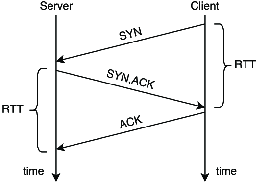

# Round trip

**Round-trip delay** (**RTD**) или **round-trip time** (**RTT**) – количество времени, которое требуется для отправки *network packet*'а, + количество времени, которое требуется для *acknowledgement* о получении этого *network packet*.  RTT также известен как **ping time** и может быть определен с помощью `ping` *command*.

[End-to-end delay](https://en.wikipedia.org/wiki/End-to-end_delay) или **one-way delay** (**OWD**) – это время, необходимое для прохождения *network packet*'а в одном направлении, которое часто приблизительно равно половине RTT.

Т.е. RTT = 2*OWD



# Связь файлового дескриптора и сокетов

В Unix-подобных ОС сокет для процесса выглядит как файловый дескриптор. Поэтому лимит «открытых файлов» одновременно ограничивает и TCP-соединения.

Когда программа вызывает:

```go
conn, err := net.Dial("tcp", "example.com:443")
```

ОС примерно делает следующее:

1. Создаёт объект сокета в ядре.
2. Добавляет ссылку на него в таблицу открытых ресурсов процесса.
3. Возвращает небольшой номер — файловый дескриптор, например `7`.

С точки зрения Unix файловым дескриптором представлены не только обычные файлы:

- TCP- и UDP-сокеты;
- открытые файлы;
- каналы `pipe`;
- терминалы;
- некоторые механизмы уведомлений ОС.

Поэтому один открытый TCP-сокет обычно занимает один файловый дескриптор.

На сервере:

- слушающий сокет занимает один дескриптор;
- каждое принятое соединение — ещё один.

Например, 10 000 одновременных клиентских соединений потребуют примерно 10 000 файловых дескрипторов плюс дескрипторы логов, файлов, DNS и внутренних механизмов runtime.

## Лимиты файловых дескрипторов

Обычно существует несколько уровней лимитов.

### Лимит процесса

Проверяется командой:

```bash
$ ulimit -n
256
```

Это максимальное количество дескрипторов, которое процесс может открыть одновременно. 

Если процесс исчерпал лимит, операции открытия сокета или файла могут завершиться ошибкой:

```
too many open files
```

### Общесистемный лимит

ОС также ограничивает суммарное число открытых файлов и сокетов.

На macOS соответствующие параметры можно посмотреть так:

```bash
$ sysctl kern.maxfiles
kern.maxfiles: 245760
```

Если исчерпан системный лимит, возможна ошибка: слишком много открытых файлов во всей системе.

### Ограничение локальных TCP-портов

Исходящее TCP-соединение идентифицируется комбинацией:

```
локальный IP
локальный порт
удалённый IP
удалённый порт
протокол
```

ОС автоматически выбирает локальный порт из диапазона ephemeral ports — временных портов.

Если программа создаёт очень много соединений к одному и тому же удаленному адресу и порту, количество одновременно доступных комбинаций ограничено размером диапазона локальных портов.

Но один локальный порт может участвовать в разных соединениях к разным удалённым адресам, поскольку полная комбинация адресов и портов различается. 

```
192.168.1.10:50000 → 1.1.1.1:443
192.168.1.10:50000 → 8.8.8.8:443
```

Поскольку удалённые адреса различаются, TCP-комбинации тоже различаются. Поэтому число *ephemeral ports* — не абсолютный лимит всех соединений машины, но существенный лимит для большого количества соединений к одной точке назначения.

При исчерпании возможны ошибки наподобие:

```
cannot assign requested address
```

На macOS диапазоны портов можно посмотреть через:

```bash
$ sysctl net.inet.ip.portrange
net.inet.ip.portrange.hilast: 65535
net.inet.ip.portrange.hifirst: 49152
```

Ядро выбирает свободный порт из диапазона:

```
49152–65535
```

Количество портов:

```
65535 - 49152 + 1 = 16384
```

Например, TCP-соединение может выглядеть так:

```
192.168.1.10:52743 → 93.184.216.34:443
                 ↑
       автоматически выбранный порт
```

### Повторное использование соединений

Для HTTP особенно важно не закрывать соединение после каждого запроса. `http.Client` и `http.Transport` поддерживают keep-alive, а HTTP/2 способен передавать много параллельных запросов через одно TCP-соединение.

