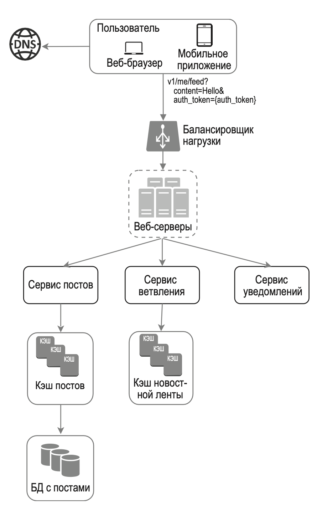
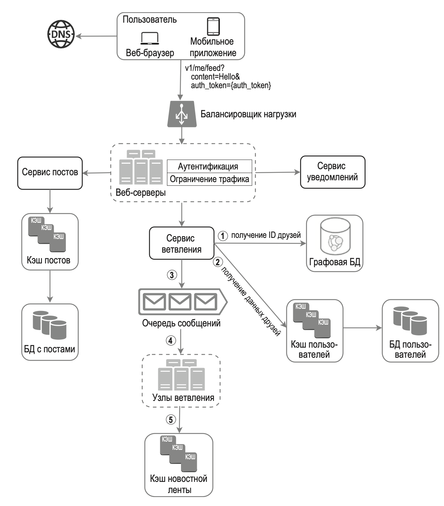
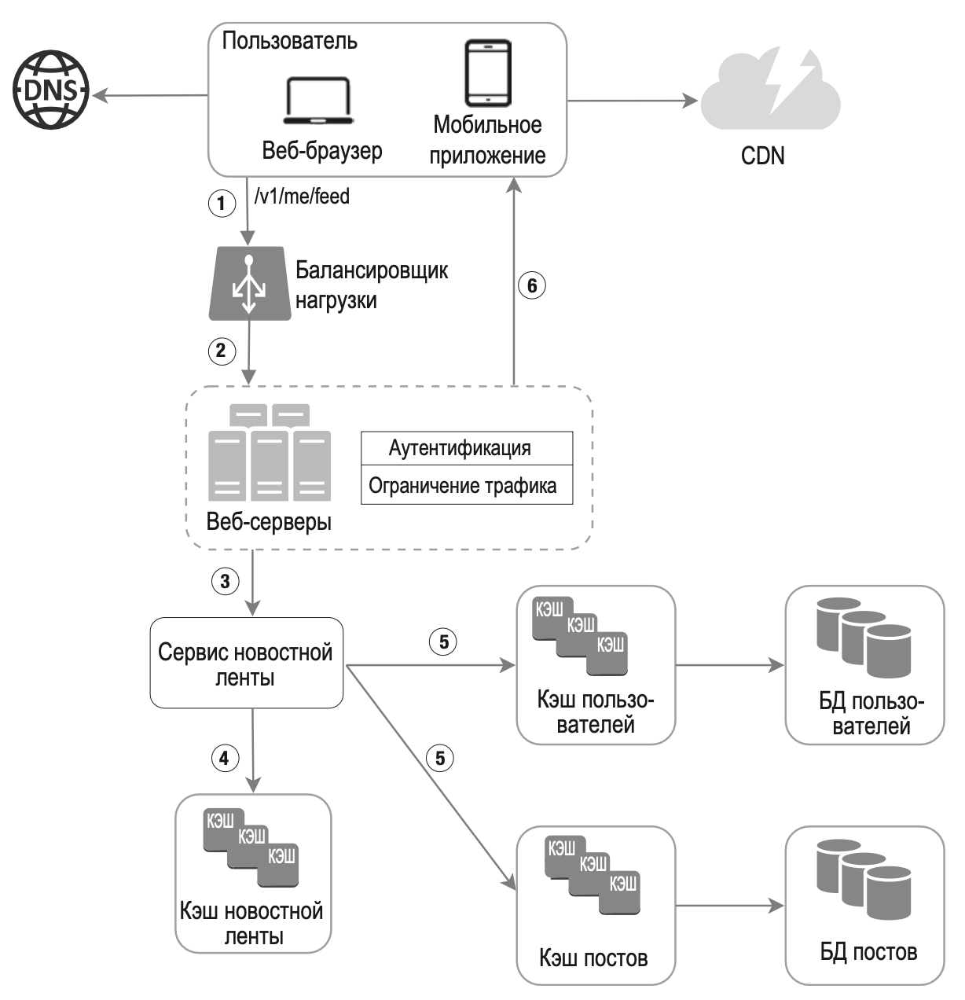

# Проектирование ленты новостей

Лента новостей — это постоянно обновляемый список историй в центральной части вашей домашней страницы. Она включает обновления информации о состоянии, фотографии, видео, ссылки, активность приложений и лайки, приходящие от людей, страниц и групп, на которые вы подписаны. 

Разновидности задачи - проектирование новостной ленты Facebook, ленты Instagram, потока сообщений Twitter и т. д.

## Вопросы

- что должно быть в ленте?
- по чему сортировка ленты
- наличие селебрити - сколько максимум друзей
- медиа в ленте

## Архитектура

Основные две ручки:

- публикация постов - данные записываются в БД (+ возможно кеш). Пост появляется в ленте новостей друзей пользователя.

  ```http
  POST /api/1/post
  
  content: текст поста
  auth_token: для аутентификации API-запросов.
  ```

  

- формирование новостной ленты - агрегирует посты друзей в обратном хронологическом порядке.

```http
GET /api/1/feed

auth_token: используется для аутентификации API-запросов.
```




Сервис постов – сохраняет статьи в базе данных и кэше.

Сервис распространения добавляет новый контент в новостные ленты друзей. Данные новостной ленты хранятся в кэше, чтобы их можно было быстро извлечь.

Сервис уведомлений - сообщает друзьям о появлении нового контента и рассылает push-уведомления (только нужно отправлять уведомление после добавления в ленту)

### Публикация постов



Функция api-gateway:

- Аутентификация по auth_token

Функция api-composition:

- ограничение трафика - количество постов, которое можно публиковать за определенный промежуток времени.

#### Сервис распространения (сохранения постов в ленты друзей)

Сервис распространения (**Fanout Service**) доставляет пост от автора в ленты всем его друзьям 

Он может быть основан на двух моделях: 

- распространение при записи (пассивная модель) 
- распространение при чтении (активная модель). 

**распространение при записи (push).** После публикации новый пост сразу же помещается в ленту друзей.

Преимущества:

- новостная лента генерируется в реальном времени и сразу становится доступной для друзей;

- получение новостной ленты происходит быстро

Недостатки:

- Проблема селебрити. если у пользователя много друзей, получение их списка и генерация новостной ленты для каждого из них будет происходить медленно. 

- если пользователь неактивен или редко входит в систему, составление его новостной ленты будет пустой тратой вычислительных ресурсов.

**распространение при чтении (pull).** Лента новостей генерируется во время чтения. Последние посты загружаются, когда пользователь загружает ленту.

Преимущества:

- лучше подходит для пользователей, которые не очень активны или редко входят в систему, так как при этом на них не тратятся лишние ресурсы;

- нет проблемы с селебрити - пользователями, у которых большое количестве друзей проблем не возникает.

Недостатки:

- загрузка новостной ленты происходит медленно, поскольку она не составляется заранее.

Мы применим гибридный поход, чтобы получить преимущества обеих моделей и избежать их недостатков. Нам крайне важно, чтобы ленту новостей можно было получить быстро, поэтому для большинства пользователей предусмотрена модель push (при записи). Посты селебрити нужно будет запрашивать по требованию, чтобы не перегружать систему. 

(???) Согласованное хеширование позволяет справляться с большим количеством друзей за счет более равномерного распределения запросов/данных (при их шардировании???).

Алгоритм

1. (Лучше пункты 1 и 2 вынести в асинхронную обработку, воркер) Извлекаем идентификаторы друзей из графовой базы данных. Графовая БД подходит для управления связями между друзьями и рекомендации новых друзей.

2. Получаем информацию о друзьях из БД пользователей (лучше из отдельного сервиса пользователей). 

   Если это указано в функциональных требованиях, система фильтрует полученный список с учетом пользовательских настроек (нежелательные друзья, скрытие поста от каких-то друзей).

3. Отправляем список друзей и ID новой статьи в очередь собщений. Fanout воркеры достают сообщения из очереди и вставляют пост в ленту новостей друзей (удобно использовать структуру list из redis). Т.е. они просто делают insert этого post_id для всех user_id. БД ленты новостей можно представить в виде таблицы <user_id, post_id> или множества упорядоченных списков list для redis - user_id => post_id1, post_id2,....  В БД лент новостей храним только ID, сами данные лежат в БД постов и пользователей. 

   Чтобы ограничить расход памяти на ленты, необходимо установить лимит на ее размер. Вероятность того, что пользователь будет прокручивать тысячи постов, невысока. Большинство людей интересуются самым новым контентом, поэтому доля промахов кэша остается низкой.


## Получение ленты новостей



Медиа хранится в CDN

1. Пользователь отправляет запрос вида /v1/me/feed, чтобы получить ленту новостей
2. Балансировщик нагрузки (kubernetes ingress + api-gateway) распределяет запросы между веб- серверами (api-composition).
3. Веб-серверы (api-composition) обращаются за новостной лентой к сервису Новостной ленты
4. Сервис новостной ленты извлекает из кэша список с идентификаторами постов
5. Сервис новостной ленты (а лучше это должен делать api-composition) извлекает полные данные о пользователях и постах из соответствующих кэшей, чтобы составить полноценную ленту новостей.
6. Полноценная лента новостей возвращается на клиент в формате JSON для дальнейшего отображения.

Можно кешировать разные данные:

- ленту новостей
- посты
- граф подписок
- действия пользователей (лайки, комментарии)


