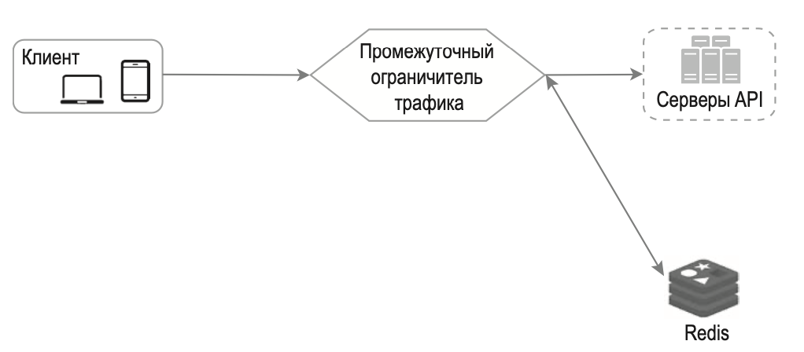
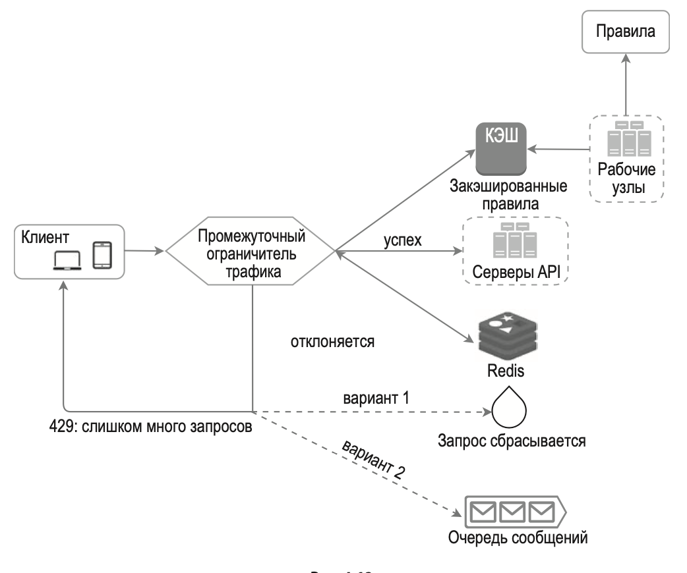

# Проектирование *rate limiter*'а

*Rate limiter* ограничивает количество запросов, которые пользователь может отправить за определенный промежуток времени. 

## Функциональные требования

- клиентский ratelimiter или серверный на стороне API
- блокировка по какому признаку – IP, user_id, без признака (по всем запросам)
- распределенный ratelimiter (в нескольких экземплярах)
- Жесткое или гибкое ограничение трафика. Жесткое: количество запросов не может превысить лимит; гибкое: запросы могут ненадолго превысить лимит.
- На каком уровне ограничение трафика – прикладной уровень (HTTP: уровень 7), или можно по IP-адресам, используя Iptables (IP: уровень 3).
- низкий latency
- high availability


 Отметим, что модель взаимодействия открытых систем (Open Systems Interconnection, OSI) имеет 7 уровней [16]: физи- ческий (уровень 1), канальный (уровень 2), сетевой (уровень 3), транспортный (уровень 4), сеансовый (уровень 5), уровень пред- ставления (уровень 6) и прикладной (уровень 7).

Способы избежать ограничения трафика. Проектируйте свой кли- ент с учетом следующих рекомендаций:

- Š  используйте клиентский кэш, чтобы не выполнять API-вызовы слишком часто;
- Š  разберитесь, в чем состоит ограничение, и не отправляйте слиш- ком много запросов за короткий промежуток времени;
- Š  предусмотрите код для обработки исключений или ошибок, чтобы ваш клиент мог как следует с ними справляться;
- Š  задержка между повторными вызовами должна быть достаточно длинной.


## Алгоритмы

Варианты:

- алгоритм маркерной корзины (token bucket);
- алгоритм дырявого ведра (leaking bucket);
-  счетчик фиксированных интервалов (fixed window counter); 
- журнал скользящих интервалов (sliding window log); 
- счетчик скользящих интервалов (sliding window counter).

### Алгоритм маркерной корзины

Алгоритм маркерной корзины довольно популярен. 

Маркерная корзина — это контейнер с заранее определенной емкостью. В нее регулярно помещают маркеры (например, 2 маркера в секунду). Когда она окончательно заполняется, маркеры больше не добавляются. 

Каждый запрос потребляет один маркер. При поступлении запроса мы проверяем, достаточно ли маркеров в корзине:

- Если маркеров достаточно, мы удаляем один и запрос проходит дальше;

- если маркеров недостаточно, запрос отклоняется.

Параметры алгоритма:

- размер корзины: максимальное количество маркеров, которое может в ней находиться;

- частота пополнения: количество маркеров, ежесекундно добавляемых в корзину.

Количество корзин зависит от правил ограничения трафика:

- для разных *endpoint*'ов обычно разные корзины. 
- каждому IP-адресу своя корзина
- общая глобальная корзина на все запросы

### Алгоритм дырявого ведра

Реализуют с использованием очереди типа FIFO. 

- при поступлении запроса система проверяет, заполнена ли очередь. Запрос добавляется в очередь при наличии места; в противном случае запрос отклоняется;
- запросы извлекаются из очереди и обрабатываются через равные промежутки времени. Поэтому этот алгоритм подходит для задач, которые требуют стабильной скорости обработки.

Алгоритм принимает два параметра:

- размер ведра: равен размеру очереди; очередь хранит запросы;

- скорость утечки: определяет, сколько запросов можно обработать за определенный промежуток времени (обычно за 1 секунду).

### Счетчик фиксированных интервалов

- Делим заданный период времени на одинаковые интервалы и назначаем каждому из них счетчик. 
- Каждый запрос инкрементирует счетчик на 1.
- Как только счетчик достигнет заранее заданного лимита, новые запросы начинают отклоняться, пока не начнется следующий интервал.

Задаются два параметра:

- интервал для отдельных счетчиков (например, 1 секунда)
- максимальное количество запросов в интервале (например, не больше 3 запросов в секунду). 

Корнер-кейс - всплески трафика на границе временных интервалов приводят к тому, что система превышает квоту и принимает больше запросов в единицу времени. Рассмотрим следующую ситуацию:

### Журнал скользящих интервалов

Идея алгоритма – сохранять упорядоченные временные метки, например, в sorted List Redis.

Когда поступает новый запрос, все просроченные запросы отбрасываются. Просроченными считают запросы раньше начала текущего временного интервала. Временная метка нового запроса (Unit-time) заносится в журнал.

Если количество записей в журнале не превышает допустимое, запрос принимается, а если нет — отклоняется.

Плюсы:

- подсчет количества запросов очень точный; на любом скользящем интервале запросы не превышают заданный лимит.

Минусы:

- алгоритм потребляет много памяти, потому что даже в случае отклонения запроса соответствующая временная метка записывается (почему?) в журнал.

### Счетчик скользящих интервалов

Счетчик скользящих интервалов — это гибридный подход, сочетающий в себе два предыдущих алгоритма. 

На определенном моменте в текущем интервале количество запросов на скользящем интервале вычисляется по следующей формуле:

`запросы на текущем интервале + запросы на предыдущем интервале * (1- процент текущего интервала)`

Предположим, ограничитель трафика допускает не больше 7 запросов в минуту. У нас 5 запросов за предыдущий интервал и 3 в текущем. На отметке в 30 % от текущего интервала количество запросов на скользящем интервале вычисляется по следующей формуле: `3 + 5 * 0,7% = 6,5 запроса`. 

Преимущества:

- cглаживание всплесков трафика: текущая частота запросов зависит от той, которая использовалась на предыдущем интервале;

- экономия памяти.

Недостатки:

- количество рассчитывается приблизительно

## Общая архитектура

Необходимо где-то хранить счетчики количства запросов в зависиомости от требований:

- для каждого пользователя
- для каждого IP-адреса и т. д. 

Для хранения счетчика лучше использовать память, например, в Redis. Необходимы дведве команды: 

- `INCR` - увеличивает хранимый счетчик на 1
- `EXPIRE` - устанавливает срок хранения счетчика, по истечении которого тот автоматически удаляется.

Архитектура:



Ограничитель трафика извлекает счетчик из соответствующего бакета Redis и проверяет, достигнут ли лимит. Если лимит достигнут, запрос отклоняется. Если лимит не достигнут, запрос направляется серверам API. Система инкрементирует счетчик и сохраняет его обратно в Redis.

Детали реализации:

- для хранения правил ограничения трафика может использоваться конфигурация вида, которая сохраняется где-то (диск, память, ???):

  ```
  rate_limit:
        unit: day
        requests_per_unit: 5
  ```

  В этом случае клиентам нельзя входить в систему чаще 5 раз в минуту. Правила обычно записываются в конфигурационные файлы и сохраняются на диске.

- Когда запрос отклоняется, API возвращает клиенту HTTP-ответ с кодом 429 («слишком много запросов»). 
- Для информирования клиента о состояние rate limiter можно использовать Response headers:
  - `X-Ratelimit-Remaining` – количество допустимых запросов, которое остается в текущем интервале.
  - `X-Ratelimit-Limit` – количество вызовов, доступных клиенту в каждом временном интервале.
  - `X-Ratelimit-Retry-After` – количество секунд, которое должно пройти, прежде чем запросы престанут отклоняться.

Если пользователь отправит слишком много запросов, клиенту будет возвращен код ошибки 429 и заголовок `X-Ratelimit-Retry-After`.

Подробная архитектура:



- Правила хранятся на диске. Рабочие узлы (что это?) регулярно считывают их с диска и сохраняют в кэш.
- Когда клиент обращается к серверу, его запрос сначала проходит через rate limiter.
- *Rate limiter* (1) загружает правила из кэша. (2) Извлекает из кэша Redis счетчики. *Rate limiter* принимает решение в зависимости от полученной информации:
  - если запрос не отклоняется, он направляется к серверам API;
  - если запрос отклоняется, ограничитель трафика возвращает клиенту код ошибки 429. При этом запрос либо сбрасывается, либо направляется в очередь.

## Распределенный ratelimiter

Для распределенного *ratelimiter* появляются проблемы.

### Состояние гонки

Если значение счетчика в Redis (например, 3) будет параллельно считано двумя разными запросами, прежде чем один из них успеет записать его обратно, каждый из них инкрементирует счетчик на 1 и сохранит полученное значение, не сверившись с другим потоком выполнения. Оба запроса (потока) сохранят значение счетчика, 4, хотя в итоге оно должно было равняться 5. 

Очевидным решением для устранения состояния гонки являются блокировки. Но они существенно замедлят систему. В таких случаях часто используют две стратегии: скрипт Lua или структуру данных «sorted set», доступную в Redis (наверное, чтобы конкурентно писать в нее *unix timestamp*). 

### Распределенные счетчики

Если вводим несколько *rate limiter*'ов, то необходимо распределенно синхронизировать счетчики. 

Варианты:

- использовать распределенный кеш, вроде Redis
- хранить отдельные счетчики в каждом ratelimiter'е и использовать *sticky session* для того чтобы клиент отправлял запросы одному и тому же *rate limiter*'у.

Также *ratelimiter* обязательно должен быть распределен по геоДЦ.

## Мониторинг

Необходимо мониторить:

- сколько запросов отсечено
- сколько маркеров в корзине

