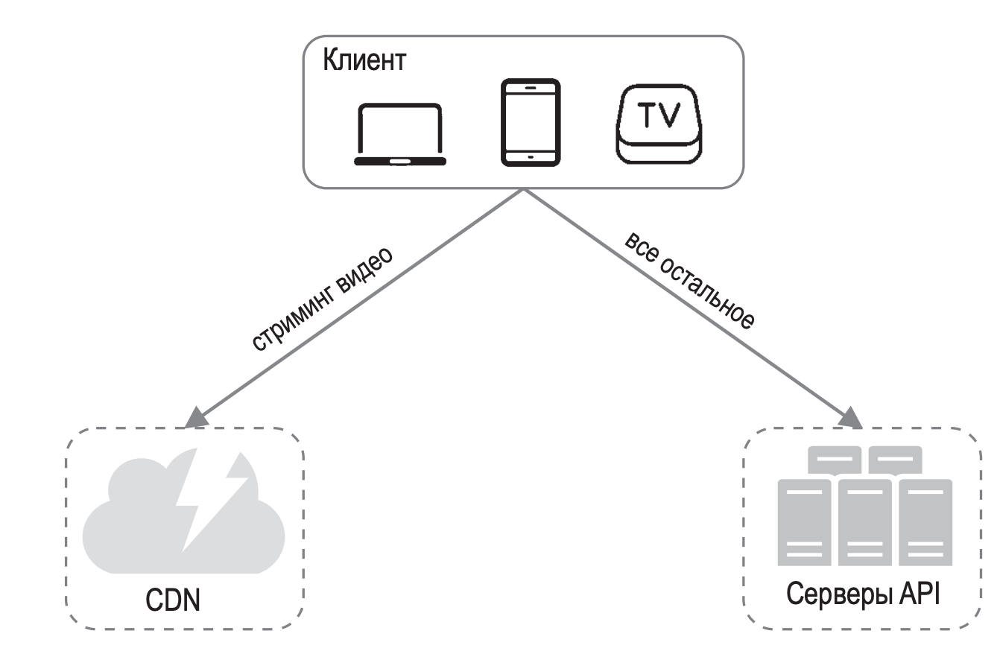
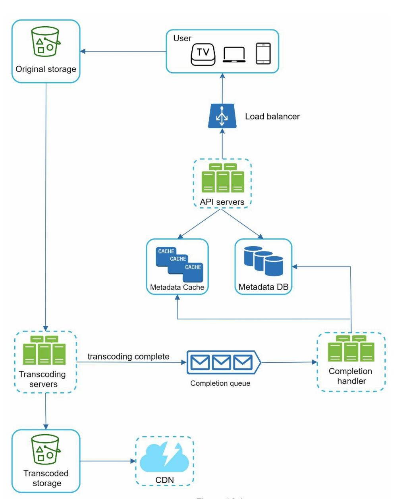

# Проектирование Youtube

## Вопросы

- функциональные возможности – загрузка/просмотр видео, комментарии, лайки, список воспроизведения, подписаться на канал 
- DAU

- время просмотра видео в день пользователем

- количество просматриваемых видео в день

- количество загружаемых видео в день

- какие разрешения поддерживаем

- средний размер видео
- хранение видео - на своей инфраструктуре или в облаке

## Оценки характеристик системы

- DAU = 5 млн
- Пользователи ежедневно просматривают по 5 видеороликов. 
- 10 % пользователей аплоадят по 1 ролику в день.

- средний размер видео составляет 300 Мб.

Общий объем данных в день: 5 миллионов пользователей * 10 % (аплоадов) * 300 Мб = 150 Тб.

Стоимость CDN:

- в CDN платим за исходящий трафик;

- СDN CloudFront от Amazon берет за гигабайт 0,02 доллара. 

- За загрузку видео с CDN платим = 5 миллионов пользователей * 5 видео * 0,3 Гб * 0,02 доллара = 150 000 долларов в день.

- Вывод - просмотр видео дорого стоит через CDN

Верхнеуровневая архитектура:

- клиент
- CDN - для стриминга видео

- сервера API - все, что не относится к стримингу, проходит через серверы API. Лента рекомендаций, генерация URL- адреса для загруженного видео, БД с метаданными, регистрация пользователей и т. д.

## Загрузка видео

- Клиенты - компьютер, мобильный телефон, Smart TV
- Балансировщик нагрузки - равномерно распределяет запросы между серверами API.

- Серверы API - все пользовательские запросы, за исключением потоковой передачи видео, проходят через серверы API.

- БД метаданных. Метаданные видеофайлов хранятся в отдельной разделяемой БД. Она реплицируется, чтобы отвечать требованиям к производительности и высокой доступности.

- Кэш метаданных. Для улучшения производительности метаданные видеофайлов и пользовательских объектов кэшируются.

- Хранилище исходного видео. Оригинальные видеофайлы размещаются в системе хранения BLOB-объектов. (??? клиент напрямую взаимодействует с хранилищем, думаю лучше поставить отдельный сервер, не API, который будет отвечать за аплоадинг). «Двоичный большой объект (Binary Large Object, BLOB) — это набор двоичных данных, которые хранятся в СУБД как единое целое» (Википедия).

- Серверы перекодирования - для преобразования видеофайлов в другой формат и разрешения для разных устройств и типов сетевых соединений.

- Хранилище перекодированного видео (также BLOB). 

- CDN - видеофайлы кэшируются в CDN. 

- Completion queue. Это очередь сообщений, хранящая информацию о завершении перекодирования видео.

- Completion handler. Этот компонент состоит из набора *worker*'ов, которые извлекают события из *completion queue* и обновляют *metadata cache* и *DB*.

Процесс загрузки видео состоит из двух процедур, которые выполняются параллельно:

А. Загрузка видеофайла.

Б. Обновление video metadata.Метаданныесодержатсведе- ния о URL-адресе, размере, разрешении и формате видео, а также информацию о пользователе и т. д.

Процедура А: загрузка видео

На рис. 14.5 показано, как загружается видеофайл. Ниже представлено описание этого процесса:

1. Видеофайлы загружаются в хранилище исходного видео.

2. Серверыперекодированияизвлекаютвидеофайлыизхранилища исходного видео и начинают их перекодировать.

3. Позавершенииперекодированияследующиедвазаданиявыпол- няются параллельно:

   3а. Перекодированные видеофайлы записываются в хранилище перекодированного видео.

   3б. События о завершении перекодирования записываются в оче- редь завершения.

   3a.1. Перекодированное видео передается в CDN.

   3б.1. Обработчик завершения содержит группу рабочих узлов, которые непрерывно достают события из очереди.

   3б.1.a. и 3б.1.б. По окончании перекодирования видео обработчик завершения обновляет БД и кэш метаданных.

**252**

**ГЛАВА 14**

1

Пользователь

Балансировщик нагрузки

4 Серверы API

Хранилище исходного видео

2

КЭШ
 КЭШ КЭШ

Кэш метаданных

БД метаданных 3б.1б

3б.1a

перекодирование завершено

3б

3б.1 Обработчик завершения

Серверы перекодирования

3a

3a.1

Очередь завершения

Хранилище перекодирован- ного видео

CDN

Рис. 14.5

4. Серверы API сообщают клиенту о том, что видео успешно загру- жено и готово для стриминга.

Процедура Б: обновление метаданных

Пока файл загружается в хранилище исходного видео, клиент отправляет запрос на обновление его метаданных, как показано на рис. 14.6. Этот запрос содержит такие сведения, как название видеофайла, его размер, формат и т. д. Серверы API обновляют кэш и БД метаданных.

Проектирование YouTube **253**

Пользователь

Обновление метаданных

Балансировщик нагрузки

Серверы API

КЭШ

Кэш метаданных БД метаданных

Рис. 14.6 Стриминг видео

Обычно, когда вы открываете видео на YouTube, оно сразу же начинает воспроизводиться, и вам не нужно ждать окончания его загрузки. Загруз- ка — это когда весь видеофайл копируется на ваше устройство, а стриминг подразумевает, что ваше устройство получает непрерывный видеопоток из удаленного источника. При просмотре потокового видео ваш клиент загружает данные постепенно, чтобы воспроизведение начиналось сразу и продолжалось беспрерывно.

Прежде чем обсуждать процесс стриминга видео, давайте рассмотрим такое важное понятие, как протокол стриминга. Это стандартизирован- ный способ управления стримингом видеоданных. Существуют такие популярные протоколы:

КЭШ КЭШ

**254**

**ГЛАВА 14**

MPEG–DASH. MPEG расшифровывается как Moving Picture Experts Group («экспертная группа по движущимся изображе- ниям»), а DASH — как Dynamic Adaptive Streaming over HTTP («динамический адаптивный стриминг по HTTP»).

Apple HLS. HLS расшифровывается как HTTP Live Streaming («стриминг по HTTP в реальном времени»).

Microsoft Smooth Streaming.
 Adobe HTTP Dynamic Streaming (HDS).

Вам не нужно досконально разбираться в этих протоколах или даже помнить их названия, так как это низкоуровневые детали, требующие знания определенной предметной области. Но важно понимать, что разные стриминговые протоколы поддерживают разные форматы коди- рования видео и доступны в разных видеоплеерах. При проектировании сервиса видеовещания необходимо выбрать протокол, подходящий для наших задач. Больше о протоколах потоковой передачи можно узнать в замечательной статье [7].

Видеопоток поступает напрямую из CDN. Его доставляет ближайший к вам пограничный сервер. Благодаря этому латентность получается очень низкой. На рис. 14.7 показана общая схема стриминга видео.

Клиент

стриминг видео

CDN

Рис. 14.7

Проектирование YouTube **255** ШАГ 3: ПОДРОБНОЕ ПРОЕКТИРОВАНИЕ

При описании общей архитектуры мы разбили систему на две части: про- цесс загрузки видео и процесс его стриминга. В этом разделе мы улучшим оба эти процесса с помощью важных оптимизаций и добавим механизм обработки ошибок.

Перекодирование видео

Когда вы записываете видео, ваше устройство (обычно телефон или каме- ра) сохраняет видеофайл в определенном формате. Если вы хотите, чтобы видео как следует воспроизводилось на других устройствах, его битрейт и формат должны быть совместимы. Битрейт — это скорость, с которой обрабатываются биты; обычно чем он выше, тем лучше качество видео. Потоки с высоким битрейтом требуют больше вычислительных ресурсов и более быстрое интернет-соединение.

Перекодирование видео имеет большое значение по следующим при- чинам.

Необработанное видео имеет большой размер. Часовое видео вы- сокого разрешения с частотой 60 кадров в секунду может занимать до нескольких сотен гигабайт.

Многие устройства и браузеры поддерживают только определен- ные форматы видео. Поэтому видео должно быть перекодировано в разные форматы.

Чтобы обеспечить высокое качество и плавность воспроизведения, выбор разрешения видео следует делать с учетом скорости сетевого соединения пользователя.

Качество сетевого соединения может меняться, особенно на мо- бильных устройствах. Чтобы обеспечить непрерывное воспроизве- дение видео, следует автоматически или вручную переключаться на поток с подходящим битрейтом в зависимости от пропускной способности сети. Это крайне важно для качественного взаимодей- ствия с пользователем.

Существует множество форматов кодирования, но большинство из них состоят из двух частей.

**256**

**ГЛАВА 14**

Контейнер. Содержит видеофайл, звуковую дорожку и метадан- ные.

Кодеки. Это алгоритмы сжатия и распаковки, предназначенные для уменьшения размера видео с сохранением его качества. Са- мыми распространенными видеокодеками являются H.264, VP9 и HEVC.

Модель направленного ациклического графа

На перекодирование видео уходит много ресурсов и времени. К тому же требования к перекодированию могут зависеть от автора видео. Напри- мер, некоторым авторам нужно, чтобы поверх видео выводились водяные знаки, прочие сами предоставляют миниатюрные изображения; одни загружают видео в высоком разрешении, а другие нет.

Для поддержки разных процедур обработки и обеспечения высокой сте- пени распараллеливания необходимо добавить некий слой абстракции и позволить разработчикам клиентов самим выбирать, какие задания должны выполняться. Например, система потокового вещания видео в Facebook использует модель программирования на основе направленно- го ациклического графа (directed acyclic graph, DAG), которая разбивает задания на этапы с возможностью последовательного или параллельного выполнения [8]. В нашей архитектуре применяется похожая модель, по- зволяющая добиться гибкости и распараллелить вычисления. На рис. 14.8 показан DAG для перекодирования видео.

На рис. 14.8 исходный видеофайл разделяется на видео, звук и метадан- ные. Вот некоторые задания, которые можно применить к видеофайлу.

Анализ. Следует убедиться в том, что видео не повреждено и имеет хорошее качество.

Кодирование видео. Это делается для поддержки разных раз- решений, кодеков, битрейтов и пр. На рис. 14.9 показан пример закодированных файлов.

Миниатюрное изображение. Миниатюры могут быть загружены пользователем или автоматически сгенерированы системой.

Водяной знак. Изображение, наносимое поверх видео и содержащее информацию, которая его идентифицирует.

Проектирование YouTube **257**

Видео

Звук Метаданные

**Задания**

Анализ

Перекодирование видео

Миниатюрное изображение

Водяной знак

Кодирование звука

...

Исходное видео

Сборка

Рис. 14.8

Кодирование видео

360p.mp4

480p.mp4

720p.mp4

1080p.mp4 4k.mp4

Рис. 14.9

**258** **ГЛАВА 14
** Архитектура перекодирования видео

На рис. 14.10 показана предложенная нами архитектура перекодирования видео, которая использует облачные сервисы.

Временное хранилище

Препроцессор

Планиров-

Рабочие

Диспетчер
 щик DAG  					 					 					ресурсов  					 					узлы

Рис. 14.10

Закодированное видео

Представленная архитектура состоит из шести основных элементов: пре- процессора, планировщика DAG, диспетчера ресурсов, рабочих узлов, временного хранилища и закодированного видео в качестве вывода. Давайте подробно рассмотрим каждый из них.

Препроцессор

Временное хранилище

Диспетчер
 щик DAG  					 					 					ресурсов  					 					узлы

Рис. 14.11

Закодированное видео

Препроцессор

Планиров-

Рабочие

На препроцессор возложено четыре обязанности:

1. Разделениевидео.Видеопотокделитсяначастиилиболеемелкие группы кадров (Group of Pictures, GOP). GOP — это группа или

блок кадров, размещенных в определенном порядке. Каждый блок является независимо воспроизводимой единицей, обычно длиной в несколько секунд.

1. Некоторые старые мобильные устройства и браузеры могут не поддерживать разделение видео на части. Специально для них препроцессор делит видеофайл на GOP.
2. ГенерацияDAG.ПрепроцессоргенерируетDAGнаосновеконфи- гурационных файлов, предоставленных разработчиками клиента. На рис. 14.12 изображено упрощенное представление DAG с двумя узлами и одним ребром:

Загрузка

Перекодирование

Проектирование YouTube **259**

Рис. 14.12

Это представление DAG сгенерировано из двух конфигурационных файлов, показанных на рис. 14.13.

Рис. 14.13 (источник: [9])

4. Кэшированиеданных.Препроцессорслужиткэшемдлясегменти- рованных видеофайлов. Для повышения надежности он записывает GOP и метаданные во временное хранилище. Если кодирование завершится неудачно, система сможет воспользоваться сохранен- ными данными для повторного выполнения операций.

**260** **ГЛАВА 14** Планировщик DAG

Временное

хранилище

Планиров- щик DAG

Диспетчер
 ресурсов  					 					узлы

Рис. 14.14

Закодированное видео

Препроцессор

Рабочие

Планировщик DAG делит задания в графе на этапы и записывает их в очередь заданий, принадлежащую диспетчеру ресурсов. На рис. 14.15 показан пример того, как работает планировщик DAG.

**Планировщик DAG**

Исходное видео

**Этап 1 Этап 2**

Видео

Звук Метаданные

Рис. 14.15

Кодирование видео

Миниатюрное изображение

Кодирование звука

Как видно на рис. 14.15, исходный видеофайл проходит три этапа об- работки. На этапе 1 он делится на видео, звук и метаданные. На этапе 2 выполняется два процесса: кодирование видео и генерация миниатюры. В рамках этого этапа также происходит кодирование аудиофайла.

Диспетчер ресурсов

Препроцессор

Планиров- щик DAG

Диспетчер ресурсов

Рис. 14.16

Временное хранилище

Рабочие Закодированное узлы видео

Диспетчер ресурсов следит за тем, чтобы ресурсы выделялись эффектив- но. Как показано на рис. 14.17, он содержит три очереди и планировщик заданий.

Очередь заданий. Это приоритетная очередь заданий, которые нужно выполнить.

Очередь рабочих узлов. Это приоритетная очередь, содержащая информацию о загруженности рабочих узлов.

Очередь выполнения. Содержит информацию о заданиях, вы- полняющихся в настоящий момент, и рабочих узлах, которые их выполняют.

Планировщик заданий. Он выбирает оптимальный рабочий узел и поручает ему выполнить подходящее задание.

**Диспетчер ресурсов**

Очередь заданий
 выбор оптимального рабочего узла

Планировщик Очередь рабочих узлов
 го узла
 я и рабоче
 заданий помещение задани едь
 в очер

**Рабочие узлы**

Очередь выполнения

Рис. 14.17

Проектирование YouTube **261**

выполнение задания

Водяной знак ...

Миниа- тюра

Кодиров- щик

Слияние

получение задания с наивысшим приоритетом

**262** **ГЛАВА 14
** Диспетчер ресурсов работает следующим образом:

получает задание с наивысшим приоритетом из соответствующей очереди;

выбирает из очереди оптимальный рабочий узел для выполнения полученного задания;

поручает выбранному рабочему узлу выполнить задание;

связывает между собой информацию о задании и рабочем узле и записывает ее в очередь выполнения;

удаляет задание из очереди выполнения, как только оно завершилось.

Рабочие узлы

Препроцессор

Планиров- щик DAG

Временное хранилище

Диспетчер Рабочие ресурсов узлы

Рис. 14.18

Закодированное видео

Рабочие узлы выполняют задания, перечисленные в DAG. Разные узлы могут быть предназначены для разных заданий (рис. 14.19).

**Рабочие узлы**

Водяной знак ... Кодировщик

Миниатюра Слияние

Рис. 14.19

Временное хранилище

Проектирование YouTube **263**

Временное

хранилище

Препроцессор

Планиров- щик DAG

Диспетчер ресурсов

Рис. 14.20

Рабочие Закодированное узлы видео

Здесь используется несколько систем хранения данных. Выбор той или иной системы зависит от таких факторов, как тип, размер и время жизни данных, частота доступа к ним и т. д. Например, метаданные часто нужны рабочим узлам и обычно имеют небольшой размер, по- этому их целесообразно кэшировать в памяти. Видео- и аудиоданные записываются в хранилище BLOB-объектов. После завершения об- работки видео соответствующие данные удаляются из временного хранилища.

Закодированное видео

Временное

хранилище

Препроцессор

Планиров- щик DAG

Диспетчер Рабочие ресурсов узлы

Рис. 14.21

Закодированное видео

Закодированное видео является конечным результатом процесса коди- рования. Оно может иметь вид файла с именем наподобие funny_720p.mp4.

**264** **ГЛАВА 14**

Оптимизация системы

На этом этапе у вас уже должно быть четкое представление о процессах загрузки, стриминга и перекодирования видео. Теперь мы оптимизируем некоторые аспекты системы, включая ее скорость, безопасность и стои- мость обслуживания.

Оптимизация скорости: распараллеливание загрузки видео

Загружать видео как единое целое неэффективно. Мы можем разделить его на мелкие блоки, выровненные по GOP, как показано на рис. 14.22.

разделение с выравниванием

по GOP

Рис. 14.22

Это сделает процесс загрузки быстрым и позволит его возобновить, если что-то пойдет не так. Разделение видеофайла на GOP можно выполнить на стороне клиента, чтобы ускорить загрузку (рис. 14.23).

Исходное видео

GOP 1

GOP 2

...

GOP N

| GOP1 |
| ---- |
| GOP2 |
| GOP3 |

Хранилище исходного видео

Клиент

Рис. 14.23

Оптимизация скорости: размещение центров загрузки поблизости от пользователя

Загрузку также можно ускорить за счет нескольких центров обработки данных, разбросанных по всему миру (рис. 14.24). Жители США могут загружать видео в североамериканский ЦОД, а жители Китая — в азиат- ский. Для этого в качестве центров загрузки мы будем использовать CDN.

Оптимизация скорости: повсеместное распараллеливание

Обеспечить низкую латентность непросто. Еще один способ оптимиза- ции состоит в разработке слабосвязанной системы с высокой степенью параллелизма.

Североамериканский центр загрузки

Проектирование YouTube **265** Азиатский центр загрузки

Европейский центр загрузки Южноамериканский центр загрузки

Рис. 14.24

Чтобы как следует распараллелить нашу архитектуру, в нее необходимо внести некоторые изменения. Давайте взглянем на то, как данные пере- даются из хранилища исходного видео в CDN. Этот процесс показан на рис. 14.25. Как видите, его результат зависит от ввода на предыдущем этапе. Эта зависимость затрудняет распараллеливание.

Хранилище исходного видео

Модуль загрузки

Модуль скачивания

исходное сегмен- тированное видео

Модуль кодиро- вания

CDN

закодированное видео

закодированное видео

скачивание исход- ного сегментиро- ванного видео

загрузка закоди- рованного видео

Хранилище закодирован- ного видео

Рис. 14.25

загрузка закоди- рованного видео

**266** **ГЛАВА 14**

Для ослабления связанности системы мы добавили очереди сообщений, как показано на рис. 14.26. Чтобы объяснить, как очереди сообщений ослабляют связанность системы, рассмотрим пример.

Когда очереди сообщений не было, модулю кодирования приходи- лось ждать возвращения вывода от модуля скачивания.

После добавления очереди сообщений модулю кодирования больше не нужно ждать, пока модуль скачивания вернет вывод. Если в оче- реди сообщения находятся события, модуль кодирования может выполнить соответствующие задания параллельно.

Очередь сообщений

Очередь сообщений

Очередь сообщений

Модуль кодирования

Хранилище исходного видео

Модуль скачивания

Очередь сообщений

Хранилище закодированного видео

загрузка закоди- рованного видео

Модуль загрузки

CDN

Рис. 14.26

Оптимизация безопасности: предварительно подписанный URL-адрес загрузки

Безопасность — один из важнейших аспектов любого продукта. Чтобы гарантировать, что видео загружается туда, куда нужно, и теми, кому это позволено, мы вводим понятие предварительно подписанного URL- адреса, как показано на рис. 14.27.

Хранилище исходного видео

3. Загрузка видео

Проектирование YouTube **267** Пользователь

2. Предварительно подписанный URL-адрес

Серверы API

Рис. 14.27

1. POST /upload

Обновленный процесс загрузки выглядит так:

1. Клиент отправляет HTTP-запрос серверам API, чтобы получить предварительно подписанный URL-адрес, который дает доступ к соответствующему объекту. Термин «предварительно подписан- ный URL-адрес» встречается при загрузке файлов в Amazon S3. Другие облачные провайдеры могут называть этот механизм ина- че. Например, хранилище BLOB-объектов в Microsoft Azure под- держивает ту же возможность, но называет ее подписью общего доступа [10].
2. Серверы API возвращают предварительно подписанный URL- адрес.
3. Получив ответ, клиент загружает видео с его помощью.

Оптимизация безопасности: защита видеороликов

Многие производители контента с неохотой публикуют свои видео в интернете, опасаясь, что их оригинальная работа будет похищена. Для защиты авторских прав можно внедрить один из следующих ме- ханизмов.

**268**

**ГЛАВА 14**

Технические средства защиты авторских прав (digital rights management, DRM). Три крупнейшие системы DRM — Apple FairPlay, Google Widevine и Microsoft PlayReady.

Шифрование AES. Вы можете зашифровать видео и настроить политику авторизации. Зашифрованные видео будут расшифро- вываться во время воспроизведения. Это гарантирует, что их будут просматривать только авторизованные пользователи.

Водяные знаки. Это изображение, которое наносится поверх видео и содержит информацию, позволяющую его идентифицировать. Это может быть логотип или название компании.

Оптимизация стоимости обслуживания

Сеть CDN — неотъемлемый компонент нашей системы. Она обеспечивает быструю доставку видео в глобальных масштабах. Но, как показывают наши приблизительные оценки, CDN стоит дорого, особенно если данных много. Как можно снизить расходы?

Согласно проведенному ранее исследованию, видеопотоки в YouTube распределяются по принципу «длинного хвоста» [11] [12]. Это означает, что большое количество просмотров приходится на горстку популярных видеороликов, тогда как многие другие видео просматриваются редко или вообще никогда не просматриваются. Исходя из этого наблюдения, можно внести несколько оптимизаций:

1. Только самые популярные видеоролики раздаются из CDN, а все остальные доступны на серверах хранения видеофайлов большой емкости (рис. 14.28).
2. Если контент не очень популярный, нам, возможно, не придется хранить множество его закодированных версий. Короткие видео- ролики могут кодироваться по требованию.
3. Некоторые видео пользуются популярностью только в опреде- ленных регионах. Их не нужно распространять за пределами этих регионов.
4. МожносоздатьсобственнуюсетьCDN,какэтосделалакомпания Netflix, и наладить партнерство с интернет-провайдерами. По- строение CDN — это масштабный проект, но для крупных ком-

паний, занимающихся стримингом видео, такой вариант может подойти. Интернет-провайдеры, такие как Comcast, AT&T или Verizon, предоставляют свои услуги по всему миру и находятся близко к пользователям. Партнерство с ними может улучшить качество воспроизведения и снизить денежные расходы на се- тевой трафик.

Пользователь

Рис. 14.28

Все эти оптимизации основаны на популярности контента, его размере, на том, как к нему обращаются пользователи, и т. д. Прежде чем что-либо оптимизировать, необходимо исследовать тенденции и закономерности в сфере видео. Вот несколько интересных статей на эту тему: [12] [13].

Обработка ошибок

В крупномасштабных системах ошибки неизбежны. Чтобы обеспечить высокий уровень отказоустойчивости, ошибки должны обрабатываться контролируемым образом и работа после них должна быстро возобнов- ляться. Есть два вида ошибок.

Проектирование YouTube **269**

CDN

Видеосерверы

самые популярные видео

другие видео

**270**

**ГЛАВА 14**

Некритические. В качестве примера можно привести неудачное кодирование сегмента видео. В таких случаях обычно делается не- сколько повторных попыток выполнить операцию. Если проблема продолжает возникать и системе не удается ее исправить, клиенту возвращается код соответствующей ошибки.

Критические. Примером может служить некорректный формат видео. В таких случаях система останавливает задание, относя- щееся к этому видео, и возвращает клиенту код соответствующей ошибки.

Ниже перечислены типичные ошибки, возникающие в каждом компо- ненте нашей системы.

Ошибка загрузки: повторить попытку несколько раз.

Ошибка разделения видео: если клиенты более старых версий не могут разделить видео с выравниванием по GOP, видеофайл за- гружается на сервер целиком и процесс разделения выполняется на стороне сервера.

Ошибка перекодирования: повторить попытку.

Ошибка препроцессора: заново сгенерировать диаграмму DAG.

Ошибка планировщика DAG: запланировать задание заново.

Отказ очереди диспетчера ресурсов: использовать реплику.

Отказ рабочего узла: повторить выполнение задания на другом узле.

Отказ сервера API: серверы API не хранят свое состояние, поэтому запрос перенаправляется к другому серверу API.

Отказ сервера для кэширования метаданных: данные реплициру- ются несколько раз. Если один сервер выходит из строя, вы можете обратиться за данными к другим серверам. Мы можем заменить отказавший кэширующий сервер новым.

Отказ сервера БД для кэширования метаданных:

- Š  отказ ведущего сервера: сделать ведущим один из ведомых серверов;
- Š  отказ ведомого сервера: для чтения можно использовать дру- гой ведомый сервер. Сервер базы данных, вышедший из строя, можно заменить новым.

Проектирование YouTube **271** ШАГ 4: ПОДВЕДЕНИЕ ИТОГОВ

В этой главе мы представили архитектуру для сервисов стриминга видео наподобие YouTube. Если в конце интервью еще остается время, можно обсудить несколько дополнительных аспектов.

Масштабирование уровня API. Поскольку серверы API не хранят свое состояние, их легко масштабировать горизонтально.

Масштабирование базы данных. Можно упомянуть о репликации и сегментировании базы данных.

Прямая трансляция. Это процесс записи и трансляции видео в ре- альном времени. Изначально наша система не рассчитана на такое вещание, но эта функция имеет некоторые сходства со стримингом обычного видео: оба процесса требуют загрузки, кодирования и по- токовой передачи. Есть и заметные отличия:

- Š  у прямой трансляции повышенные требования к латентности, поэтому для нее может понадобиться другой протокол потоко- вой передачи;

- Š  у прямой трансляции не настолько высокие требования к парал- лельной обработке, поскольку небольшие блоки данных и так обрабатываются в реальном времени;

- Š  прямая трансляция требует другого подхода к обработке оши- бок. Любой механизм, обрабатывающий ошибки слишком долго, не подходит.

  Запрет доступа к видео. Видеоролики, нарушающие авторские права, содержащие порнографию или нарушающие закон каким-то другим образом, должны удаляться. Некоторые из них могут быть обнаружены в процессе загрузки, о других могут сообщать сами пользователи.

  Поздравляем, вы проделали длинный путь и можете гордиться собой. Отличная работа!

**272** **ГЛАВА 14
** [1] YouTube by the numbers: https://www.omnicoreagency.com/youtube-statistics/

[2] 2019 YouTube Demographics: https://blog.hubspot.com/marketing/youtube- demographics

1. [3]  ЦенынаAmazonCloudFront:https://aws.amazon.com/ru/cloudfront/pricing/
2. [4]  Netflix на AWS: https://aws.amazon.com/solutions/case-studies/netflix/
3. [5]  Официальный веб-сайт Akamai: https://www.akamai.com/
4. [6]  Двоичные большие объекты: https://ru.wikipedia.org/wiki/BLOB
5. [7]  Here’s What You Need to Know About Streaming Protocols: https://www.

dacast.com/blog/streaming-protocols/

[8] SVE: Distributed Video Processing at Facebook Scale: https://www. cs.princeton.edu/~wlloyd/papers/sve-sosp17.pdf

[9] АрхитектураобработкивидеовWeibo(накитайскомязыке):https://www. upyun.com/opentalk/399.html